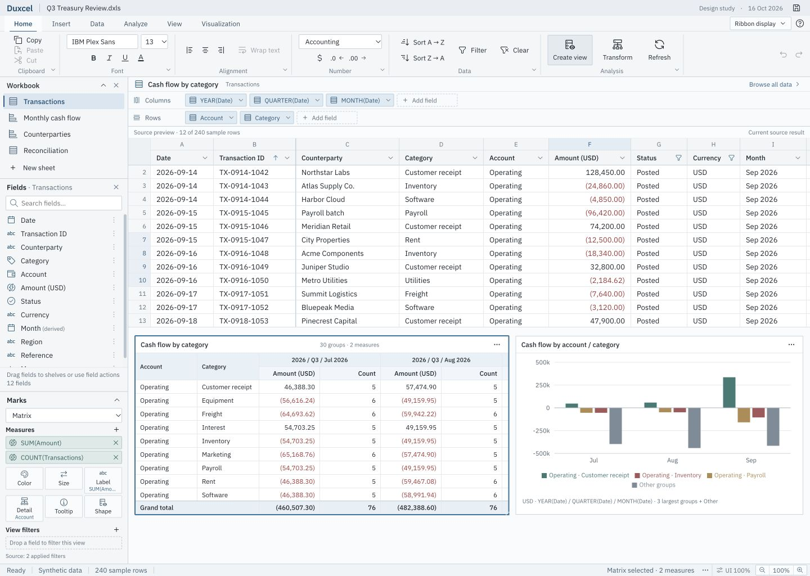
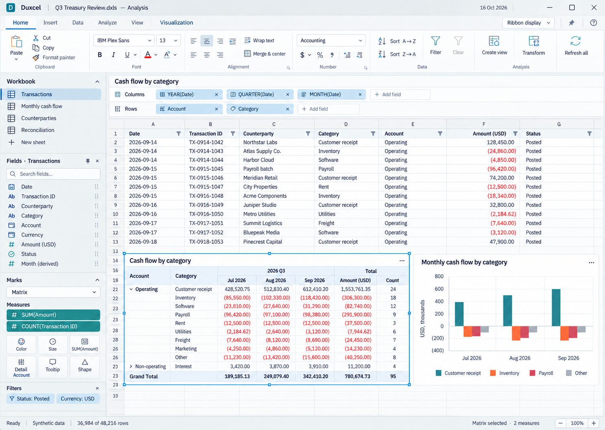
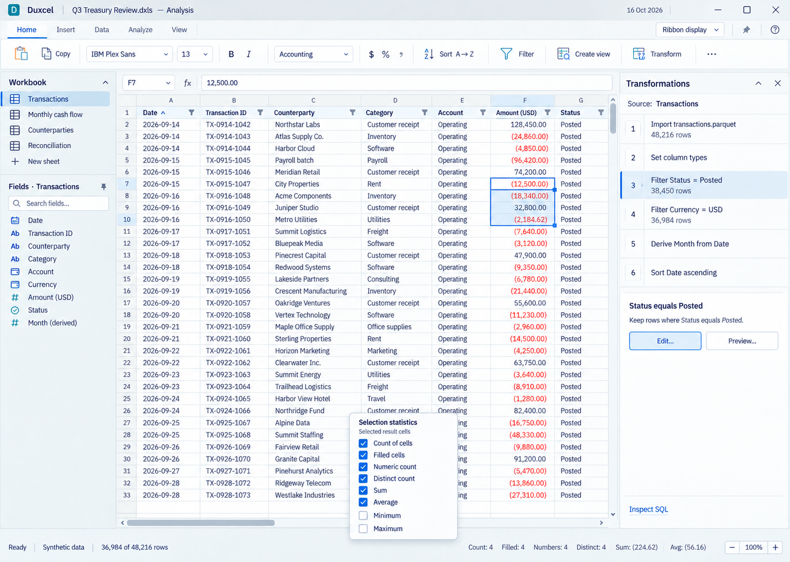

# Duxcel product design

Updated 17 October 2026. **The user explicitly designated the web app interface as the design definition. Implement that exact UI in C99/raylib.** Its rendered layout, typography, spacing, colors, icons, control anatomy and interaction states are the specification, rather than inspiration for a native redesign. The [native implementation plan](design/NATIVE_UI_PLAN.md) and ROADMAP track delivery and native validation separately from browser evidence. No web runtime enters the product.

Duxcel is a native analytical spreadsheet built with **C99, raylib, and DuckDB**. The worksheet remains the working surface. Direct spreadsheet manipulation, reproducible data transformations, and spatial visual-analysis authoring belong in the same workspace.

This specification records the latest product decisions. It supersedes earlier design recommendations about Inter, bottom sheet tabs, minimal-only toolbars, and permanently visible transformation history. Implementation status remains in README.md, ROADMAP.md, and BENCHMARKS.md; the behavior described here is a design target, not a claim that it is implemented.

## Current interaction study

[Open the running prototype](http://localhost:4173/) · [Prototype scope and controls](design/prototype/README.md) · [Browser QA evidence](design/prototype/design-qa.md).

The browser study focused on UI behavior: motion, pane relationships, drag and drop, resizing, typography, icon proportions, density, and viewport adaptation. Synthetic transactions, example summaries, charts, SQL, and history illustrate those states. Native implementation now connects that design to the existing real engine and workbook model. The eventual WebAssembly distribution remains an architectural topic for a later stage.

The browser uses actual locally bundled IBM Plex Sans Regular, Medium, Semibold, and matching italics. Match its light appearance and measurements in the native renderer, including responsive states. Earlier tables distinguishing proposed visual measurements are superseded by the user's exact-UI instruction; engine semantics and feasibility still require explicit implementation and validation. Consult the validation record for what was actually tested.

## Decision status

| Confirmed by the user | Proposed for validation |
| --- | --- |
| IBM Plex Sans replaces Inter as the design typeface | Exact sizes, weights, colors, and pixel measurements below |
| Vertical workbook navigation on the left | Workbook and Fields as independently collapsible sections of one left dock |
| A field browser usable without entering pivot/chart editing | Single-click reveal behavior and the detailed focus rules |
| Thin status bar with configurable selection statistics | A 22-unit default height and the precise statistics definitions |
| Right-click status customization, including distinct and numeric counts | Default enabled metrics and narrow-window overflow behavior |
| Transformation history in a dismissible right pane | The pane lifecycle and proposed shortcut assignments |
| Full ribbon, compact icons with names, icons only, and focus view | Exact group membership and command overflow order |
| Two stacked horizontal shelves for Columns and Rows, accepting multiple fields | Shelf wrapping limits and assignment conflict handling |
| A left authoring area for measures and Marks | How unsupported encodings survive a representation change |
| Shared construction experience for matrices and charts | Conversion previews for analytically ambiguous mappings |

The user selected elements of the earlier Workbench and Canvas concepts. The revised concept combines their useful workspace structure. Light appearance is a comparison baseline, not a decision against a dark appearance.

## Design principles

1. **Make the grid exact.** Selection, headers, resizing, frozen boundaries, scrolling, and focus must feel dependable before adding more analytical controls.
2. **Use space to explain structure.** A field list describes available columns; shelves describe assignments; the sheet displays results. These are distinct places with distinct jobs.
3. **Keep controls discoverable and compressible.** A full ribbon teaches where commands live. Smaller modes recover working space without changing the command vocabulary.
4. **Let users choose their context.** Workbook, Fields, and right inspectors can be shown independently. Closing an inspector must reclaim its entire footprint.
5. **Use one authoring grammar.** Ordered fields, aggregations, filters, and visual encodings construct both cellular matrices and charts. Each output still has appropriate rendering and selection semantics.
6. **Put transient facts at the bottom.** Selection statistics and task state occupy one thin status line. Transformation history has its own right pane.
7. **Preserve intent across layout changes.** Opening a pane, changing ribbon density, or resizing the window must preserve selection, active object, and useful viewport position.
8. **Keep every interaction available from the keyboard.** Dragging, resizing, assignment, ordering, menus, pane access, and dismissal require explicit keyboard alternatives.
9. **Treat SQL as an inspectable explanation.** The visual definition is primary. SQL inspection is available on demand and identifies its scope and step.
10. **Validate behavior separately from appearance.** Generated concepts suggest composition. Real fonts, focus, gestures, and viewport behavior need interaction evidence. Engine correctness and query states belong to a separate implementation stage.

## Revised visual concept

### Analysis authoring

This state shows the full ribbon, a selected matrix, two horizontal shelves, the available fields and authoring controls on the left, and a completely clear right edge. A chart and source table coexist with the matrix on the worksheet.

### Data inspection

This state shows the compact ribbon, an ordinary source selection, Fields outside authoring mode, an explicitly opened transformation inspector, and the status-bar context menu.

Both are generated visual concepts, not executable screens. Their lettering was prompted to resemble IBM Plex Sans but was not typeset using verified font files; it is not typography evidence. The data labels and row geometry in generated images are illustrative. Exact numeric fixtures, state rules, and known render discrepancies are recorded in [validation](design/VALIDATION.md). Measurements below guide this prototype; they must not be inferred from generated pixels.

For the actual typeface, use the [IBM Plex Sans specimen](design/typography/ibm-plex-sans-specimen.png), rendered from IBM's Regular, Medium, and Semibold files. [Font provenance and checks](design/typography/README.md) distinguish this specimen from native raylib rendering; delivered native components have their own [validation record](design/NATIVE_UI_VALIDATION.md).

## Workspace regions

| Region | Purpose | Visibility |
| --- | --- | --- |
| Title and workbook identity | Document identity, save state, window controls | Normal modes; platform conventions apply |
| Ribbon tabs and commands | Discoverable formatting, data, analysis, and view actions | Full, compact, icons-only, or temporarily hidden in focus mode |
| Left Workbook section | Vertical sheet navigation and sheet management | Independently shown, collapsed, or hidden |
| Left Fields section | Column inventory, field search, navigation, and assignment | Independently available in browsing and authoring |
| Left Marks and Measures | Representation, aggregations, encodings, and view filters | Contextual to an analysis being edited |
| Context strip | Cell address/value in grid browsing; selected object identity during authoring | Bound to current editing context |
| Columns shelf | Ordered fields defining horizontal structure or axes | Analysis editing only; horizontal above the canvas |
| Rows shelf | Ordered fields defining vertical structure or axes | Analysis editing only; horizontal directly below Columns |
| Worksheet | Source tables, cells, independently anchored matrices and charts | Dominant working surface |
| Right inspector | Transformations, formatting, properties, or SQL | On request or eligible context, subject to dismissal preferences |
| Status bar | Ready/busy state, result size, selected statistics, and zoom | One thin line; remains available in focus mode |

There is no persistent bottom history strip and no duplicate bottom sheet navigation. Menus and shortcuts can recover any hidden region.

## Left dock

Workbook and Fields have independent disclosure, visibility, and scroll state. A user may keep both, keep only one, or hide the dock. When both are hidden, no empty left gutter remains.

Workbook contains compact vertical sheet entries with names and type icons. The active sheet has an accent indicator and selection fill. Rename, reorder, duplicate, and hide are explicit actions. New sheet has its own stable target; switching sheets never shares its pointer activation.

Fields describes the bound table or analysis source, rather than only the columns currently on screen. It includes type, full name on demand, derived-field indication, and assignment menu. Source order is the browsing default. Search does not change the data, field order, or query definition.

In ordinary grid browsing, revealing an off-screen field scrolls its column into view without silently selecting the whole column. The default alignment is the first scrollable column after frozen columns; a Center column action is also available. Already-visible columns do not cause unnecessary scrolling. Selection and keyboard behavior are specified in [interactions](design/INTERACTIONS.md#field-navigation).

Marks and Measures are contextual sections below the field inventory. Their height does not force Workbook or Fields to disappear. Sections can collapse independently; each long list has its own deliberate scroll area. On a short window, section headers remain reachable and authoring sections may scroll within their allocated area.

## Shared matrix and chart authoring

An **analysis view** is a source-bound analytical definition with a representation. Matrix and Chart are representations, with shared field placement and separate output semantics.

| Definition element | Meaning |
| --- | --- |
| Source | Stable reference to a table/result and its fields |
| Columns and Rows | Ordered lists; multiple dimensions or aggregated measures can be assigned |
| Measures | Multiple explicit aggregations, including repeated source fields with different aggregates |
| View filters | Filters scoped to this analysis; separate from shared source transformations |
| Marks | Type plus field assignments such as Color, Size, Label, Detail, Tooltip, and Shape |
| Representation | Matrix, bar, line, scatter, and other supported outputs |
| Placement | Object identity, sheet anchor, dimensions, and presentation properties |

Columns and Rows are two distinct horizontal shelves, stacked above the canvas. They are not vertical row/column side areas, a one-line form, or one dropdown per role. Field order is visible; insertion points and removal are explicit. When space runs out, tokens remain accessible through wrapping and a labelled overflow mechanism, not silent clipping.

Measures and Marks live on the left. A matrix can place multiple measures into cell text; a chart can use measures on axes and mark properties. Fields remain available after assignment. Field menus provide Add to Rows, Add to Columns, Add measure, and encoding targets, alongside drag and keyboard equivalents.

Changing representation preserves the analytical definition and shows a preview of the new mapping. If axes or encodings are ambiguous, the user resolves them before commit. Unsupported assignments are retained as inactive assignments and explained; they are not discarded. A matrix selection refers to rendered cells or its object frame, while a chart selection refers to marks or its object frame.

Filters in an analysis view affect only that view. Header filters on a source table affect its source-result transformation chain and dependent analyses. Both interfaces name their scope. There is no silent promotion of an object filter into a source-wide filter.

## Right inspector lifecycle

Transformations is a vertical ordered list in a right inspector. It is hidden by default until requested, and never occupies the bottom status area.

| State | Visible footprint | Recovery |
| --- | --- | --- |
| Expanded | Pane body and its header; resizes the worksheet | Header actions, menu, or shortcut |
| Collapsed and retained | Optional compact vertical dock entry for a retained pane | Activate the entry or its shortcut |
| Dismissed | No pane, icon, rail entry, or reserved gutter for that pane | View > Panes or its explicit shortcut |
| No retained panes | No right rail at all | View > Panes or an explicit command |

Close means dismiss. Collapse is a separate named action. A solitary expanded inspector needs only its header. If several panes are retained, an optional vertical switcher may expose them. Dismissing the last one removes the entire switcher.

Automatic contextual opening respects explicit dismissal. Selecting another object must not immediately reopen a pane that the user just closed. An explicit menu command or shortcut opens it again. A pinned applicable pane can follow the selected object; unrelated or invalid context does not leave an empty rail.

Transformations identifies its bound source or object. Selecting a step shows its properties. Historical result preview is a separate explicit action with a visible Preview step label and Return to current action. Inspect SQL identifies whether it explains the current result, a selected step, or an analysis object.

## Ribbon modes

| Mode | Command presentation | Intended use |
| --- | --- | --- |
| Full | Tabbed, grouped commands, icons, labels, expanded formatting controls | Discovery and detailed formatting |
| Compact | Tabs plus one command row with icons and names | Frequent daily work |
| Icons only | Tabs plus compact icon controls, tooltips, accessible names | Maximum working space with commands present |
| Focus | Ribbon and docks temporarily hidden; worksheet and thin status bar remain | Concentrated data work |

The ribbon display menu names all four modes. Full and compact modes share group order and command identity. Groups overflow by priority into labelled menus; they do not become unreadable. Focus mode saves and restores the previous ribbon and dock layout. Escape restores it when focus is on the worksheet; an inner editor or popup consumes Escape first.

Home covers clipboard, font, alignment, and number formatting. Insert covers new worksheet objects. Data covers source operations, sort, filter, and transformations. Analyze covers shared analytical construction. View covers ribbon modes, panes, freezing, and scale. Contextual commands describe the selected object without inventing a separate builder for every representation. Visible commands in the eventual prototype must work or be clearly disabled with an explanation.

## Responsive command placement

Ribbon modes remain an explicit user choice. Within each mode, measure the actual rendered groups in logical units. Start with complete groups, collapse lower-priority groups into labelled controls, then move whole groups into a named overflow menu if necessary. Reverse that progression as the viewport grows. Avoid a horizontally clipped command strip or isolated commands spilling onto another row.

On Home, preserve Data and Analysis longest; collapse Clipboard, Alignment, Number, and Font first according to available space. Every expanded group has a disclosure control for its complete controls, so Compact and Icons keep a path to less-frequent formatting. Overflow preserves group names and includes Undo/Redo when their dedicated controls no longer fit. Display/help stay outside the scrollable tab-name strip. Save remains reachable when document metadata is hidden.

Ordinary icons are 16 units, full-ribbon analysis icons 20, and disclosure arrows 11. Do not stretch all icons to fill wide windows. Relax group gutters at large widths, retain consistent baselines, and reduce internal spacing before collapsing a group. Vertically stacked formatting groups retain their smaller row gaps.

Below 700 logical workspace units, the left sections become an explicitly opened overlay, recovered from the context-strip workspace button or View commands. This preserves grid width and restores the same sections as a dock when the window widens. Field reveal dismisses the temporary overlay so the revealed column is visible. The right overlay policy below 1040 remains independent.

## Thin status bar

One line separates workbook/result context from ad hoc selection statistics. The prototype initially shows Count of cells, Sum, and Average for ordinary selections. Filled cells is independently available. All metrics are toggleable from a right-click menu; users can enable Count of cells, Numeric count, Distinct count, Minimum, and Maximum as well.

Count, filled count, numeric count, and distinct count are separate quantities. Scope, blanks, types, filtering, large selections, and chart marks are defined in [interactions](design/INTERACTIONS.md#selection-statistics). Metric preferences are application preferences, not transformation steps. Under width pressure, metrics move into an overflow menu; the bar never becomes a second row.

## Component inventory

| Component | Required variants and states |
| --- | --- |
| Ribbon tab and command group | Active, hover, focus, disabled, compact, overflow |
| Icon command and split command | Default, hover, pressed, toggled, focused, disabled |
| Workbook entry | Active sheet, focus, rename, drag insertion, hidden entry management |
| Dock section, narrow overlay and splitter | Expanded, collapsed, hidden, overlay recovery, resize, keyboard resize |
| Adaptive ribbon group and flyout | Expanded controls, collapsed group, named overflow, full-control flyout, keyboard focus restoration |
| Field row and search | Source/derived, dimension/measure, focused, search match, missing field |
| Field token | Multiple ordered assignments, aggregate label, menu, insertion, inactive assignment |
| Rows/Columns shelf | Empty target, populated, multiple fields, wrapping, valid/invalid drop |
| Marks target and measure list | Empty, assigned, multiple where supported, incompatible, overflow |
| Grid cell and range | Default, active cell, selected range, unfocused selection, edit, pending result |
| Column/row header | Selected, sorted priority, filtered, frozen boundary, resize affordance |
| Header filter menu | Sort, search, checklist, conditions, partial selection, Apply/Cancel |
| Matrix/chart object | Frame selected, content selected, edit context, move/resize, query/error |
| Right inspector | Expanded, retained/collapsed, dismissed, pinned, context unavailable |
| Transformation step | Current chain, property selected, preview, editing, pending, failed |
| SQL inspector | Current result/step/object scope, read-only, selectable, copyable |
| Status metric and menu | Enabled, unavailable, calculating, overflow, focus, checked item |
| Scrollbar and frozen separator | Hover, drag, keyboard, independent canvas zoom |

## Initial measurements and typography tokens

All measurements are logical units at 100% interface scale. These are logical measurements of the current experiment or explicit future targets, not measurements inferred from the generated images.

| Token | Initial value |
| --- | --- |
| Concept viewport | 1440 × 1024; also validate 1280 × 800 and 1920 × 1080 |
| Title row / ribbon tabs | 28 / 28 |
| Ribbon command area, full / compact / icons | 80 / 36 / 32 |
| Status bar | 22; one line |
| Left dock default / range | 228 / 188–360 |
| Right inspector default / range | 280 / 240–400 |
| Grid minimum working width target | 640 before changing pane presentation |
| Cell context / analysis title / shelf row | 28 / 26 / 30 minimum per shelf |
| Data row, default / compact / comfortable | 24 / 22 / 28 |
| Grid letters / typed header row | 22 / 26 |
| Row-number gutter | 40 initially; expands for longer labels |
| Field row / workbook row | 24 / 28 |
| Splitter target / visible line | 6 / 1 |
| Header resize target | 6, with separate filter target |
| Icons, regular command / full-ribbon analysis / dense Marks | 16 / 23 / 15 |
| Control and field token radius / popup radius | 2 / 3 |
| Selection border / keyboard focus | 2 / 2, visually distinct |

| Typography role | IBM Plex Sans size / weight |
| --- | --- |
| Grid data / field names | 13 / 12.5, Regular 400 |
| Header / sheet entry / ribbon control | 12 / 12.5 / 12; Medium 500 for structural emphasis |
| Inspector and section title | 13 / Semibold 600 |
| Status / secondary metadata | 12 / 10.5–11, Regular 400; small metadata remains a legibility review item |
| Command-group label | 11 / Regular 400 |

Use equal-width lining digits for aligned numeric data, dates, row numbers, and statistics. Verify actual glyph advances in the bundled font files and the native renderer; a font-feature label alone is not evidence that the rendering path applies it. Use real Regular, Medium, and Semibold cuts. Keep IBM Plex Sans proportional for names and labels. No condensed cut is the default for the grid. Inspect SQL can use IBM Plex Mono as a secondary face after the same small-size checks.

| Light comparison palette | Value |
| --- | --- |
| Worksheet / chrome | #FFFFFF / #EDF0F2 |
| Main text / secondary text | #20272E / #5E6E7C |
| Gridline / structural divider | #E4E8EC / #CAD2DA |
| Selection border / fill | #285F86 / #E4EEF6 |
| Keyboard focus | #7952B3, outline plus focus shape |
| Measure assignment accent | #397C75, accompanied by type/aggregate labels |
| Negative amount | #A43337, accompanied by parentheses or a minus |

Validate contrast, physical-pixel alignment, high DPI, 80/100/150% interface scale, and independent canvas zoom. A dark palette requires its own contrast and small-text pass; colors must not simply be inverted.

## Next design gate

The user has requested native implementation of this direction. Follow the [native UI plan](design/NATIVE_UI_PLAN.md) and ROADMAP, preserving the C99 + raylib + DuckDB architecture and existing real commands. Use the running prototype to resolve visual/interaction details without building a second web implementation. The [interaction rules](design/INTERACTIONS.md) include the study's motion specification, while [validation](design/VALIDATION.md) records browser observations. Native screenshots, interaction evidence and remaining differences are recorded separately; completing one component does not imply the entire study has been ported.

## References

- [IBM Plex source and family](https://github.com/IBM/plex).
- [Tableau shelves and Marks reference](https://help.tableau.com/current/pro/desktop/en-us/buildmanual_shelves.htm): ordered fields, horizontal shelves, and encoding targets inform the authoring grammar.
- [Tableau workspace](https://help.tableau.com/current/pro/desktop/en-us/environment_workspace.htm): inspected the official annotated workspace image for spatial relationships.
- [Excel status bar options](https://support.microsoft.com/en-us/excel/excel-status-bar-options): right-click customization informs the status interaction. Distinct count and the exact Duxcel statistics semantics are Duxcel design decisions.

References inform interaction patterns; they are not a requirement to reproduce another product's brand or every behavior.
