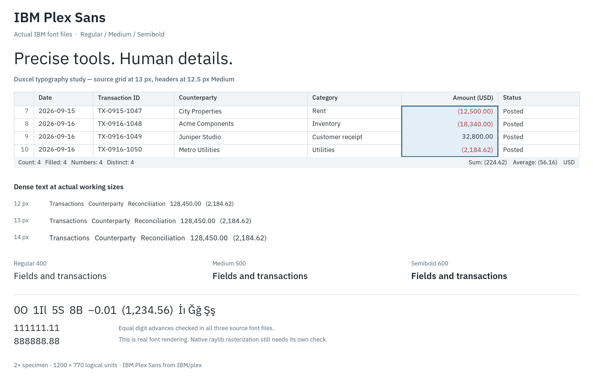

# IBM Plex Sans font specimen

Created 16 October 2026 to distinguish actual type rendering from the approximate lettering in the generated Duxcel concept images.

The specimen was rendered directly from the official IBM Plex Sans Regular, Medium, and SemiBold OTF files with Pillow/FreeType. It is 2400×1540 image pixels for a 1200×770 logical-unit composition at 2× resolution. Display scaling may change its apparent size in a preview.

Family/style metadata was checked for all three files. Default digit advances were measured at a 26-pixel font size, corresponding to the 13-unit sample at 2×, and found equal across digits 0–9 in each cut. This check does not depend on assuming that a native renderer applies a particular OpenType feature.

The specimen includes a financial grid, 12/13/14-unit text samples, three weights, ambiguous glyph pairs, Turkish characters, and equal-width digit comparisons. Its financial selection uses the exact fixture from [VALIDATION.md](../VALIDATION.md).

Source: [IBM/plex](https://github.com/IBM/plex/tree/master/packages/plex-sans/fonts/complete/otf). Download URLs, SHA-256 hashes, metadata, and measured digit advances are in [font-provenance.json](font-provenance.json). The accompanying font [license](fonts/license.txt) is retained.

These files are design-study assets. The native application's bundled font has not been changed in this pass. Raylib rasterization, platform DPI behavior, interface scaling, native accessibility, and interactive layout remain separate validation tasks.
