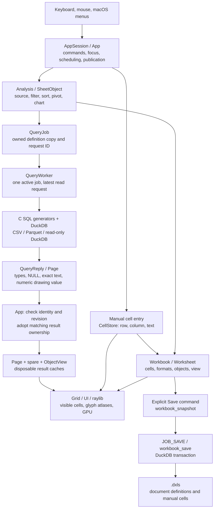
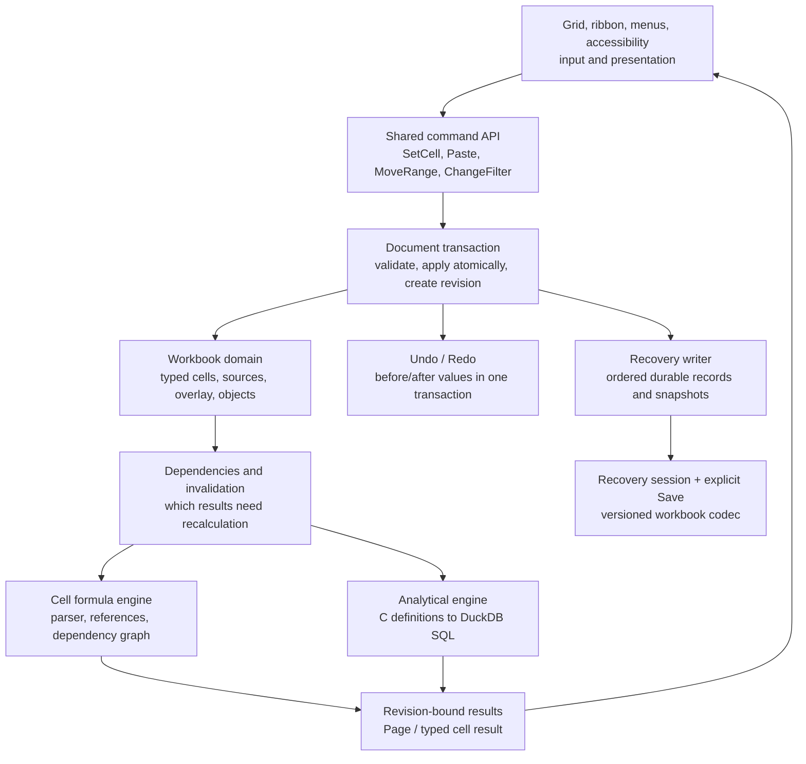
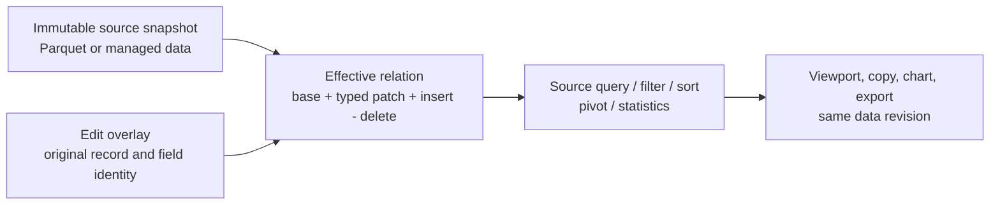
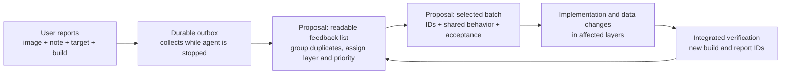

# Architecture and ownership

Duxcel has one C99 spreadsheet implementation, raylib rendering and DuckDB computation. Native macOS and browser Wasm use the same App, grid, widgets and analytical definitions. The browser has platform glue, not a second UI.

| Area | Responsibility |
| --- | --- |
| `src/app/` | Owned AppSession lifecycle, commands, jobs, history, source/object selection and orchestration |
| `src/grid/` | Viewport, cell/extent selection, scrolling, resizing and header geometry |
| `src/ui/` | C widgets, ribbon, shelves, panes, typography and renderer/cache ownership |
| `src/transforms/` | SQL/analysis/PIVOT/Marks/number/chart semantics shared by both platforms |
| `src/data/` | Typed Pages, source identity, native DuckDB worker and asynchronous browser bridge |
| `src/workbook/` | Sparse cells, formats, objects, versioned `.dxls` and shared metadata codec |
| `src/platform/` | Portable boundary plus Objective-C AppKit windows, file panels, shortcuts and precise gestures |
| `src/dev/` | Development-only semantic review registry, captures and reporting; excluded from production |
| `web/` | Emscripten startup, DOM/device/file/clipboard/WebGL lifetime, official DuckDB-Wasm Worker transport and browser tests |
| `tests/` | Authored C/Objective-C tests and small immutable inputs/oracles |
| `tools/` | Offline fixture/icon generation, builds, test orchestration, browser automation and external review queue |
| `assets/`, `packaging/` | Runtime fonts/icons/licenses and platform metadata |

## State and resource rules

`AppSession` owns start/frame/finish. Native `app_run` drives it synchronously; the browser host schedules the same frame callback. C owns model/commands/SQL/jobs/Pages. Worker replies are accepted only for matching owned requests; cancellation, stale replies and bounded transport cannot replace accepted state partially.

Keep SQL NULL, empty text and literal `NULL` separate. Preserve canonical integer/DECIMAL strings. Page, schema, cell, format, image, font and request ownership must be explicit. Rendering cached state must not issue queries. UI scale, sheet zoom and framebuffer density remain separate.

Native AppKit is intentionally Objective-C behind the portable platform interface. The browser requires a JavaScript boundary to DOM events, browser file/clipboard APIs and the official asynchronous DuckDB-Wasm package. Moving those calls into C string macros would not eliminate that boundary.

macOS workbook Open Document callbacks enqueue owned filesystem paths in the adapter (16 pending paths, whole-event admission). A will-finish-launching hook installs the delegate before cold-launch documents arrive inside raylib window creation. Ordinary C frame dispatch consumes one eligible request through the existing document controller, preserving unsaved-change guards, ongoing file IO and frozen review boundaries. Closed document surfaces can reopen; shutdown frees pending paths and removes the launch observer. Other hosts keep a no-op boundary. Bundle document/UTI declarations live in `packaging/Info.plist`.

The macOS adapter owns an explicit application menu rather than depending on GLFW's optional defaults. Menu Quit and its Command-Q equivalent call AppKit `terminate:`; the delegate records a quit request and defers termination to the ordinary C document controller. AppKit does not bypass the dirty guard. Shutdown restores the prior application/Services menus and delegate before raylib teardown, supporting repeated App sessions.

The shared workbook metadata reader is staged infrastructure, not completed browser Open/Save. Complete candidate validation, migration, activation, writer/output adapters and recovery remain roadmap work.

## Feature seams and build identity

`src/app/selection.c` owns selection expansion from borrowed sparse cells and
resolved body/header/owner/primary/used bounds. Its typed outcome reports whether
the selection stays inside or selects the whole owner. The App adapter verifies
page/result/source revisions and applies UI focus changes; the controller owns
no worker, workbook, history, page allocation or renderer. Pure module checks
and the real App GUI slice exercise the same controller. Extend this pattern
when a feature changes rather than pre-emptively rewriting all App state.

`src/workbook/cell_command.c` is the first admitted mutation producer. Its v2
in-process envelope freezes durable workbook/sheet IDs, a process/session fence,
expected CellStore and admitted-document revisions, coordinates and bounded
borrowed bytes. The pure admission check rechecks primary/object protection and revision fences;
the mutation producer repeats it before adoption, then publishes
one cell-history action, dirty state and one monotonic command revision only for
a changed value. No-op and failure preserve all three. The App owns drafts,
source readiness, navigation and feedback. The persisted command clock covers
this admitted subset and coordinated history replays; direct legacy
paste/range/object producers still use their own store revisions. It is not a durable receipt or retry protocol.

`src/workbook/identity.c` owns bounded identity validation/allocation/restore.
The first sheet allocates a 128-bit workbook ID from OS/browser cryptographic
entropy, with no time/PRNG fallback. Sheet IDs use a non-recycled uint64 high-water
outside Undo. Rename/reorder preserve them, duplicate allocates another, and Save
snapshots retain the exact durable identity/clock. Transient session fences are
not copied to snapshot/load, so an outstanding draft cannot replay after reopen.
Exhausted counters still allow Open/Save of existing data but reject allocation
atomically. Native entropy and shared-C model behavior are tested; browser crypto
and Windows entropy branches are not platform acceptance in this slice.

Native v15 adds required workbook_identity(high,low,sheet_high_water,command_revision)
and sheet_identity(sheet_id,stable_id) tables to the strict v14 metadata package.
Existing integer sheet_id values remain archive ordinals. The adapter validates
exact types, SQL NULL, row counts, complete ordinal coverage, uniqueness,
nonzero IDs and high-water bounds before publishing a staged Workbook. Native
v1–v14 Open generates identities in RAM without modifying the file or making it
dirty; Save upgrades transactionally. Snapshot/Save As preserve logical identity.
Physical copies can share an identity but their runtime fences remain separate.
The shared partial browser decoder still rejects v15; browser Workbook Open/Save
and final staged-model activation remain incomplete.

`src/workbook/version_index.c` owns pure version metadata admission and
publication planning. It borrows immutable index descriptors and returns an
owned value plan; it performs no allocation, IO, payload decoding or App mutation.
Complete-payload identities are opaque32-byte values, with presence separate
from key bytes. Index generations order metadata publications and do not identify
document content. A transient write-owner token separates physical runtime
owners sharing durable document IDs. User Save can move one Latest Saved pointer;
private checkpoints/exports preserve it, and historical owners can only export.
The native adapter must retain and verify complete assets before publication.
`workbook_save_core_payload` writes a relocatable v15 core leaf through the
existing controlled transaction, storing already-resolved primary/Table/ledger
locators absolutely. It does not read external data, retain results or publish
an index. Ordinary Save keeps relative references. `core_payload.c` owns the closed leaf, private child and exclusive lease. Its
fixed64 KiB SDK hash binds exact bytes/file identity; it rechecks inventory and
identity before consumption/disposal. Unknown or changed artifacts are kept.
The core info is deliberately distinct from a complete version-root descriptor;
exact-byte hashing alone does not prove semantic equality of separate captures.
`core_compare.c` compares every persisted v15 descriptor table in both directions
as typed SQL multisets under64 MB/one-thread engine limits, with private spill,
pending-task cancellation and pre/post sealed-byte verification. It compares
source query text as data and never queries external sources. This full core
proof supports later reuse; it does not certify assets/results outside the codec.
`version_chunks.c` is a shared allocation-free framing controller: a reserved
uint64 byte extent defines exact64 KiB ordered BLOB spans and a positive final
remainder. Invalid/missing/duplicate/trailing observations fail closed; hashing,
SQL transactions, full model admission and asset closure remain adapter work.
`version_stage.c` is a native encoder under a borrowed exclusive connection and
caller-owned explicit transaction. It rejects autocommit/existing reserved schema,
checks root-to-leaf identity/hash/size and total reserved bytes, then writes
codec-v1 `_duxcel_versions` metadata/roots/tags and64 KiB BLOB chunks. Leaves are
verified before/after consumption. READY does not commit; failure requires caller
rollback. Strict decode/closure and whole-file compatibility remain separate.
`version_codec.c` shares the four-table/18-column version family inventory.
Native `version_read.c` first admits its exact physical shape and bounded
NULL/length/count observations, then copies typed roots/tags into an owned
immutable metadata handle and validates references/generations/storage bounds.
Its transaction proof is shared with the encoder. Metadata READY is deliberately
separate from chunk/hash/embedded-model closure; no live model is adopted.
`workbook_core_payload_restore` reconstructs bounded sequential input in a new
leased child, checks exact bytes/hash, admits the embedded model through
`workbook_load_core_payload`, then rechecks integrity. The strict reader requires
v15, original absolute source locators and no unrelated tables/nested version
schema; failures preserve the independent output. Ordinary legacy Open remains
unchanged. Copy/hash/admission/recheck have explicit cancellation phases.
`version_restore.c` preflights aggregate chunk extents/NULLs/orphan references,
then restores and admits every core root independently before returning an owned
core set. Missing older tagged payloads reject the whole set. Copied metadata and
leased files outlive the outer SQL connection; failure/cancel releases ordinary
new staging. This proves codec-v1 core closure, with external sources still
explicit dependencies. Native `archive_read.c` stages legacy candidates or the explicitly discriminated
v16 container, whose authored head retains the v15 layout. The v16 candidate
owns its independent complete core set and validates head/index document identity,
closed-WAL policy and unchanged native file identity. It preserves an older
Latest Saved R in an R+1 head. Legacy reads remain non-writing and cannot silently
ignore a reserved version schema. Borrowed head decoding stays in the existing
core reader; candidate adoption belongs to the caller. `archive_write.c` adds v16 through the existing native transaction using an
internal typed borrowed adapter (`save_native.h`). Inspection validates prior
core/index closure before mutation; staging preserves unrelated tables and owns
a complete new receipt/core set before PUBLISH/COMMIT. Failure/cancel rolls back
and releases ordinary staging. External sources/borrowed leaf aliases are protected.
Post-close identity is optional observation and cannot turn COMMIT into a failure.
The adapter chooses no live Save purpose or pointer itself. Core-only tests keep
native archive dependencies outside their ordinary link boundary. `version_save.c` coordinates capture, full-core equality, pure version planning
and native transactional IO. User Save can reuse the existing Saved root; private
checkpoint/export preserve the supplied index and all its leaves. State-only
export supplies no base. Output plans/receipts are owned; no live App state is
changed. Callers must distinguish internal capture publication from named-file
PUBLISH and apply owner/index plus separate R+1 dirty fences after success.
Immutable core sets have scalar mutex-protected owning references: retained
worker/journal snapshots keep the same closed files and lease until the final
owner releases them. Getters borrow immutable metadata/leaf values. The last
release disposes on its caller thread; native App adapters must queue retirement
off frames. QueryWorker has an optional typed native file-task envelope; ordinary Core-only
jobs keep their existing writer/reader without native archive link dependencies.
Owned contexts move into replies, and an intrusive retirement queue runs disposal
outside the worker mutex before pending work and stop. Replacement/cancel frees
also leave the mutex first, allowing safe retirement/scalar observers. Native
preparation remains cancellable until named-file publication. `version_seed.c` retains an already admitted legacy Saved R in the working store
before edits begin, without rewriting the source file. Bounded metadata copying
and atomic adoption of verified owned leaves avoid an extra archive round-trip;
source identity remains unchanged. This supplies the older Saved R to a first
private R+1 checkpoint before user-file upgrade. `data/worker_archive.c` owns typed native file contexts, retained input stores,
prepared receipts/candidates and legacy Saved seeding. Its UI-side constructor
only allocates/copies/refcounts; the worker creates working folders and executes
all native IO. Owned context/store retirement uses the background queue, with
synchronous fallback only after stop/shutdown. Internal capture publication is
kept distinct from named-file cancellation, and outputs outlive the worker when
explicitly transferred. `app/versionstate.c` owns the current immutable store, transient write owner and
observed file identity. It prepares native jobs and adopts only owner/index-fenced
receipts, queues retirement, and rotates runtime ownership on successful Open.
App separately owns live model/path/history/dirty publication, retaining newer
edits after captured R saves. Normal native App files and version-bound recovery checkpoints now use v16. Working roots use a separate sibling
folder beside recovery sessions, excluded from normal user Save/Open targets.

Implicit same-destination Save/Tag copies the observed file identity into the
owned worker context, checks it before open and again inside the archive transaction,
and compares the existing v16 manifest with the retained input index before replacing
it. A fresh stat alone cannot bless another writer's different tag/root metadata.
Legacy upgrades retain the file-identity fence without treating their runtime-seeded
Saved index as an on-disk version schema. This is a conservative fence for cooperating
writers; arbitrary raw path/file mutation during Save is outside its ownership
contract. A missing current-file proof requires explicit Save As. The native accepted
destination callback uses a separate replacement intent; ordinary Save/Tag never
silently acquires it. Failed preparation leaves the App request epoch unchanged.

`version_tag.c` prepares an owned exact UTF-8 label plus a canonical owner/index
fence. Native `workbook_version_tag_save` adds that label and updates captured
Latest Saved atomically, preflighting duplicates/capacity before capture. The same
Save controller proves whole supported-core equality against retained roots;
unchanged tags share payloads, and later ordinary Saves can reuse named roots.
Tag publication always has a new generation, even for an unchanged Saved root.
Its receipt exposes a complete tag plan separately from an ordinary Save plan;
App adapters must fence the whole operation. No label operation mutates an older
root, silently renames a duplicate or evicts protected states. `ui/versionview.c` borrows metadata and owns only bounded layout/focus/scroll.
`app/versions.inc` validates names, obtains a first destination and submits the
owned Tag job through the existing Save lane. File/access-key and native menu
commands reach the same C adapter; cancel/failure preserves the name and prior
state. Successful publication returns to the list unless another document action
is pending. The panel adapts to list length/viewport; the ten-row File geometry
retains normal Quit visibility. The same widget selects explicit tags or Latest Saved for read-only historical opening.

`version_preview.c` projects a selected opaque root from an admitted immutable
store into a separate owned core model under an explicit historical reader.
It verifies the leaf before/after strict decoding, executes no source query,
clears the model's Save target and retains the protected roots independently of
model transfer. Cancellation never publishes a partial candidate. The decoder
has cooperative before/after cancellation; no per-query interruption is claimed.
This reader does not receive or suspend the live Working Head. Native preview jobs now carry an admitted store/root and historical owner through
the ordered Load lane without resolving the job's diagnostic path or creating a
new working folder. Reply model ownership is separate from protected preview
metadata. Preview replies deliberately fail the ordinary archive-Open predicate,
preventing accidental live replacement; cancellation and retirement use the same
worker ownership boundary. `app/versionpreview.c` now owns a request/reader/store-instance ticket and moves
the actual Working Head plus its complete runtime version/file-proof state into
suspension at adoption. It does not clone away Undo/Redo or allocate new draft
identities. Historical models can switch while the same working owner stays
protected; return restores its original ownership and rejects a mismatched live
reader. App owns job readiness/cancellation and presentation surface preservation.
`ui/versionpreviewview.c` owns a separate read-only Grid/Page and stored-definition
layout, using the existing grid/value/text painters. It never receives the Working
App's Pages, grid or query editor. `app/versions.inc` admits only idle source work,
submits the reader job, adopts through that controller and restores Working Head
before document Close/New/Open/Quit. Frame dispatch fences normal authoring,
source scheduling, format publication and history synchronization while a reader
is active; journal queue polling continues. Cancel invalidates the request epoch.
A historical model has no live Save destination; ordinary Save/Tag stays blocked.
Historical Save As creates an independent export (W13). Missing linked rows/analytical output values stay
explicitly unavailable and stored definitions are never re-executed. Changing the
preview sheet affects its dedicated viewer only, including inspection of hidden
sheets. Working Undo/Redo, dirty state, target identities, layout and recovery
ownership remain untouched.

`src/workbook/history.c` coordinates the existing session journals. Each
worksheet_record receives a non-recycled process-order stamp; transfers retain
it and prune/cap operations advance a lost-history floor. Stable IDs identify the
selected sheet independently of its name/position. The coordinator scans bounded
journals for the newest Undo or earliest Redo and refuses misaligned constituents,
ambiguous targets and revision overflow. It stops at the largest discarded order,
so a retained older action on another sheet cannot jump a missing interval.
A separate smallest lost-future order stops Redo after constituent eviction; it
does not block valid older Undo. A new branch clears this future ceiling.
No duplicate snapshot storage or persistence schema is introduced.

Cell/style/composite transfers, dirty state and command revision publication are
owned by C; the App follows the affected sheet, restores column presentation and
checks current source layout. Analysis/object replay delegates to the existing
live-Analysis/cache adapter, using the same global selection and advancing the
clock only after an action transfers. Their wider interaction matrix remains a
milestone gate. Changed cell commands release abandoned Redo constituents across
all sheets only after success; failed/no-op commands preserve them. Legacy new
records invalidate Redo logically immediately; the App frame boundary releases
the obsolete branch, and direct C clients synchronize before history transfer. Display defaults
and identity/high-water metadata remain outside snapshot replay. Order/floor/
branch metadata and history are session state, excluded from snapshot/Save/Open.
The private DUXCEL_FEATURE_WORKBOOK_HISTORY App fixture is compile/link excluded
from production, matching the other feature fixtures.

`src/workbook/lifecycle.c` owns a separate bounded session journal of sheet
commands, merged by process order with the existing worksheet journals. Metadata
replay swaps owned names, positions and visibility. Presence replay moves an
entire Worksheet between the live array and exactly one detached event owner,
including its earlier histories, source ledger, objects and formats. It never
clones a deleted dataset. At most 32 lifecycle events can retain detached sheets
in addition to the 64 live-sheet bound; duplicate still creates independent
current stores. Eviction releases detached ownership and raises the coordinator's
past barrier. Detached format/ledger/composite-history ownership remains charged
to retained workbook usage; duplicate and restoration preflight their prospective
current/retained budgets without evicting history to admit a change. Branch disposal also releases detached Redo payloads and clears
obsolete per-sheet future constituents. Workbook identity/high-water, command
revision and presentation defaults never rewind. Save snapshots clone live
current state only, excluding the lifecycle journal and detached sheets.
The App captures live Analysis/view before structural changes and invalidates
its result/cache adapter when activating the resulting sheet. This does not
implement formula/reference restoration or durable lifecycle replay.

`src/workbook/journal.c` is the staged native DuckDB storage boundary. One
connection owns a versioned private journal tied to a document ID and immutable
checkpoint revision. Cell records carry operation ID, exact uint64 revision and
targets, and bounded before/after BLOB spans, avoiding UTF-8/numeric conversion.
Append validates an ordered 256-entry/4 MiB batch before BEGIN, compares complete
payloads for operation-ID retries and commits all new records plus the durable
head together. Cancel/conflict rolls back; an engine/commit failure poisons the
handle, requiring reopen and same-ID retry to resolve uncertain durability.
Only a successful COMMIT publishes a receipt. Failed initial creation releases
its own new incomplete database/WAL after closing handles; a pre-existing path
is never deleted by failed open. This distinguishes safe retry from erasing
unknown or previously committed state. Reads return at most 31 records
per page (under 4 MiB worst-case text); borrowed spans end at the visitor return.
The caller must match the actual checkpoint and validate before-values when
staging replay. The native App now admits manual-cell commands through the checkpoint/session
coordinator below. This primitive alone does not establish recovery UI, retained
Undo or complete Save fencing.
Its private file format is independent of native workbook v15.

The native journal accepts v1 unbound archives and v2 immutable origins. Binding
an empty journal transactionally stores generation/parent IDs, checkpoint byte
length and SHA-256, and an owned bounded original-workbook locator. It cannot
replace an existing origin or infer one for a nonempty legacy tail. Metadata
reads bound row count and text/blob sizes before native allocation; path bytes
are read as BLOB to reject embedded NUL instead of silently truncating. Recovery
must still hash the actual checkpoint and compare the complete origin before
replay. The session now supplies the actual closed-checkpoint fingerprint and immutable
parent/generation identity before opening the write lane on native macOS.
Missing/conflicting origin or engine failure retains pending records for exact
retry; no failed metadata binding can acknowledge an edit. Startup choice/adoption remains W10c; generation ownership uses the lease below.

`src/workbook/journal_queue.c` is the staged native asynchronous owner. The
producer reserves a bounded immutable record before model mutation and either
cancels it on rejection/no-op or publishes after success. The worker never reads live
Workbook/App pointers; it owns a private DuckDB connection and borrows only the
queue's immutable in-flight prefix. All reserved/pending/in-flight data remains
charged until acknowledged. A failure racing a reservation cannot make its later
publication fail or release its bytes. Failed records remain for explicit
same-ID retry; uncertain commits reopen and resolve through the storage API.
Accepted and durable revisions stay separate. Stop joins only this owned thread,
with explicit drain/abort semantics and reported non-durable work. Checkpoint setup owns an independent Workbook snapshot until the writer has
published its `.dxls` baseline. Failed preparation retains it for retry; setup
release runs only after joining. Nonblocking stop allows the producer to retire
an old generation without waiting inside ordinary frames. No browser journal
adapter is implemented.

`src/workbook/schema.c` owns the allocation-free current-package column proof.
It consumes bounded borrowed table/kind/column/type byte spans, with exact table
inventory and ASCII-folded column identity independent of physical order. Known JSON text aliases retain
the previous C-API VARCHAR compatibility. Invalid
or duplicate fields poison the proof. Native complete-package validation obtains
those fields in one bounded catalog snapshot, preserving embedded NUL and
rejecting oversized names/types. Required row NULL/text checks and owner/ledger
validation stay separate. Historical lenient column/default behavior remains in
the legacy reader; current v15 stays strict. The proof adds no runtime dependency
and compiles with the shared C model.

`src/workbook/journal_session.c` connects native one-cell admission to complete
checkpoint lineage. It creates a private generation only for a valid changed
command, snapshots current owned state, reserves immutable before/after bytes,
applies through the existing producer and publishes only on success. Checkpoint
Save, closed-file fingerprinting and immutable journal-origin binding run on the
queue owner before readiness or any edit COMMIT can be acknowledged. Native
macOS uses the existing fixed-buffer SHA-256 adapter; a leftover baseline WAL
rejects preparation for Retry. Other native hosts retain v1 unbound backups until
their digest boundary is implemented. No App/Page/renderer pointer crosses that boundary. The App captures
its independent live Analysis/view first; source protection remains authoritative.

App explicitly binds a retained immutable store and transient working owner before
versioned checkpoint admission. The journal writer preserves the older Saved root
and complete core closure without moving that pointer. After captured R publishes
while R+1 remains dirty, App prepares a new private baseline carrying the new Saved
R. Each generation owns its store; App supplies background retirement, and a failed
replacement remains uncovered until a valid binding can retry. Versioned generations
cannot silently fall back to a legacy checkpoint. The staged recovery reader admits
v16 roots independently of head/tail, while legacy private checkpoints supply no
user Saved evidence. Recovered owners rotate; candidate and App root ownership are
independent, including deferred tails. Working extraction uses the sibling versions
folder and keeps fixed recovery-generation inventories unchanged.

A bounded scalar/identity/store/action fence tracks the admitted prefix, including
object extents and source-ledger publication. Unadmitted changes/Undo/Redo mark it
uncovered. The next changed cell stages a fresh full current checkpoint; at most
current/retiring generations coexist, and old files/owned bytes retire only when
the replacement is complete and the old writer has stopped. This fence covers
registered mutation paths, not arbitrary writes into model pointers or a content
hash proof. Display defaults/view navigation do not become data edits. Retained
checkpoint format bytes join the App's existing additional-format budget.

Native production generations live under the platform user-data Recovery root
(macOS Application Support/Duxcel/Recovery); automated runners override a private
root under their ignored run directory. Cryptographic directory/operation IDs
separate instances and generations. Normal Open/Save/source entry points reject the private recovery root, active working paths and
aliases, protecting named artifacts from later cleanup. Only fixed files in
current-session owned directories are discarded, never an external source/named workbook or unknown
recovery material. Explicit Don't Save discards the current session; a successful current-state Save
and clean file replacement/close dispose covered working copies. Unexpected dirty shutdown
retains committed files. Catalog/candidate preparation and guarded startup/File
adoption are implemented; broad foundation acceptance remains W10c3, and session
history is not persisted until W12. Linked-source availability remains
the existing file-mode policy.

`src/platform/file_lease.c` owns native OS-backed generation leases. The producer
claims the fixed private zero-byte `lease.lock` before starting its writer and
releases it only after joining. Kept generations retain the inode for a later
exclusive recovery claim; acquisition/release never truncate/unlink it. Explicit
discard removes known owned artifacts while still holding the lease. POSIX uses
nonblocking flock with close-on-exec/no-follow; Windows has an exclusive native
handle boundary. Only macOS execution is validated. Recovery discovery must
claim a generation before inspecting/adopting it and skip active leases. The
module is excluded from the shared-C browser source inventory.

`workbook_journal_open_readonly` opens an existing private archive with DuckDB
READ_ONLY. It never initializes an empty/missing archive, and its handle rejects
bind/append while retaining read/origin access. Actual v2 pre/post-COMMIT process
kills establish read-only WAL recovery without changing the DB/WAL bytes or file
set on the validated engine. A recovery controller must still hold its generation
lease and verify the baseline digest before replay into an isolated candidate.

`src/workbook/recovery.c` prepares an isolated native candidate from a direct
private generation under a resolved root, holding its existing lease. Metadata
inspection validates inventory/schema/origin without scanning the tail; that
handle refuses tail reads. Full replay reopens with the matched document/base
and validates the complete sequence before streaming bounded records. The
controller verifies actual closed-baseline size/SHA-256, rejects baseline WALs
and file/directory aliases, loads through the existing codec and checks every
before-image/worksheet/target before projection. No external source query runs.

Candidate projection uses local CellStore state and immediately retires transient
Undo snapshots. It never allocates live draft identities or process-wide history
order, so another model can accept commands while the worker prepares a candidate.
It does not reconstruct durable Undo (W12). Progress/cancel covers hashing,
loading and per-record replay; cancellation/failure releases only owned memory
and its lease, never the current workbook or recovery files. The returned model
is dirty with no Save path; the original locator is informational. Checkpoint
inspection explicitly marks deferred/unknown or unbound tails and cannot silently
resume them. A take operation transfers only the model; the caller retains the
candidate's lease/info until its lineage choice is resolved. The existing digest
adapter currently makes this preparation available on native macOS. `recovery_catalog.c` now streams direct generation rows in 1–128-entry steps.
It acquires a brief metadata lease, skips active owners, offers bound/unbound/
checkpoint-only/incomplete/invalid/older entries and releases all borrowed row
storage after its visitor returns. Pause supports bounded pages; cancellation
retains the cursor; enumeration failure requires a fresh scan. There is no
recursion, full-root filename inventory, pruning, sorting or mtime-based branch
inference. The POSIX cursor/no-follow metadata boundary is in
`src/platform/directory.c`; Windows iteration currently reports unavailable.
Missing roots are completed empty scans without filesystem creation.

`recovery_worker.c` owns a native reading thread with one active request or
unpolled reply, never latest-wins disposal of a candidate. It copies at most
32 rows into a 4 MiB reply, retaining scan continuation only on that thread.
Cancellation releases partial pages/candidates and restarts a later scan;
publication competes with cancellation under the mutex. Retirement occurs
outside that mutex before reservations are released. Preparation reserves the
loader's maximum format ownership; ready state exposes actual format/row bytes,
not total RSS. Poll transfers those owners to the App; replies/candidates may
outlive the worker. Shutdown cancels/joins and releases only worker-owned data,
without deleting recovery files. No App/live-model pointers cross this seam.
Explicit candidate retirement is separate from free/cancellation. It requires
full bound replay, unchanged known file identities and no additional directory
entries. Deferred/unknown/unbound material is preserved. The lease stays held
through fixed-file cleanup; partial filesystem cleanup failures never invalidate
a completed named Save. A newly edited recovered branch seeds a copied parent
and informational original locator before its first checkpoint, validating the
document identity without changing its Save destination. Noncreating recovery
location lookup allows startup scans without allocating a recovery directory.
`src/app/recovery.inc` now owns request/presentation epochs, bounded page replies,
staged candidates and the adopted parent lease. Startup scan uses noncreating
location lookup and offers choices only over its untouched initial document;
File → Recover session opens the same controller manually. The borrowed
`src/ui/recoveryview.c` panel owns selection/focus/geometry, with no filesystem,
model or lease authority. Current dirty documents pass through the existing
document guard before candidate adoption. Dismissed/late results are freed
without deleting files. Format preflight counts worker/staged ownership until
release. Recovered documents stay dirty/pathless; full clean Save or explicit
discard may retire the parent, while checkpoint forks always preserve deferred
tails. Ordinary Open/Save/source entry refuses the private recovery root.
Crash/restart and broad foundation regression remain W10c3.

Native `workbook_save_controlled` (`src/workbook/save.h`) borrows an immutable
snapshot and a synchronous, bounded saving-thread callback. Progress counts
actual sheet/column/cell writes and bounded metadata stages. Returning false
before COMMIT yields a distinct cancelled result and transactional rollback;
post-COMMIT completion cannot be revoked. The original `workbook_save` uses
empty control. Native Save now reserves the worker lane through reply polling; replacement
read jobs are rejected and generic cancellation cooperatively requests Save
cancellation without changing its request ID. Mutex-owned progress closes the
cancellation gate before COMMIT, preserving its completion even if a later read
or cancellation arrives. The App renders a 360×136 logical-unit progress panel with Escape/button
cancellation and a non-cancellable publication phase. The panel owns its pointer
area; the grid retains scrolling outside it with structural edits locked.
The Save reply retains its immutable snapshot until UI publication, included in
the existing IO staging reservation. `save_fence.c` compares current registered
content, exact sparse values, source/format/object clocks, definitions and view
state with that snapshot, in addition to chronological action order. Failed or
cancelled Save does not adopt a path or clear dirty/recovery state; an older
successful Save cannot close a newer dirty document. Snapshot ownership ends
in `reply_free`; no App pointers cross the worker boundary.

The cell-command GUI fixture has its own App object compiled with
`DUXCEL_FEATURE_CELL_COMMAND`; its private fixture lives in `tests/support/`.
Normal/review/browser App objects omit the hook, state and fixture dependency.
Pure command/model tests have incremental per-file optimized/sanitizer objects,
using the existing shared-C browser-conditioned model without a GUI or DuckDB
engine. This keeps their cache/configuration separate from the production App.

`src/app/build_info.c` owns immutable compiled provenance with a source-archive
fallback. The build generates metadata into one object only; browser cache input
signatures include the generated metadata while other object flags stay stable.
`src/platform/macos_about.m` owns the scrollable native About panel and runtime
TEST icon/Dock badge, preserving raylib's OpenGL context and restoring session
resources. No Git call, test capture bridge or external service runs in product
frames. `tools/test_catalog.py` owns local test plans and deferred interactions;
[TESTING.md](TESTING.md) owns execution policy and acceptance limits.

## Review isolation

Normal binaries omit review modules, command strings and browser bridges at compile/link/package time. Review binaries enumerate bounded stable widget IDs during an armed capture, retain an owned same-frame image/state and publish immutable reports. External Python tools validate/store/queue them and optionally dispatch an agent; product frames do not poll a service or require Python/Node. Browser review uses the same C registry with development-only capture/upload/IndexedDB transport.

## Generated output

`build/bin/` holds native binaries and an executable-relative asset link; `build/obj/` separates release/sanitizer/review objects; `build/tests/` holds test programs, generated databases and reports. `data/downloads/` is optional public-data cache. `.cache/web/` holds installed SDK/dependencies; `build/web/` holds disposable Wasm packages; `build/locks/` holds disposable operation locks; a checkout-specific OS-temp shared/exclusive gate prevents cleanup from replacing a lock while it is in use. No generated executable belongs at root or next to test source.

## Known structural debt

`src/app/app.c` is about 15,500 lines / 1.22 MB; native scenario code shares this translation unit. `src/dev/review_app.inc` is about 4,200 lines / 441 KB. These sizes impede focused compilation and ownership. Extract cohesive controllers and test-only harnesses incrementally, preserving behavior and keeping a single integration owner. Do not undertake a broad rewrite solely to change GitHub language percentages.

Synthetic fixture generation uses Python plus the existing DuckDB CLI and a finite SQL input; native tests separately verify product load/PIVOT/save/reload behavior. Most behavioral assertions already are C. External orchestration remains Python with completion, sanitizer, timeout, binary-fingerprint, fixture-order and desktop-lock contracts. Product-linked helpers remain C under `tests/support/`; tool/browser test sources live in their subsystem test directories.

## Operational walkthrough and assessment

This section explains the current source paths, missing product contracts and architectural proposals for discussion. **Current-behavior sections describe implementation; proposal sections are neither implemented nor accepted decisions.** Preserve C99/raylib/DuckDB and the shared C/Wasm boundaries. Duxcel has a real analytical query engine and sparse text cells, but these do not yet form a shared, typed, recoverable editing model comparable to Excel.

For future workbook behavior, the 21 October user decisions in [the workbook TRD](design/WORKBOOK_MODEL_TRD.md#19-decision-register) take precedence over the earlier proposals below: DuckDB journaling without a new SQLite dependency, explicit Connect/Import/Data Model boundaries, complete saved analytical outputs, move-following A1 references, separate grid occupancy/floating/Master View composition and three-version-state Undo retention. [REQUIREMENTS](REQUIREMENTS.md#workbook-design-direction) summarizes this accepted direction. These are design decisions; the current implementation walkthrough and STATUS do not gain those capabilities from this revision.

### Current layers and main flow

`main.c` drives the native `app_run` loop; the browser host schedules the same `app_start/app_frame/app_finish` lifecycle. `AppSession` owns one raylib window/context session. Native `QueryWorker` uses its own DuckDB connection on a separate thread. The UI does not execute queries on that connection; it sends cancellation through `duckdb_interrupt` under the lock.

App currently contains persistent document state, transient views and job orchestration. The active primary source's live `Analysis` resides in `App.analysis`; `Worksheet.analysis` also holds a saved/sheet copy updated by `capture_sheet`. Table sources reside in `SheetObject.source`. Coordinating several ownership and revision types inside App makes it harder for new features to reach all affected layers.

The browser runs the same C App/grid/UI as Wasm. C-generated SQL passes through the thin JS adapter to the official asynchronous DuckDB-Wasm Worker. Arrow output is copied into C Pages through bounded wire transport, preserving type/null information. DuckDB handles and C pointers are not jointly owned with the Worker. Native in-place queries and browser file lifecycles differ: the current browser chooser reads the entire file, limited to 256 MiB, and registers a session buffer. This registration is not a persistent workbook/source reference. Sources: [worker_browser.inc](../src/data/worker_browser.inc), [engine_host.mjs](../web/engine_host.mjs), [official_worker.mjs](../web/official_worker.mjs).

Entry points: [main.c](../src/main.c), [App model](../src/app/app.c), [worker.c](../src/data/worker.c), [workbook.h](../src/workbook/workbook.h).

### What happens when a user enters a cell

1. `TextInput` holds uncommitted text while the user types. Enter, Tab or a relevant focus change reaches `commit_cell`.
2. `manual_range` prevents overlap with the imported primary data area or an object. Existing source cells cannot be edited through this path.
3. `cells_set` stores text in a sparse array sorted by `(row, col)`. Every populated cell owns its text allocation; lookup uses binary search. The virtual canvas does not allocate a dense cell matrix.
4. The previous cell-store state is copied into an undo snapshot; `worksheet_record(EDIT_CELLS)` adds the chronological action and the document becomes dirty.
5. `draw_blank_cells` reads visible text from this store. Typing does not send a DuckDB cell UPDATE for every keystroke.

This store is **text-based**. Entering `123` does not create a numeric value; `=SUM(A1:A3)` has no parser, dependency graph or calculation execution. Manual values entering mixed-selection statistics are also carried as VARCHAR. Applying a number format does not convert text into a numeric type.

Current limits are 20,000 editable cells and 4 MiB of text per sheet, with 64 KiB per value. Calling `cells_set` with empty text removes the cell record; the getter returns empty text for missing cells. This entry path is therefore not a general typed editor for SQL NULL/empty VARCHAR/literal `NULL`. Imported Page values preserve these distinctions separately; the two paths do not have identical semantics.

Sources: [cells.c](../src/workbook/cells.c), [cells.h](../src/workbook/cells.h), `commit_cell`, `draw_blank_cells` and `statistics_snapshot` in [app.c](../src/app/app.c).

Manual range moves preflight the complete model through `worksheet_check_move`, returning ready, invalid/protected or needs explicit replacement. The default `worksheet_move_range` still rejects occupied destinations. After UI confirmation, `worksheet_replace_range` revalidates read-only/object boundaries and admits only manual ranges. It prepares formatting before changing cells, clears destination values under source holes and translates the original sparse cells once, so self-overlap cannot read partially moved values. Existing composite worksheet history records cells/formats as one action. The transient C dialog captures the sheet index, selection and data/format/Analysis revisions; it refuses stale approval and never owns a second copy of the document. This legacy range adapter does not yet use the W05 stable target envelope; general formula rewrites and durable journal commands remain separate.

### How query results live in memory

| Area | Contents | Lifetime and limits |
| --- | --- | --- |
| Workbook / Worksheet | Cell text, source/operation definitions, objects, formats, views and source-identity metadata | Authoritative RAM state; explicit Save writes it to `.dxls` |
| DuckDB query database | Prepared queries, operator memory and native pivot result/totals temporary tables | Native session in-memory database; spills to a private temporary directory as necessary; configured for 512 MB and two threads |
| C Page | Column schema and row-major `Cell[]`; each value has `is_null`, exact `text` and `double number` for drawing | Ordinary pages have at most 256 rows; primary pages have a 16 MiB bound and Table/Pivot pages a 4 MiB bound |
| App result caches | Primary `page`, `spare`, per-object `ObjectView.page` and separate step preview | Disposable and re-queryable; excluded from workbook snapshots |
| Undo / Redo | Cell, Analysis, object and format snapshots plus their matching action sequence | Session memory; not a general durable command journal or saved user version history |
| GPU / UI | Glyph atlases, render batches, transition and popup textures | Not authoritative calculation/data state; paint buffers have a combined 32 MiB budget excluding fonts and driver costs |

`Page.cells[(row - offset) * column_count + column]` addresses only the loaded window. `Page.total` is the result's total row count, or a lower bound until counting completes; it does not allocate `total` cells. `spare` can avoid re-querying a recent previous window. The primary viewport requests a new window after a short debounce when cached coverage is insufficient.

Native `duckdb_result` is released after conversion into a C Page. The Page carries the callback needed to free text using the correct allocator. The `QueryReply` → App transition transfers pointer ownership and zeroes the former owner. Rendering reads the accepted Page. Text is the exact representation of large integer/DECIMAL values; `double` supports chart coordinates or appropriate approximate display. Never reconstruct exact copied values from the drawing double.

**A 256-row output does not mean the query processes only 256 rows.** Sort, DISTINCT, aggregates and COUNT can process much larger data. Native pivots materialize into temporary `_duxcel_pivot_result`; the UI reads pages from it. Primary-page SQL selects all business columns, not just horizontally visible columns. Deep `LIMIT/OFFSET` navigation can be costly. DuckDB's 512 MB setting is not a hard limit on combined C/JS/GPU/process memory. [DuckDB memory management](https://duckdb.org/2024/07/09/memory-management).

Charts also have bounded scope: current ranking operates on loaded pivot groups. Source-derived non-additive “Other” support covers specific combinations, not a universal global top-N guarantee over all data.

Sources: [Page model and cleanup](../src/data/page.h), [page.c](../src/data/page.c), `result_page_visible_status`, `fetch_window`, `pivot_materialize_proved` and statistics queries in [database.c](../src/data/database.c), [chartview.c](../src/ui/chartview.c).

### Rendering and user interaction

Each frame receives platform/UI input, publishes worker replies, processes commands/grid geometry/visible content, sends raylib drawing calls to the GPU, and schedules subsequent page/pivot/count/statistics jobs. There is no direct DuckDB query in the cell drawing loop. However, some `draw_*` functions also process input, focus and command side effects; presentation and behavior are not strictly separated throughout App.

The grid calculates visible rectangles from `top/fraction/horizontal`, selection `active/anchor/extent`, column widths and object coordinates. It draws visible cells and intersecting objects. Frozen columns use a separate clipping plane. Application scale, sheet zoom and physical framebuffer/DPI are separate concepts. UI metrics, glyph caches and bounded framebuffer caches support drawing; the screen buffer does not store the document.

The `Command+Shift+Down` example exposes a specific gap. `grid.c:navigate` sends shortcut-arrow navigation to the edge of `Grid.navigation` when present, otherwise to the primary `Page.total` boundary. `set_grid_navigation` provides ready Table/Pivot bounds, not the occupied/empty sequence in manual `CellStore` data. `cells_region` serves the separate Select All command. There is no shared “find next data boundary” contract. This is a source-level model gap, not evidence of a physical keyboard-event test. Excel Mac documents extending selection to a populated data boundary with Shift+Cmd+Arrow. [Microsoft shortcut reference](https://support.microsoft.com/en-us/accessibility/excel/keyboard-shortcuts-in-excel).

W03's `cells_containing_region` reads the canonical sparse store with a bounded component queue and binary neighbor lookup: O(n log n) work and O(n) temporary memory, independent of worksheet area. Original finite selection bounds seed four-neighbor components once; bounding-box growth cannot recursively swallow disconnected islands in one command. Blank interiors use deterministic enclosing bounds. `select_region` combines this candidate with current explicit owner/used bounds, and `grid_select_next_region` preserves active cell/direction while choosing a strict superset. Cells, formats, history, cached Pages and query ownership remain borrowed. This is Select All region inference; it does not implement C01 Cmd+Arrow occupancy navigation or infer permanent Tables.

Sources: [grid.c](../src/grid/grid.c), [sparse cells](../src/workbook/cells.c), `set_grid_navigation`, `select_region`, `shortcuts` and `draw_app` in [app.c](../src/app/app.c), [UI input/font management](../src/ui/ui.c), [paintlayer backend](../src/ui/paintlayer_backend.c), [macOS adapter](../src/platform/macos.m).

### Save, Close, recovery and versioning are distinct

| Need | Current behavior |
| --- | --- |
| Explicit Save / Save As | A separately owned snapshot commits transactionally with real progress/cooperative cancellation; publication is fenced against newer content and action order. |
| Failed Open / Save | Load builds a temporary candidate Workbook and replaces the current one only after successful validation. Save uses transactions/rollback. This is not autosave. |
| Normal native Close / Quit | `request_document_action` commits an open cell edit and offers Save / Don't Save / Cancel for dirty documents. Pending Quit waits for successful Save. |
| Browser workbook Open / Save | `workbook_browser.c` explicitly returns unavailable. Shared metadata-reader tests do not establish the integrated feature. Browser tab closing also has host constraints. |
| Local recovery / startup restoration | Manual cells have checkpoint-backed transactional journaling and native isolated candidate preparation. Startup/File recovery choice and guarded adoption are implemented; process crash/restart acceptance remains W10c3. Named-file autosave is separate. |
| Undo and document version history | Undo/Redo are bounded RAM snapshots. `workbook_snapshot` excludes them and Pages; reopening does not restore the previous session's undo history. |
| External source data | CSV/Parquet/DuckDB contents are not automatically embedded in the workbook. Source references and supported identity proofs are saved; moving/changing a file requires relinking or reverification. |

`.dxls` schema versions 1–15 represent file-format compatibility. The `SourceVersions` ledger binds source/owner/reader/schema/content proofs; it does not retain old Parquet bytes for time travel. Displayed row position is not durable source-record identity. Supported raw CSV/Parquet paths can carry original record ordinals; universal lineage is absent for custom SQL, DISTINCT, aggregates and the browser. Extending this formatting foundation into an editing model needs separate design and validation.

The user confirmed the compact dirty guard and Command-Q on the current Mac. Scoped native tests cover Save/cancel/failure and pending close with newer edits. Startup recovery now offers verified committed manual-cell tails or a checkpoint copy; persistent Undo and broader command journal coverage remain separate.

Sources: `capture_sheet`, `workspace_job`, `request_document_action`, `draw_unsaved`, `poll_query` and `app_start` in [app.c](../src/app/app.c), [workbook_save/load](../src/workbook/workbook.c), [browser unavailable adapter](../src/workbook/workbook_browser.c), [source_scope.h](../src/workbook/source_scope.h), [browser persistence plan](design/BROWSER_PERSISTENCE.md).

### Proposal: shared document and command contracts

A suitable target is a modular native C application with explicit boundaries. Merely shrinking source files does not fix disconnected behavior; define how every user operation changes the shared document model.

The Formula branch is a new capability. It shares types, document revisions and dependency boundaries with SQL analytics; each cell keystroke need not become a SQL query. Microsoft's public calculation description also uses a dependency tree, calculation order and recalculation of dirty dependents. This is a formula-engine design reference, not a claim to know all Excel internals. [Microsoft recalculation documentation](https://learn.microsoft.com/en-us/office/client-developer/excel/excel-recalculation).

Proposed shared contracts:

- **One document authority:** Define persistent-model and active-view-copy roles. Avoid having UI code mutate scattered stores and manually complete dirty/undo/query-invalidation chains.
- **Target identity:** Use sheet/cell addresses for manual cells; dataset, immutable base version, original record and field identity for data edits; additionally definition/result revisions for result cells. Define reference movement during row insertion/deletion.
- **Typed value and expression:** Preserve sparse absence, SQL NULL, empty text, literal `NULL`, integer/DECIMAL, dates, errors and formula input. Separate raw input/expression, computed value and formatted display. This does not require a synthetic “blank” storage type.
- **One change result:** Return what changed and which results were invalidated. Multi-cell operations such as Paste are one undo action and one durable transaction. Selection/scroll alone must not dirty data.
- **Scheduling appropriate to job type:** Preserve cancellation/latest-wins for viewport reads. Durable writes complete in order; viewport scrolling must not drop a commit. This is where priorities on the current single worker need separation; adding threads alone does not solve it.
- **Revision-bound publication:** Asynchronous Save reports the revision persisted. Newer edits keep the document dirty. Establish this contract before removing the current broad IO input lock and enabling background autosave.

Existing `worksheet_*` atomic range/history helpers, owned snapshots, source identity and stale-reply protection can support this transition. A rewrite is unnecessary. Extract document lifecycle, command/history, query scheduling/publication and grid-interaction controllers from `app.c` while preserving tests. Move native scenarios behind a test-build boundary; development infrastructure must not become production behavior.

### Proposal: editing large Parquet datasets

Changing text inside a `Page` only changes the display. Correct editing changes the logical relation read by queries. A suitable first slice keeps the base Parquet immutable and stores changes in a local overlay.

If displayed row seven corresponds to original record 8,431 after sorting, an edit cannot target “row seven.” Its identity must be `(dataset, base_version, record_id=8431, field_id=amount)`. Initial support can be limited to direct source records and individually traceable fields. Do not enable aggregate/pivot-total editing without defining which source records change and how.

Keep a bounded current-patch index in RAM. A durable store holds typed patches, inserts/deletes and transaction revisions. Do not materialize the whole source into a C cell array. As overlays grow, measure managed DuckDB tables versus materialization/compaction into new Parquet snapshots. An overlay is a proposal for sparse edits; the same plan is not assumed to remain fast for millions of changes.

Apply the overlay to the effective relation **before filtering, sorting and aggregation**. An excluded row can become visible after an edit; a visible row can leave the filter. Patching only the loaded 256 rows misses these effects. SQL `COALESCE(patch, base)` is also incorrect edit semantics: an explicitly NULL patch would restore the old value. Patch presence and patch-value nullness must be separate information.

Initial editing acceptance: change the correct record under filter/sort; viewport, full-selection statistics, pivot, copy and export observe the same revision; Undo/Redo restores old values; Save/Open and crash recovery retain the edit; external source changes never silently apply patches to other records. A snapshot content hash can verify identity but does not retain the old source. Durable history also needs access to old source bytes.

### Do we need DuckLake or Delta Lake?

| Approach | Capability | Assessment for this project |
| --- | --- | --- |
| Existing DuckDB + typed local overlay | Controlled record editing within C; extend the workbook format and SQL engine | Fewest new components for the first editing slice. Identity, query plans, durable journals and compaction still need design. |
| Managed DuckDB table | Application-owned imported data with real UPDATE/DELETE | Candidate for frequent edits and independent file sharing; measure import time, duplicate disk space and snapshot/history policy. |
| DuckLake | Data snapshots, time travel and small changes stored in metadata; catalog plus data files | Research candidate for large managed datasets and future shared data. Prove extensions, packaging and file compatibility against pinned native/browser engines. |
| Delta Lake / Iceberg | File-based transactions/snapshots and row-level change mechanisms | Consider for external lakehouse interoperability. These do not provide cell/formula/focus/undo contracts automatically. |

DuckLake provides [data inlining](https://ducklake.select/docs/stable/duckdb/advanced_features/data_inlining), [time travel](https://ducklake.select/docs/stable/duckdb/usage/time_travel) and [catalog choices](https://ducklake.select/docs/stable/duckdb/usage/choosing_a_catalog_database). Delta's [deletion vectors](https://docs.delta.io/delta-deletion-vectors/) also offer an alternative to rewriting an entire Parquet file for each small edit. **The resulting proposal** is to keep the storage provider replaceable behind the document/command layer, without making lakehouse integration a prerequisite for basic grid behavior. Multi-user data writing and single-user workbook editing are different scopes.

### Proposal: autosave and crash recovery

Distinguish three promises: the UI accepted the edit; the edit was durably written to recovery storage; the named workbook file was saved. One `dirty` boolean cannot express all three. Track document identity, current revision, recoverable revision and saved revision.

The current manual-cell seam already prepares owned checkpoints and journals ordered commands through DuckDB with pending/durable feedback. There is no artificial debounce; measured bounded natural batching and post-COMMIT receipts define the implemented contract above. General command families, startup choice/adoption, retained history and compaction remain later roadmap work.

Recovery records are not caches and must not live under `build/` or temporary query-spill directories. Store them in the platform's durable user-data location under document/session identities. Startup reads a complete snapshot plus committed continuation records, handles missing/truncated tails safely and resolves source access separately. Acceptance includes disk full, permission failures, writer shutdown and preventing old recovery data from being applied to the wrong workbook. Define how explicit Don't Save retires that session's recovery records.

Named-file autosave updates the chosen workbook automatically; recovery protects work even without explicit Save. VS Code exposes Auto Save separately from Hot Exit for unsaved changes. Office also distinguishes AutoSave and AutoRecover. The proposal drawn from these products is to separate untitled/crash protection from explicit workbook persistence. [VS Code](https://code.visualstudio.com/docs/editing/codebasics), [Microsoft AutoSave](https://support.microsoft.com/en-us/office/collab-files/what-is-autosave?ad=us&rs=en-us&ui=en-us).

### Proposal: Excel-like behavior contracts

Excel-like behavior cannot be accepted through one general parity checkbox. Specify starting state, actual input, expected selection/value and side effects for each behavior. The first matrix should include Cmd+Arrow and Shift+Cmd+Arrow at occupied/empty boundaries, active cell/anchor/extent, Enter/Tab, edit commit/cancel, paste/clear, range move, insert/delete, Undo/Redo and save/close.

A shared navigation service should resolve targets from the model for sparse manual cells, sources and objects. Use the existing occupied-cell index rather than scanning the entire sparse canvas. SQL-backed data can use a bounded boundary query tied to the same source revision when necessary. A 256-row viewport cache cannot represent whole-sheet occupancy. Explicitly decide and verify Excel Mac occupancy rules for SQL NULL, empty strings, formatting-only cells and future formulas returning empty text.

Acceptance covers the affected layers together. Navigation changes need correct target/selection and no unintended dirty/query effects. Data edits also need engine results, undo and persistence. Pure shadow/spacing changes do not require a full persistence regression every time. A unit pass does not replace real event delivery or integrated data correctness.

### Current feedback infrastructure and batch proposal

Native review atomically writes report bundles into a local outbox without requiring a running Python service or agent. Browser review first stores reports in IndexedDB and then attempts shared-outbox delivery; local-pending does not establish shared durable delivery. The external Python queue uses SQLite transactions, leases and retries. The optional worker performs read-only triage, not automatic fixes. Normal product binaries exclude review infrastructure.

The first missing piece is a **batch workflow** over the existing outbox: collect reports → select a batch → describe shared root cause and acceptance → implement → verify. Keep `triaged`, `implemented`, `verified` and human design acceptance separate. A completed/triaged queue item does not establish that the defect is fixed.

A batch can link report IDs, document/source revisions, expected/observed behavior, layer tags, test scope and fix build. Screenshots alone do not establish data correctness; calculation/persistence reports need small reproducible data or supported workbook fixtures. Existing foundations include reader `list/read/status`, the queue and `worker --once`. Selected multi-report packages, duplicate/root-cause grouping and batch progress views remain missing. Python is external development tooling here; changing its language does not solve the batch workflow.

Sources: [review capture](../src/dev/review_capture.c), [native outbox](../src/dev/review_store.c), [reader](../tools/native_review.py), [queue](../tools/review_queue.py), [worker](../tools/review_worker.py), [service commands](../tools/review_service.py), [review plan](design/NATIVE_REVIEW_PLAN.md).

### Proposed ownership areas and initial order

| Ownership area | Contract | Integrated result to prove |
| --- | --- | --- |
| Grid and interaction | User input to selection/edit commands; hit testing, focus and geometry | Consistent navigation/edit lifecycle for manual and queried data |
| Workbook and commands | Typed values/expressions, target identity, atomic changes, undo/revisions | UI menus and shortcuts perform the same operation |
| Analytics and formula runtime | Effective dataset, lineage, SQL, formula dependencies and result publication | All consumers observe the same revision |
| Persistence and recovery | Versioned codec, durable ordering, snapshots and source references | Accepted work survives Save/Open and crashes |
| Feedback and acceptance | Report/batch/finding/fix/test links with correct build evidence | Each closed report identifies its accepted behavior and tests |

These are logical ownership areas, not a proposal for five simultaneous agents/implementation lanes. Preserve the maximum of two active implementation lanes and one App/shared-interface/build/desktop integrator on this Mac. Compatible initial areas could be grid/manual editing and native persistence/recovery sharing common contracts. Preserve ongoing browser codec/tests without making them a prerequisite for native recovery.

Proposed initial work: (1) isolate closing-related data loss by build and close path, then deliver the first recovery slice including untitled workbooks; (2) fix occupied/empty navigation and basic edit/undo using shared command contracts; (3) connect typed manual cells to the analytical model; (4) complete raw-source record overlays across viewport/pivot/statistics/export/save/recovery. A selected-feedback batch view can be a small parallel external-tool task. General formula dependencies and a lakehouse provider are later capabilities with separate acceptance. Basic grid fixes must not wait for all this infrastructure.

### Review and verification scope

These source paths describe the dirty working tree inspected, not HEAD alone. The product source tree contained 135 files; the review examined module interfaces and App/input → model → worker/SQL → Page → render, plus Save/Open/review paths. Generated brand/icon derivatives were not treated as design authority. This section does not establish native visual or physical-keyboard acceptance; the user's application was not controlled.

Focused checks passed for `grid`, `page`, `cellreadout`, `objects` and `selection_ladder` in release and ASan/UBSan configurations (11.933 s including builds). Native workbook `--formats-only` checks passed in release and ASan/UBSan (17.413 s). Both runs executed zero App scenario stages. Results, source/binary hashes and commands were recorded under ignored `build/tests/results/architecture-review/` and `architecture-persistence/`. Cleanup subsequently pruned these disposable payloads; its current acceptance summary is `build/tests/results/cleanup-summary.json`. Test sources and commands remain. These historical checks do not establish new autosave, general formulas or editable Parquet support.

`workbook/history_window.c` is the pure W12 retention planner. Its borrowed input
contains adapter-proved ordered version-boundary identities, operation positions,
Saved/named roots, origin/available floor, cursor and tail. It selects at most three distinct anchors,
not three intervals or three hashes. Distinct presentation states can share an
operation position. Same-anchor labels coalesce; equal roots at different anchors
retain their separate spans. Current Redo/unsaved suffix and
an older active cursor remain protected. Insufficient retained coverage returns a
gap rather than silently shrinking the contract. It does not prove event continuity,
serialize history, restore session stacks or authorize root deletion. All named
checkpoints, reader/recovery pins and payload closure remain separate obligations
for W12b–W12g.

`workbook/history_anchors.c` checks the borrowed public-anchor projection against
an admitted `version_index`: document identity, separately retained high-water,
Saved and one exact binding per immutable tag publication. Anchor IDs are globally
unique in this directory and independent of content/operation position. All
public anchors must have a Saved/tag reference; every reference resolves to the
matching known root. Physical row order and alias labels do not supply identity.
Lineage/position values require the separate structural path proof and later
payload admission. This
projection is neither a file-format declaration nor permission to drop protected
assets; existing v16 files contain no durable Undo metadata.

`workbook/history_path.c` validates a borrowed root-to-current ancestry spine and
its exact retained transition suffix in linear time. Later monotonic lineage IDs
inherit a prefix at an explicit fork position; operation IDs remain separate from
positions and process Undo order. Its anchor/window join includes ancestor anchors
only through their fork, preserving abandoned branches as independent checkpoints.
A Saved endpoint beyond the draft's fork needs its own retained path/window; the
single-path helper reports that case without changing the output. This is structural
planning, not a payload decoder, archive profile, mutation producer, replay or GC.

`workbook_history_protect` combines independently proved Saved and current paths.
It compares the shared prefix, rejects operation-ID reuse after divergence and
lineage rejoin, and extends protected floors to the fork/an older active cursor.
Current high-water marks cannot regress. Its output retains both interval
obligations; it neither drops old checkpoints nor authorizes pruning. Empty Saved
and checkpoint-only legacy files are not fictional event paths.

`workbook/cell_delta.c` owns the shared sparse manual-text/clear payload contract.
Its borrowed input has stable sheet/coordinate identity and exact before/after
spans; capture copies into a caller-owned disjoint bounded arena without another
allocation. Native journal validation/reservation uses this before cell mutation.
The queue still owns one allocation until commit/cancel/disposal; operation clocks
and document identity belong to the outer envelope. This body is not typed source
SQL NULL/empty text, a file format or activated cross-session history.

`workbook/cell_delta_codec.c` encodes sparse manual deltas as a closed payload
family (encoding1), using fixed little-endian integers and exact raw spans.
Its34-byte DXCD header contains target, lengths and zero reserved flags, followed
by before/after bytes. Decode borrows the complete immutable asset after strict
shape/value checks. The outer event/archive adapter must prove document binding,
operation identity, digest and asset lifetime; this family does not select a
`.dxls` version or activate durable Undo. No process struct is serialized.

The shared cell command producer exposes `CellEditRecorder` with borrowed typed
record/fence context and a single owned reservation ticket. No-op/stale input
never calls it. A changed command reserves copied exact values before mutation,
rechecks the target, applies one coherent cell/history/revision change, then
publishes. Failure cancels the ticket; publish/cancel consume ownership once
without synchronous IO. Native recovery is the first real adapter. Retained event
identity/path/asset ownership is separate and not activated for partial producers.

`workbook/history_stream.c` is the bounded single-owner staging controller for
canonical immutable event assets. Its first adapter consumes `CellEditRecorder`;
only publish advances separate action/transition/lineage and document clocks.
Fork metadata preserves the old branch's owned assets. One dispatched immutable
event can be read by a writer without accessing stream state; the mutation owner
later completes or retries that exact lease. Pending/reserved/in-flight bytes all
remain charged, and active leases block destruction. The adapter must separately
prove asset/metadata durability before releasing a completed event. The recommended8-MiB
capacity and256-entry resident bound cannot prune accepted history. Explicit
capacities up to32 MiB admit complete supported compound packets under the outer
memory governor; capacity does not preallocate a pool. It has no IO or
App activation; other producer/cursor families and composed recovery/retained
admission remain prerequisites of the final publication/replay integration.

Spatial/result formatting now exposes owned `format_plan_spatial` and
`format_plan_scoped` candidates, and a semantic `format_snapshot_matches` query.
Ordinary apply calls those same planners before the existing commit. This gives
future event admission complete before/after state before mutation without
changing current compaction, source-aware precedence or history budgets. Plans
are independent owned graphs; cancellation/failure preserves live mode, revision
and Undo/Redo. Callers still own workbook/source/revision commit fences.

`workbook/format_delta_codec.c` is the closed scoped-format payload family. It
serializes explicit little-endian fields, snapshot mode, exact opaque scope bytes
and selector vectors, excluding native layouts, derived rendering state and live
display defaults. Decode preflights both graphs' arrays/definitions and the peak
scope-uniqueness scratch before allocation, then validates full format semantics
and replaces the owned result only on success. It does not prove source-version
closure or activate scopes. The producer must capture after any required guarded
baseline, pin immutable source-version dependencies without rewinding high-water,
and preserve source/import/lifecycle composites before retained-history activation.

`workbook/source_versions_codec.c` encodes closed source-version metadata assets,
including stable sheet/owner/version IDs, exact locators and RAW provenance/schema
packets or explicit pending absence. Captured high-water is a monotonic ownership
obligation, not an Undo value. Decoding produces independent owned metadata after
framing/memory and full packet/ledger checks; it does not read source files,
materialize datasets, adopt a live ledger or prove a currently displayed Page.
Final history projection must preserve known immutable completions, maximum
allocator bounds and every referenced dependency through source/lifecycle changes.

`workbook/format_dependencies.c` closes a format before/after pair over the
referenced immutable source ledger rows. It checks exact RAW owner/version/kind
and original-field bounds, rejects pending/missing/conflicting bindings, and owns
an ordered deduplicated subset with the captured allocator obligation. Referenced
opaque non-record legacy scopes are counted without activation; unknown record
identity rejects. Unreferenced scope rows remain format bytes without fabricated
source dependencies. All failure paths preserve inputs and the existing owned
output. This is metadata closure, not source file/Page proof or live adoption.

`workbook/history_format.c` provides typed format-only reservations over the same
bounded history stream as cells. Each event independently owns the canonical
format delta and a canonical source-metadata dependency asset. Their byte/entry
charge survives dispatch/retry; mixed events share one operation/transition and
lineage sequence. Source metadata is never assigned back over the live ledger.
Only effect8 is admitted: source/analysis/object/range/lifecycle composites need
all constituents and cannot publish their format part alone. The private stream
reservation helper is shared by typed producers without admitting arbitrary
public payload bytes. The format producer remains responsible for readiness and
workbook/sheet/format/source fences, recheck, coherent model/action/dirty/revision
adoption and exactly one publish/cancel. App retained-history activation waits
for every family and ordered file publication; no persistence receipt is implied.

`workbook/format_command.c` owns source-free/object-free manual format admission.
It borrows the workbook and an independent planned graph, uses the shared cell
command's runtime identity issuer, and resolves the durable sheet across reorder.
Exact cell/format/document fences and manual eligibility are checked before and
after optional reservation. Only after complete adoption does it record one
worksheet action and publish dirty/branch/document clocks. Rejection preserves
the plan; semantic no-op consumes it without a reservation or losing Redo. Normal
App manual formatting uses this same controller with no retained recorder. Source
baseline normalization and source/analysis/object composites keep their existing
App owner until their complete retained constituents are available.

`workbook/analysis_asset.c` owns canonical primary/Table Analysis metadata assets.
Explicit closed enum tags and nullable UTF-8 spans retain source/query/group and
filter/sort display order. Measurement is allocation-free; encode admits grammar
scratch before validation/writing, and decode preflights framing plus owned texts
and parser scratch before allocation. Output replacement is atomic. Schema-derived
NumberType caches are excluded and must be rebound against verified source/schema
metadata before execution; a cache-only refresh is not a retained user action.
The asset preserves source-version IDs without adopting a ledger, issuing queries
or proving the outer owner/source dependency closure. Missing-source definitions
remain inspectable metadata, not implicitly executable relations.

`workbook/definition_wire.c` shares checked little-endian/text ownership and
nonrecursive filter-grammar scratch accounting across typed definition codecs.
`workbook/pivot_asset.c` retains Pivot/Chart query shelves in order with explicit
aggregate/filter/date-grain tags and exact nullable payloads. Framing, owned
memory and parser scratch are admitted before copied strings; full shelf and
grammar rules precede atomic output replacement. Derived schema caches require
verified rebinding before execution. The enclosing Object asset remains owner of
geometry/source links; this asset contains no result cells or source dataset.

`workbook/marks_asset.c` retains all six ordered Marks roles using the shared
checked definition wire layer. Size/Shape single-field limits, duplicate semantics,
measure/date-grain rules, exact UTF-8 names and latent aggregate values survive
independently of current chart capabilities. Decode preflights exact inline/text
ownership before allocation and replaces an independent graph atomically. Outer
Object/source/representation binding and result caches remain separate owners.

Analysis/Pivot/Marks assets expose allocation-free `*_asset_preflight` inspection
of exact sheet/owner headers, closed framing/text and owned/parser-scratch needs.
A composed object owner can admit its complete graph budget before allocating any
nested definition. Each ordinary decoder reuses that same inspection boundary.
Preflight is not semantic/grammar/source admission: full decode remains required,
and a well-framed but invalid filter can pass inspection while decode rejects it.

`workbook/objects_asset.c` composes ordered object metadata and exact canonical
Analysis/Pivot/Marks assets. It requires same-sheet/exact-object nested headers,
bounded geometry and local Table source links. Complete count-sized array/text
ownership plus peak grammar scratch is inspected before any constituent copy.
Capture replaces an owned packet only after complete encoding; decode replaces
an independent graph only after full nested and object/source semantics. Runtime
query/title/Marks epochs are excluded and decoded query revisions start unset;
the adopter must invalidate/rebind fresh runtime owners before installing them.
Captured object high-water is a monotonic obligation, not an Undo assignment.
Source-version ledger closure, verified typed execution, cached analytical output
and retained event/file publication remain separate owners. App conservative
array-slack/global/job reservation policy is not replaced by codec graph accounting.

`workbook/definition_dependencies.c` closes primary/Table version references
across complete before/after definition pairs. Nonzero CSV/Parquet bindings
require exact ledger owner/kind/locator matches; pending metadata is retained,
while version0 remains explicitly unbound. Missing/conflicting or unsupported
bindings fail without mutation. Definition and format closure share the ordered
borrowed ledger lookup and canonical selected-row ownership helper. The resulting
metadata subset pins required versions and allocator obligations without issuing
queries, retaining datasets or assigning historical high-water over live state.
Full canonical definition validation, source/schema activation proof and compound
event/revision admission remain separate owners.

`workbook/definition_state.c` owns the pure retained-event intent/preimage
projection, distinct from SQL-result equivalence and checkpoint byte equality.
It keeps exact nullable text and visible field/object order, source bindings and
stored attributes, while excluding schema-derived NumberType/query epochs.
Pivot/Table extents change on worker count/result publication without user actions;
those are computed and excluded, while Chart dimensions are authored and strict.
Checkpoint object assets still preserve captured extents; replay must associate
or invalidate results explicitly rather than treating those dimensions as proof
of fresh output. Default schema/table completion also occurs without a user action
(App worker publication and objects_resolve_source). Its source identity remains
strict: the baseline/resolution owner must close that enrichment against retained
origins/replay before activation, not silently weaken source-name comparison.

Format and definition closure expose atomic index selections against the SAME
unchanged immutable source ledger. Compound owners can union them and encode
selected canonical metadata directly; ordinary owned-subset builders use those
same selectors. Format history reservations now avoid the intermediate ledger
clone. Analysis owns the shared nonrecursive grammar-scratch measurement used by
definition codecs and metadata-read admission. Existing source-scope RESULT
validation may parse bounded filter grammar, so its worst-case scratch plus the
scope marker/format validation allowance must also be admitted before compound
preparation. None of these helpers activate scopes or replace owner/revision
fences, complete definition validation or global App resource accounting.

Format deltas and source-version assets expose allocation-free framing/owned
inspection for whole-compound admission. Format inspection includes both graph
sizes and peak uniqueness scratch; source inspection includes exact row ownership
and allocator headers. Ordinary decoders reuse the same boundary. This does not
prove selectors/change, complete locator/RAW semantics or source activation:
well-framed no-op/invalid metadata can pass inspection and still reject at decode.
A compound owner must inspect ALL constituents before copying any graph, then
require complete decoding and cross-owner/dependency closure before adoption.

The object codec's private unpublished-buffer writer lets a compound owner encode
nested definitions directly into its own admitted final buffer. It validates
model/capacity/parser scratch first, never allocates a second complete packet,
and cannot publish bytes. A failed call preserves written while its caller
cancels/discards the private buffer; the ordinary public object-packet API still
replaces an independent owned output atomically only after complete encoding.

`workbook/definition_event.c` owns the closed Analysis/Object/Format compound
packet. Explicit effect masks require complete changed constituent pairs;
canonical headers and exact sheet/owner/counter associations bind nested assets
with one source-dependency union. Preparation admits shared grammar/uniqueness/
source-scope scratch before validation; encoding targets one final private buffer
without intermediate full object/source copies. All child graphs are inspected
before decode allocation, and full semantic/effect/dependency closure precedes
atomic output replacement. No-op input creates no packet; malformed/partial/
unsupported input preserves prior state. Captured counters remain outside Undo.
The private prepared view never survives input mutation/reentry. Runtime owner/
revision readiness, baseline completions, large-payload staging policy and actual
stream/App/file publication remain separate obligations.

`workbook/history_definition.c` reserves complete DXDE events in the shared
cell/format stream without an intermediate full packet. The producer supplies
separately admitted grammar scratch and immutable before/after inputs, rechecks
runtime ownership after reservation, adopts every constituent coherently, then
publishes once. Cancellation consumes no action/transition identity or Redo.
The adapter owns event bytes, not App readiness, source execution or durability;
retained App activation still requires the remaining producer/publication families.

`workbook/definition_baseline.c` is the allocation-free resolved-relation boundary
for trusted definition views. A DATABASE primary/Table with NULL table needs
worker completion; empty schema/table identifiers are invalid, not default
selection. Typed retained definition admission requires both sides ready. Legacy
core/packet codecs may still represent unresolved definitions. Final origin
admission must use this boundary after completion; it cannot amend an earlier
immutable event or turn derived type/extent publication into a user edit.

`workbook/analysis_command.c` owns same-connection primary transform adoption.
Its typed borrowed context distinguishes the authoritative App Analysis from the
worksheet Save cache. Durable/session/cell/format/document/history/source fences
are rechecked after optional typed definition reservation. Complete owned states,
parser scratch and source dependencies are validated before moving the candidate
and prior current state into the existing bounded journal. Authored no-op consumes
the independent candidate without Redo loss. Runtime schema verification, epoch
advancement, query/cache invalidation and focus remain with the App adapter;
source acquisition/replacement/binding composites have separate owners.

`workbook/object_source_plan.c` prepares same-connection Table transforms as an
independent full object snapshot. Canonical measurement admits the complete new
graph and peak validation scratch before semantic parsing/copying. Source identity
and allocation high-water stay fixed; derived type no-op and display-only filter
reordering do not advance query epochs. A changed result cannot wrap its epoch.
Only one current graph is cloned, without cloning or pruning history. The final
command owner still owes runtime/layout fences, dependency/composite closure,
event reservation and coherent adoption; this primitive does not mutate the App.

After complete Table command admission, `objects_adopt_source_transform` moves
the previous current object graph into bounded Undo and consumes the independent
after-plan without allocating/copying another graph. It preserves object allocator
and store title/Marks counters; query epochs come from the admitted plan. The
outer command must reserve before count/byte eviction, recheck fences, record one
worksheet action, advance document/dirty/branch state and invalidate runtime jobs.
This primitive alone is not App command admission or retained-history activation.

`workbook/table_command.c` owns the same-connection Table command transaction.
Borrowed context provides definition readiness, request epoch and separately
admitted plan/event-validation budgets. Its bounded native runtime fences compare
exact object/store/ledger descriptors without dereferencing stale ownership; they
are never file bytes. One independent after-plan and closed source union precede
optional immutable DXDE reservation; a full recheck precedes nonfallible graph
transfer and one object action/document revision/dirty branch publication. The
App still owns request/cache invalidation and full transient accounting. Source
replacement/binding/format composites and retained App activation remain separate.

The App Table adapter now uses this controller for same-connection transforms,
reserving caller-proposal/new-graph/parser/reply coexistence through the native
budget owner. Query-changing plans invalidate the target and bound analytical
objects; display-only filter reorder preserves their Pages and query epochs.
Unrelated Table results survive graph replacement and Undo/Redo. Connection/
binding/default-relation replacement remains with its legacy/composite owner
until complete admission is installed; no retained-history writer is activated.

`object_fence.c` shares the Table transaction's exact native runtime checks with
other object producers. `object_name_command.c` additionally keeps a small rename
draft identity/prior-name target, so unrelated background result completion can be
rebased before a fresh transaction fence. Complete graph/grammar/dependency and
optional event admission precede one ownership move/title counter/object action/
document-clock publication. Allocation-free `objects_prepare_name` shares the
same normalization/uniqueness rules with the legacy model API. The App editor is
a separate adapter; query caches are not invalidated by this producer.

`object_presentation_command.c` uses the shared full object fence for immediate
Chart mark, analytical selected-measure and complete Marks binding edits. Its allocation-free projection
measures complete before/after graphs; admitted ownership, grammar, dependency
and optional DXDE reservation precede one definition move and history action.
No-op does not allocate, advance clocks or clear Redo. Measure selection advances
only the title counter; bindings advance only the Marks counter and use exact
authored equality, retaining latent aggregate/grain fields. These operations do
not change query epochs, layout, source links or allocator state. App owns schema/scatter availability and native
memory admission (including caller binding staging), and keeps existing result
Pages/jobs. This is a command seam;
retained App event writing and durable Undo remain separate roadmap work.

`object_layout_command.c` owns representation and chart sizing admission. It
borrows the live primary source total/column/count-pending scalars separately
from Page ownership and captures them with the shared full object fence. Unknown
counts protect the whole source column lane. Complete object/manual/source
rectangle checks, grammar/source closure and optional event reservation precede
one definition move and action; extent or model changes during reservation cancel.
App supplies matrix dimensions from an accepted matching object/result ID,
keeps shared production result readiness, schema/scatter and native memory
admission, adjusts matching chart selections and re-resolves render pointers after
adoption. These changes preserve compatible result Pages and query/Marks/title/
allocator/source clocks. Retained event IO and durable Undo remain separate.

`object_pivot_command.c` admits whole Pivot definitions for analytical objects.
Its allocation-free projection measures full graph and caller staging, ignores
derived NumberType-only changes, guards query revision exhaustion and uses the
same measure-selection remapping as `objects_update`. Grammar/source closure and
optional complete DXDE reservation precede one graph/action/document/query
revision publication. App authoring and filter adapters share this producer,
preserve unrelated result Pages, invalidate the changed object and retain schema/
aggregate/date checks, job cancellation and focus. Caller definitions remain
borrowed in the controller; the selected-object adapter consumes its owned draft.
Retained event writing, source binding replacement and format composites remain
separate roadmap boundaries.

Table replacement is an explicit mode of the existing source planner/transaction.
It permits changed connection and source-version identity while requiring resolved
DATABASE endpoints. The same full runtime fence, complete object/source union,
reservation-before-eviction and ownership move apply; version changes invalidate
results even when query text matches. App rebind/relation adapters use this owner,
keeping schema/default completion, native budgeting and target/dependent query
invalidation separate from model ownership. Formats and the immutable ledger are
preserved. `analysis_same_result_measured` performs allocation-free comparison
only after bounded shape measurement; full grammar still follows scratch admission.
Primary and analytical binding admission are described below; source/format
composite publication remains separate. Metadata closure is not dataset retention.

Primary replacement is explicit Analysis transaction admission with independent
App authority. Targets now freeze complete live/cached native descriptors,
allocator high-water and immutable source ledger rows; changed candidates are
rechecked after event reservation before one ownership/action publication. The
validated after-plan and runtime source/document clocks cannot change or wrap
silently. App path/relation adapters admit clone/scratch coexistence, clear stale
source-version locators before dependency closure and allow relink from a real
failed prior result without relaxing ordinary transform readiness. Only primary-
bound analytical views invalidate; independent Table Pages remain. Relation
selection resets transforms as one definition action; default enrichment remains
metadata work. Native descriptors are never serialized; retained event IO and
source/format composites remain separate.

`object_binding_command.c` admits analytical source_id changes against a resolved
Table or actual primary authority. The shared graph fence is extended with the
primary descriptor/epoch; both owners recheck after optional complete object-event
reservation. Whole graph and primary grammar/dependencies are validated within
admitted scratch, while the independent live primary footprint is included in
App memory accounting. The unchanged primary stays a parent/root dependency,
not an invented changed event family. Adoption changes one query revision/action,
preserving geometry, name, Marks and allocator. App owns the compact frozen-ID
chooser, stale-draft guard, readiness and target-only cache invalidation; worker
schema errors remain explicit. Retained App writing/data remain separate.

`object_delete_command.c` projects one removal without mutation, protects Tables
with live dependents and validates full before/after graphs plus their source
union. Optional event reservation and full owner recheck precede the nonfallible
`objects_adopt_removal` transfer, one history action and one document revision.
The empty after-graph owns no array; immutable source ledger and allocator
high-water survive deletion/Undo. App reconciles result Pages by stable ID,
retires the removed result and clears authoring caches; independent Pages remain.
Deletion needs no ready query result. Retained event IO remains separate.

`object_move_command.c` admits an exact single-object rectangle as a complete
Object or Object+Format event. Allocation-free graph/extent and format-shape
inspection precedes bounded format planning. The runtime target pins format
headers/current patch/scope descriptors as well as the shared object/source
extent fence; nested owned bytes remain immutable. The native adapter checks
actual prospective format history plus the incoming retained object charge
before either history can evict. Optional event reservation, recheck and both
ownership transfers precede one matching action/document publication. Positional
format resets/precedence follow the existing format planner, including explicit
unsupported record/reset mixtures. No-op creates no event or clock. App routes
exact single-object ranges without hidden manual cells through this producer,
keeps result Pages/query epochs and adjusts selection/reveal. Mixed ranges keep
their complete legacy cell/format/object constituent until W12c.4. Retained App
writer activation and durable Undo remain separate.

`object_create_command.c` prepares a complete independent graph with a prospective
monotonic ID, validates source/geometry/dependency ownership and reserves before
publishing one worksheet action. First-Table creation can compose the current
manual-format mode transition without rewriting prior snapshots. The App retains
job/readiness/governor ownership. `object_import_draft.c` keeps an unresolved
DuckDB relation outside the authored graph: the private probe reply must match
its request, sheet, source and destination before creation admission. It does not
consume an object ID, alter the primary source or insert a placeholder. Cancel,
stale replies and admission failures dispose the draft. The resolved Table then
uses the ordinary result query/cache path. This does not activate durable event
IO or retain external datasets.

`source_format_command.c` owns the native first-binding transaction: complete
immutable source-ledger candidate, primary or Table binding and independent
format candidate, optional event reservation, full owner recheck and one action.
Already-bound formatting uses the same source owner fence and existing effect8
format payload while keeping the source ledger unchanged. The App adapter owns
proof collection, queries, result readiness and memory-governor admission; it
reserves retained parser scratch before planning and rechecks the full after-state
before adoption. Legacy finite-style normalization still requires authoritative
working-origin admission. These producers do not activate retained-history IO.

Historical Save As snapshots the actual inspected workbook, assigns a fresh
document/runtime export identity and submits `JOB_SAVE` with no inherited
version index. Export receipts have a distinct intent and are polled before
ordinary Save adoption. Neither success nor failure publishes the export path,
version index or recovery owner into the suspended Working Head. The native
archive transaction rejects an existing destination with the origin document ID.
Optional `_duxcel_workspace.export_origin` metadata records immediate origin
identity/root, has strict schema/value admission, survives native Save/Open and
participates in complete-core equality. Ordinary files omit absent provenance;
older strict readers reject files containing this extension. Missing external
rows/results are not fabricated, and selected-history export remains W14.
