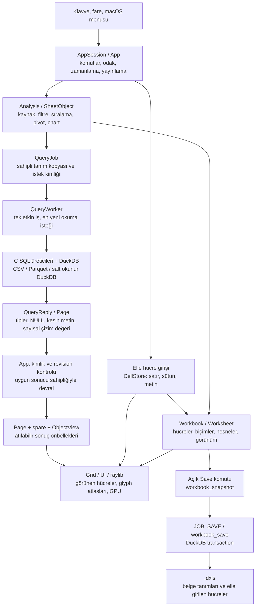
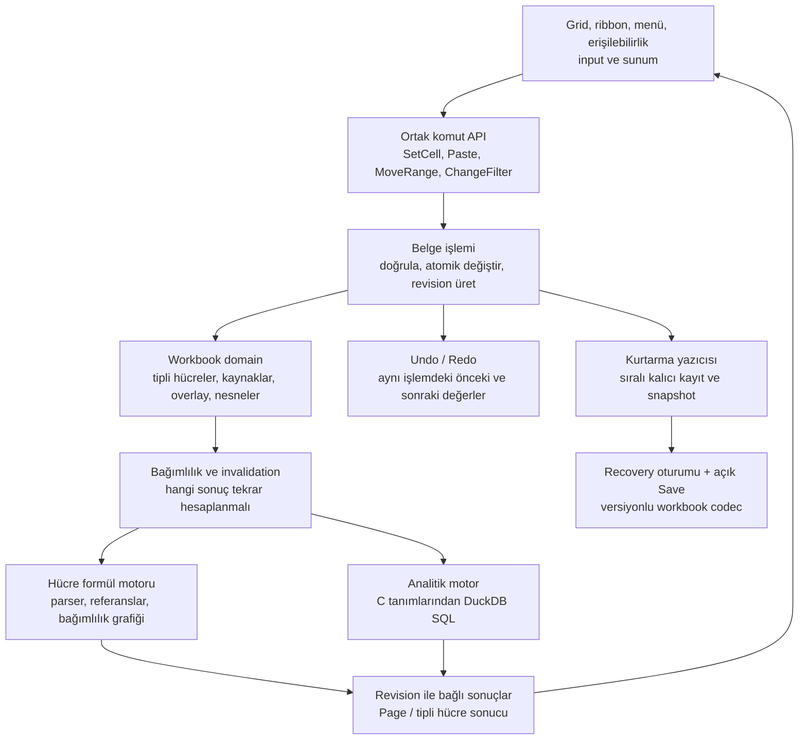
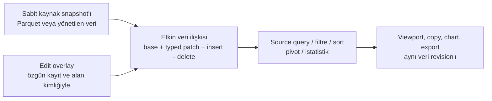
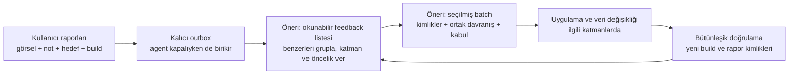

# Architecture and ownership

Duxcel has one C99 spreadsheet implementation, raylib rendering and DuckDB computation. Native macOS and browser Wasm use the same App, grid, widgets and analytical definitions. The browser has platform glue, not a second UI.

| Area | Responsibility |
| --- | --- |
| `src/app/` | Owned AppSession lifecycle, commands, jobs, history, source/object selection and orchestration |
| `src/grid/` | Viewport, cell/extent selection, scrolling, resizing and header geometry |
| `src/ui/` | C widgets, ribbon, shelves, panes, typography and renderer/cache ownership |
| `src/transforms/` | SQL/analysis/PIVOT/Marks/number/chart semantics shared by both platforms |
| `src/data/` | Typed Pages, source identity, native DuckDB worker and asynchronous browser bridge |
| `src/workbook/` | Sparse cells, formats, objects, versioned `.dxls` and shared metadata codec |
| `src/platform/` | Portable boundary plus Objective-C AppKit windows, file panels, shortcuts and precise gestures |
| `src/dev/` | Development-only semantic review registry, captures and reporting; excluded from production |
| `web/` | Emscripten startup, DOM/device/file/clipboard/WebGL lifetime, official DuckDB-Wasm Worker transport and browser tests |
| `tests/` | Authored C/Objective-C tests and small immutable inputs/oracles |
| `tools/` | Offline fixture/icon generation, builds, test orchestration, browser automation and external review queue |
| `assets/`, `packaging/` | Runtime fonts/icons/licenses and platform metadata |

## State and resource rules

`AppSession` owns start/frame/finish. Native `app_run` drives it synchronously; the browser host schedules the same frame callback. C owns model/commands/SQL/jobs/Pages. Worker replies are accepted only for matching owned requests; cancellation, stale replies and bounded transport cannot replace accepted state partially.

Keep SQL NULL, empty text and literal `NULL` separate. Preserve canonical integer/DECIMAL strings. Page, schema, cell, format, image, font and request ownership must be explicit. Rendering cached state must not issue queries. UI scale, sheet zoom and framebuffer density remain separate.

Native AppKit is intentionally Objective-C behind the portable platform interface. The browser requires a JavaScript boundary to DOM events, browser file/clipboard APIs and the official asynchronous DuckDB-Wasm package. Moving those calls into C string macros would not eliminate that boundary.

The shared workbook metadata reader is staged infrastructure, not completed browser Open/Save. Complete candidate validation, migration, activation, writer/output adapters and recovery remain roadmap work.

## Review isolation

Normal binaries omit review modules, command strings and browser bridges at compile/link/package time. Review binaries enumerate bounded stable widget IDs during an armed capture, retain an owned same-frame image/state and publish immutable reports. External Python tools validate/store/queue them and optionally dispatch an agent; product frames do not poll a service or require Python/Node. Browser review uses the same C registry with development-only capture/upload/IndexedDB transport.

## Generated output

`build/bin/` holds native binaries and an executable-relative asset link; `build/obj/` separates release/sanitizer/review objects; `build/tests/` holds test programs, generated databases and reports. `data/downloads/` is optional public-data cache. `.cache/web/` holds installed SDK/dependencies; `build/web/` holds disposable Wasm packages; `.state/` owns stable checkout lock inodes. No generated executable belongs at root or next to test source.

## Known structural debt

`src/app/app.c` is about 15,500 lines / 1.22 MB; native scenario code shares this translation unit. `src/dev/review_app.inc` is about 4,200 lines / 441 KB. These sizes impede focused compilation and ownership. Extract cohesive controllers and test-only harnesses incrementally, preserving behavior and keeping a single integration owner. Do not undertake a broad rewrite solely to change GitHub language percentages.

Native fixture generation now uses the DuckDB C API and production workbook/PIVOT code, with no mock, Node or DuckDB CLI dependency. Most behavioral assertions already are C. External orchestration remains Python with completion, sanitizer, timeout, binary-fingerprint, fixture-order and desktop-lock contracts. Product-linked helpers remain C under `tests/support/`; tool/browser test sources live in their subsystem test directories.

## Türkçe çalışma haritası ve değerlendirme

Bu bölüm bugünkü kaynak kodunun çalışma yollarını, ürünün eksik sözleşmelerini ve tartışılacak mimari önerileri açıklar. **“Mevcut” bölümleri uygulamayı anlatır; “öneri” bölümleri uygulanmış veya kabul edilmiş karar değildir.** Mevcut C99/raylib/DuckDB ve ortak C/Wasm sınırları korunur. Buradaki temel ayrım şudur: Duxcel bugün gerçek bir analitik sorgu motoruna ve seyrek metin hücrelerine sahiptir; bu ikisi henüz Excel benzeri ortak, tipli ve kurtarılabilir bir düzenleme modelinde birleşmez.

### Mevcut katmanlar ve ana akış

`main.c`, native tarafta `app_run` döngüsünü; browser tarafında aynı `app_start/app_frame/app_finish` yaşam döngüsünü host zamanlayıcısıyla çalıştırır. `AppSession` tek raylib pencere/context oturumuna sahiptir. Native `QueryWorker` ayrı thread üzerinde kendi DuckDB bağlantısını kullanır. UI bu bağlantıyı sorgulamak için kullanmaz; iptal isteği kilit altında `duckdb_interrupt` üzerinden iletilir.

App bugün hem kalıcı belgeyi hem geçici görünümü hem de iş orkestrasyonunu taşır. Aktif ana kaynağın canlı `Analysis` değeri `App.analysis` içindedir; `Worksheet.analysis`, `capture_sheet` sırasında güncellenen bir kayıt/sheet kopyası da taşır. Table kaynakları ise `SheetObject.source` içindedir. Birden fazla sahiplik ve revision türünün App içinde koordine edilmesi, yeni bir özelliğin doğru halkalara ulaşmasını zorlaştırır.

Browser aynı C App/grid/UI'ını Wasm olarak çalıştırır. C tarafında üretilen SQL, ince JS adaptöründen resmi asenkron DuckDB-Wasm Worker'ına gider; Arrow çıktısı tip/null bilgisi korunarak bounded wire üzerinden C Page'e kopyalanır. DuckDB handle'ı veya C pointer'ı Worker'la ortak sahiplenilmez. Native kaynağı yerinde sorgulama ile browser dosya yaşam döngüsü eşdeğer değildir: mevcut browser chooser, en fazla 256 MiB dosyanın tamamını okuyup oturumluk buffer olarak kaydeder. Bu registration kalıcı workbook/source referansı değildir. Kaynak: [worker_browser.inc](../src/data/worker_browser.inc), [engine_host.mjs](../web/engine_host.mjs), [official_worker.mjs](../web/official_worker.mjs).

Kaynak girişleri: [main.c](../src/main.c), [App modeli](../src/app/app.c), [worker.c](../src/data/worker.c), [workbook.h](../src/workbook/workbook.h).

### Bir hücre yazıldığında gerçekten ne olur

1. `TextInput`, kullanıcı yazarken henüz commit edilmemiş metni taşır. Enter, Tab veya uygun odak değişimi `commit_cell` çağrısına ulaşır.
2. `manual_range`, hedefin içe alınmış ana veri alanıyla veya bir nesneyle çakışmasını engeller. Mevcut kaynak hücreleri bu yoldan düzenlenemez.
3. `cells_set`, `(row, col)` sıralı seyrek dizide metni saklar. Her dolu hücrenin metni kendine ait allocation'dır; lookup binary search ile yapılır. Devasa canvas boyutu kadar hücre bellekte ayrılmaz.
4. Değişen hücre deposunun eski durumu undo snapshot'ına kopyalanır; `worksheet_record(EDIT_CELLS)` kronolojik aksiyon kaydını ekler ve belge dirty olur.
5. `draw_blank_cells`, görünür konumlardaki metni bu depodan okuyup çizer. Her tuşa basışta DuckDB'ye hücre UPDATE'i gönderilmez.

Bu depo **metin tabanlıdır**. `123` elle girildiğinde sayı tipi kazanmaz; `=SUM(A1:A3)` için parser, bağımlılık grafiği veya hesaplama yürütmesi yoktur. Karışık seçim istatistiğine katılan elle yazılmış değerler de VARCHAR olarak taşınır. Sayı biçimi uygulamak, metni sayısal veri tipine dönüştürmez.

Mevcut sınırlar sheet başına 20.000 düzenlenebilir hücre, 4 MiB metin ve hücre başına 64 KiB'dır. Boş metinle `cells_set` hücre kaydını kaldırır; eksik hücre getter'da boş metin döner. Dolayısıyla bu giriş yolu SQL NULL/boş VARCHAR/literal `NULL` için genel bir tipli editör değildir. İçe alınmış Page değerlerinde bu ayrım ayrıca korunur; iki yolun semantiğini aynı saymamak gerekir.

Kaynak: [cells.c](../src/workbook/cells.c), [cells.h](../src/workbook/cells.h), `commit_cell`, `draw_blank_cells`, `statistics_snapshot` içinde [app.c](../src/app/app.c).

### Bir sorgu sonucu bellekte nasıl tutulur

| Alan | Ne tutar | Kalıcılık ve sınır |
| --- | --- | --- |
| Workbook / Worksheet | Hücre metinleri, kaynak ve işlem tanımları, nesneler, biçimler, görünüm, kaynak kimliği metadata'sı | RAM otoritesi; açık Save ile `.dxls`'e aktarılır |
| DuckDB query database | Hazırlanmış sorgular, operator belleği, native pivot sonuç/totals geçici tabloları | Native oturum içi in-memory database, gerektiğinde özel geçici klasöre spill; config 512 MB ve iki thread |
| C Page | Sütun şeması ve satır sıralı `Cell[]`; her değerde `is_null`, kesin `text`, çizim için `double number` | Olağan sayfa en fazla 256 satır; ana kaynak sayfası 16 MiB, Table/Pivot sayfası 4 MiB sınırına tabi |
| App sonuç önbellekleri | Ana `page`, `spare`, nesne başına `ObjectView.page`, ayrı step preview | Atılabilir ve yeniden sorgulanabilir; workbook snapshot'ına girmez |
| Undo / Redo | Hücre, Analysis, nesne ve format snapshot'ları; bunları eşleyen aksiyon dizisi | Oturum belleği; genel durable komut günlüğü veya kaydedilmiş kullanıcı sürüm geçmişi değildir |
| GPU / UI | Glyph atlasları, render batch'leri, geçiş ve popup texture'ları | Hesaplamanın/verinin otoritesi değildir; paint buffer bütçesi toplam 32 MiB, font ve driver maliyetleri bunun dışındadır |

`Page.cells[(row - offset) * column_count + column]` yalnızca yüklenmiş pencerenin hücresidir. `Page.total` ise sorgu sonucunun toplam satır sayısıdır veya count tamamlanana kadar bir alt sınırdır; `total` adet hücre allocation'ı yapılmaz. `spare`, önceki pencereye kısa geri dönüşü yeniden sorgusuz yapabilir. Ana viewport, yeterli önbellek yoksa kısa bir beklemeden sonra yeni pencere ister.

Native DuckDB sonucu C Page'e dönüştürüldükten sonra `duckdb_result` bırakılır. `Page`, text'in uygun allocator ile serbest bırakılmasını da taşır; `QueryReply` → App geçişinde pointer sahipliği taşınır ve eski sahip sıfırlanır. Render sırasında geçerli Page okunur. Büyük integer/DECIMAL değerlerinin kesin temsili metindir; `double` grafik koordinatı veya uygun yaklaşık gösterim içindir. Kesin kopya/değerler çizim double'ından geri üretilmemelidir.

**256 satırlık çıktı, sorgunun yalnızca 256 satır çalıştığı anlamına gelmez.** Sort, DISTINCT, aggregate ve COUNT çok daha büyük veriyi işleyebilir. Native pivot `_duxcel_pivot_result` geçici tablosunda materyalize edilir; UI bunun sayfasını alır. Ana sayfa SQL'i bütün iş sütunlarını seçer; sadece yatayda görünen sütunlar kadar okuma garantisi yoktur. `LIMIT/OFFSET` derin gezinmede maliyet yaratabilir. DuckDB'nin 512 MB ayarı da toplam C/JS/GPU/process belleğine sert bir üst sınır değildir. [DuckDB bellek açıklaması](https://duckdb.org/2024/07/09/memory-management).

Chart görünümü de kendi kapsamını korumalıdır: mevcut chart sıralaması yüklenmiş pivot grupları üzerinden çalışır. Kaynakta yeniden hesaplanan non-additive “Other” desteği belirli birleşimler içindir; tüm veri üzerinde evrensel global top-N garantisi değildir.

Kaynak: [Page modeli ve cleanup](../src/data/page.h), [page.c](../src/data/page.c), `result_page_visible_status`, `fetch_window`, `pivot_materialize_proved` ve istatistik sorguları içinde [database.c](../src/data/database.c), [chartview.c](../src/ui/chartview.c).

### Rendering ve kullanıcı etkileşimi

Her frame platform event'leri ve UI girişleri alınır; worker cevapları yayınlanır; komutlar, grid geometrisi ve görünür alan işlenir; raylib draw çağrıları GPU'ya gönderilir; sonraki sayfa/pivot/count/istatistik işleri zamanlanır. Hücre çizim döngüsünde doğrudan DuckDB sorgusu yoktur. Bununla birlikte bazı `draw_*` fonksiyonları input, odak ve komut yan etkilerini de işler; görünüm ile davranış sınırı bütün App boyunca katı değildir.

Grid `top/fraction/horizontal`, seçim `active/anchor/extent`, kolon genişlikleri ve nesne koordinatlarından görünür dikdörtgenleri hesaplar. Görünen hücreler ve kesişen nesneler çizilir. Frozen sütunlar ayrı clipping düzlemindedir. Uygulama ölçeği, sheet zoom ve fiziksel framebuffer/DPI ayrı kavramlardır. UI metrik ve glyph cache'leri ile sınırlı framebuffer cache'leri kullanır; ekran buffer'ı belgeyi saklamaz.

`Command+Shift+Down` örneğinin kod karşılığı özellikle açıklayıcıdır. `grid.c:navigate`, shortcut oku için `Grid.navigation` varsa o dikdörtgenin sınırına; yoksa ana `Page.total` sınırına gider. `set_grid_navigation` hazır Table/Pivot nesnesinin sınırını sağlar, elle girilen `CellStore` içindeki dolu/boş hücre dizisini sağlamaz. `cells_region` başka bir komut olan Select All için kullanılır. Ortak “bir sonraki veri sınırını bul” semantiği mevcut değildir. Bu, fiziksel klavye event'i testi yapılmış iddiası olmadan, kaynaktan görülen bir model açığıdır. Excel Mac'in belgelenmiş davranışı Shift+Cmd+ok ile dolu veri sınırına seçim genişletmektir. [Microsoft kısayol sözleşmesi](https://support.microsoft.com/en-us/accessibility/excel/keyboard-shortcuts-in-excel).

Kaynak: [grid.c](../src/grid/grid.c), `set_grid_navigation`, `select_region`, `shortcuts`, `draw_app` içinde [app.c](../src/app/app.c), [UI input ve font yönetimi](../src/ui/ui.c), [paintlayer backend](../src/ui/paintlayer_backend.c), [macOS adaptörü](../src/platform/macos.m).

### Save, Close, recovery ve sürümleme aynı şey değildir

| İhtiyaç | Bugünkü durum |
| --- | --- |
| Açık Save / Save As | Native tarafta gerçek DuckDB `.dxls` kaydı var. Ayrı sahipli Workbook snapshot'ı worker'a verilir, metadata transaction içinde yazılır. |
| Başarısız Open / Save | Load geçici aday Workbook oluşturur; başarılı doğrulamada eskisini değiştirir. Save transaction/rollback kullanır. Bu, autosave değildir. |
| Normal native Close / Quit | `request_document_action`, açık hücre editini commit eder; dirty belge için Save / Don't Save / Cancel sunar. Başarılı Save gelmeden bekleyen Quit tamamlanmaz. |
| Browser workbook Open / Save | `workbook_browser.c` açıkça unavailable döner. Paylaşılan metadata reader testleri bütünleşik özelliği tamamlamaz. Browser sekmesini kapatmanın ayrı host kısıtları da vardır. |
| Otomatik kayıt / yeniden başlatmada unsaved belge | Üretim akışında tamamlanmış autosave, recovery journal veya açılışta unsaved oturum geri yüklemesi yok. Dosya yolu verilmeden açılış yeni boş sheet oluşturur. |
| Undo ve belge sürüm geçmişi | Undo/Redo RAM'de sınırlı snapshot'lardır. `workbook_snapshot` bunları ve Page'leri dışarıda bırakır; yeniden açılan belge önceki oturumun undo geçmişini yüklemez. |
| Dış kaynak verisi | CSV/Parquet/DuckDB içerikleri otomatik olarak workbook içine kopyalanmaz. Kaynak referansları ve desteklenen kimlik kanıtları saklanır; dosya taşınır/değişirse relink veya yeniden doğrulama gerekir. |

`.dxls` şema sürümü 1–14 arası dosya biçimi uyumluluğudur. `SourceVersions` ledger'ı, belirli kaynak/owner/reader/schema/içerik kanıtını bağlar; eski Parquet byte'larını saklayan bir veri time-travel sistemi değildir. Ekrandaki satır konumu da kalıcı kaynak kayıt kimliği değildir. Mevcut destekli raw CSV/Parquet yolları orijinal kayıt ordinal'larını taşıyabilir; özel SQL, DISTINCT, aggregate ve browser için evrensel lineage yoktur. Format için oluşturulmuş bu temeli düzenleme modeline genişletmek ayrı tasarım ve doğrulama ister.

Kullanıcının “normal kapattım, uyarı gelmedi” gözlemi mevcut native kaynak yolu ile farklıdır; kullanılan binary, platform ve kapanış şekliyle yeniden üretilmesi gerekir. Kaynakta diyalog bulunması çalışan uygulamada bu olayın doğru yönetildiğini tek başına kanıtlamaz. Crash/force quit için bu diyalog koruma sağlamaz.

Kaynak: `capture_sheet`, `workspace_job`, `request_document_action`, `draw_unsaved`, `poll_query` ve `app_start` içinde [app.c](../src/app/app.c), [workbook_save/load](../src/workbook/workbook.c), [browser unavailable adaptörü](../src/workbook/workbook_browser.c), [source_scope.h](../src/workbook/source_scope.h), [browser persistence planı](design/BROWSER_PERSISTENCE.md).

### Öneri: ortak belge ve komut sözleşmesi

Bu proje için uygun hedef, native C içinde açık sınırları olan modüler bir uygulamadır. Mevcut dosyaları yalnızca küçültmek davranış kopukluğunu çözmez; her kullanıcı işleminin ortak belge modeline hangi değişikliği yaptığı tanımlanmalıdır.

Buradaki Formula kolu yeni yetenektir. SQL analitiği ile aynı veri tiplerini, belge revision'ını ve bağımlılık sınırlarını paylaşır; her hücre tuşunu SQL sorgusuna çevirmek gerekmez. Excel'in kamuya açık hesabı da bağımlılık ağacı, hesaplama sırası ve dirty bağımlıların yeniden hesaplanmasına dayanır. Bu, Duxcel'in formül motoru tasarımı için referanstır; Excel'in tüm iç mimarisini bildiğimiz anlamına gelmez. [Microsoft hesaplama açıklaması](https://learn.microsoft.com/en-us/office/client-developer/excel/excel-recalculation).

Önerilen ortak sözleşmeler:

- **Tek belge otoritesi:** Kalıcı model ile aktif görünüm kopyalarının rolü açık olsun. UI doğrudan dağınık store'ları değiştirerek dirty/undo/sorgu invalidation zincirini elle tamamlamasın.
- **Hedef kimliği:** Elle girilmiş hücre için sheet/cell adresi; veri editinde dataset, sabit kaynak sürümü, özgün kayıt ve alan kimliği; sonuç hücresinde ayrıca tanım ve sonuç revision'ı kullanılsın. Satır ekleme/silmede referans taşıma kuralları açık olsun.
- **Tipli değer ve ifade:** Eksik seyrek hücre, SQL NULL, boş metin, literal `NULL`, integer/DECIMAL, tarih, hata ve formül girdisi birbirine dönüşmesin. Girilen ham metin/ifade ile hesaplanmış değer ve biçimli gösterim ayrı tutulsun. Bu, sentetik bir “blank” veri türü icat etmeyi gerektirmez.
- **Tek değişiklik sonucu:** Başarılı bir işlem neyin değiştiğini ve hangi sonuçların geçersizleştiğini döndürsün. Paste gibi çok hücreli işlemler bir undo ve bir kalıcı işlem olsun. Yalnız seçim/scroll gibi görünüm işlemleri veri dirty'si oluşturmasın.
- **İş türüne uygun zamanlama:** Viewport okumalarında eskisini iptal et/en yenisini kabul et yaklaşımı korunsun. Kalıcı kayıtlar ise sırayla tamamlanan işlemler olsun; viewport kaydırması bir commit'i düşürmesin. Mevcut tek worker önceliklerinin ayrılması gerektiği nokta budur; daha fazla thread açmak başlı başına çözüm değildir.
- **Revision'a bağlı yayın:** Asenkron Save hangi belge revision'ını kalıcılaştırdığını bildirsin. O sırada daha yeni edit varsa belge dirty kalsın. Şu anki geniş I/O input kilidini kaldırıp arka planda autosave sunmadan önce bu sözleşme gerekir.

Mevcut `worksheet_*` atomik range/history yardımcıları, sahipli snapshot'lar, source identity ve stale reply korumaları bu hedefe geçiş için kullanılabilir. İşlevleri baştan yazmak gerekmez. Önce `app.c` içinden document lifecycle, komut/history, query scheduling/publication ve grid interaction controller'ları mevcut testleri koruyarak çıkarılabilir. Native senaryolar test build sınırına taşınmalı; geliştirme altyapısı üretim davranışına dönüşmemelidir.

### Öneri: büyük Parquet verisini düzenleme

Bir `Page` içindeki text'i değiştirmek yalnız görüntüyü değiştirir. Doğru düzenleme, sorgunun okuduğu mantıksal veriyi değiştirmelidir. İlk hedef için kaynak Parquet'i sabit tutup yalnız değişiklikleri saklayan yerel bir overlay uygundur.

Örneğin görünür yedinci satır sıralama sonrası özgün kayıt 8.431 ise editin hedefi “7. satır” olamaz. Hedef `(dataset, base_version, record_id=8431, field_id=amount)` olmalıdır. İlk destek yalnız doğrudan kaynak kayıtları ve bire bir izlenebilir alanlar olabilir. Aggregate/pivot toplamına yazmak, kaynaktaki hangi kayıtları nasıl değiştireceğini ayrıca tanımlamadan açılmamalıdır.

RAM'de sınırlı güncel patch indeksi tutulur; kalıcı store tipli patch'leri, insert/delete'leri ve işlem revision'ını saklar. Kaynağın tamamı C hücre dizisine alınmaz. Overlay boyutu büyürse managed DuckDB table veya yeni Parquet snapshot'ına materyalizasyon/compaction ölçülerek seçilir. “Overlay” az edit için uygun öneridir; milyonlarca değişiklikte aynı planın hızlı kalacağı varsayılmaz.

Overlay **filtre, sıralama ve aggregate'den önce** etkin ilişkiye uygulanmalıdır. Filtreye dahil olmayan bir satır editten sonra görünebilir; görünen satır da filtreden düşebilir. Sadece yüklenmiş 256 satırı yamamak bu sonuçları kaçırır. Benzer şekilde SQL `COALESCE(patch, base)` edit semantiği olamaz: kullanıcı açıkça NULL girerse eski değere döner. Patch'in varlığı ile patch değerinin NULL olması ayrı bilgiler olmalıdır.

İlk düzenleme kabulü: filtre/sort altında doğru kayıt değişsin; viewport, tam seçim istatistiği, pivot, copy ve export aynı revision'ı görsün; Undo/Redo ile eski değer geri gelsin; Save/Open ve crash recovery değişikliği korusun; dış kaynak değiştiyse overlay sessizce başka kayıtlara uygulanmasın. Snapshot içerik hash'i doğrulama sağlayabilir fakat eski kaynağı saklamaz; kalıcı geçmiş için eski kaynak byte'larının da erişilebilir tutulması gerekir.

### DuckLake veya Delta Lake gerekli mi

| Yaklaşım | Sağladığı şey | Bu proje için değerlendirme |
| --- | --- | --- |
| Mevcut DuckDB + tipli yerel overlay | C uygulaması içinde kontrollü kayıt düzenleme; mevcut workbook formatını ve SQL motorunu genişletme | İlk düzenleme dilimi için en az yeni bileşen. Kimlik, sorgu planı, kalıcı journal ve compaction politikası yine tasarlanır. |
| Yönetilen DuckDB table | İçe alınmış verinin uygulama tarafından sahiplenildiği gerçek UPDATE/DELETE yolu | Çok edit ve bağımsız dosya paylaşımı için aday; import süresi, kopya disk alanı ve snapshot/history politikası ölçülmeli. |
| DuckLake | Veri snapshot'ları, time travel, küçük değişiklikleri metadata içinde tutma; catalog ve data files | Büyük yönetilen dataset'ler ve ileride ortak veri için araştırma adayı. Native/browser sabit engine sürümlerinde extension, paketleme ve gerçek dosya uyumluluğu ayrıca kanıtlanmalı. |
| Delta Lake / Iceberg | Dosyalar üzerinde transaction/snapshot ve row-level değişiklik mekanizmaları | Dış lakehouse birlikte çalışabilirliği hedeflendiğinde değerlendirilmeli; hücre/formül/odak/undo sözleşmelerini kendiliğinden sağlamaz. |

DuckLake'in [data inlining](https://ducklake.select/docs/stable/duckdb/advanced_features/data_inlining), [time travel](https://ducklake.select/docs/stable/duckdb/usage/time_travel) ve [catalog seçimi](https://ducklake.select/docs/stable/duckdb/usage/choosing_a_catalog_database) gerçek özelliklerdir. Delta'nın [deletion vectors](https://docs.delta.io/delta-deletion-vectors/) yaklaşımı da her küçük editte bütün Parquet dosyasını yeniden yazma zorunluluğuna alternatif sunar. **Bu özelliklerden hareketle önerimiz**, veri depolama sağlayıcısını belge/komut katmanının arkasında değiştirilebilir tutmak ve lakehouse entegrasyonunu temel grid davranışlarının önkoşulu yapmamaktır. Çok kullanıcılı veri yazımı ile tek kullanıcının workbook düzenlemesi ayrı kapsamdır.

### Öneri: autosave ve crash recovery

Kullanıcı için üç farklı söz ayrılmalıdır: ekranda edit kabul edildi; edit recovery deposuna kalıcı yazıldı; açık workbook dosyası kaydedildi. Tek `dirty` bool'u bu üçünü anlatmaya yetmez. Belge kimliği, current revision, recoverable revision ve saved revision gerekir.

İlk dilim, mevcut snapshot/codec ile untitled workbook dahil özel bir recovery oturumuna periyodik snapshot yazabilir. Sonraki dilim, komut transaction'larını sıralı kalıcı journal'a alıp arada snapshot/compaction yapabilir. Kendi yeni WAL biçimini yazmadan önce mevcut transaction store'unun küçük yazı gecikmesi ve kaynak maliyeti ölçülmelidir. UI'da “kaydedildi/kurtarılabilir” bilgisi ancak ilgili yazı tamamlandıktan sonra gösterilmeli; debounce aralığındaki olası kayıp sınırı açık olmalıdır.

Recovery kaydı cache değildir; `build/` veya geçici query spill klasöründe tutulmamalıdır. Platformun kalıcı kullanıcı verisi alanında belge/oturum kimliğiyle saklanır. Açılış tamamlanmış snapshot + commit edilmiş devam kayıtlarını yükler, eksik/kesilmiş kuyruğu güvenli biçimde ele alır ve kaynak erişimini ayrıca çözer. Disk dolu, izin hatası, yazıcı kapanışı ve eski recovery kaydının yanlış workbook'a uygulanması kabul testleridir. Açık “Don't Save” ile bu oturumun recovery kaydını kapatma davranışı da tanımlanmalıdır.

Normal named-file autosave kaynak dosyayı otomatik güncelleme politikasıdır; recovery ise kullanıcı Save dememiş olsa da çalışmayı korur. VS Code bu ayrımı Auto Save ve unsaved değişiklikler için Hot Exit ile görünür kılar. Office de AutoSave ile AutoRecover'ı ayırır. Bu ürünlerden alınan öneri, Duxcel'de untitled/crash korumasını açık workbook kaydından bağımsız kurmaktır. [VS Code](https://code.visualstudio.com/docs/editing/codebasics), [Microsoft AutoSave](https://support.microsoft.com/en-us/office/collab-files/what-is-autosave?ad=us&rs=en-us&ui=en-us).

### Öneri: Excel benzeri davranış sözleşmeleri

Excel'e benzerlik tek bir “parity” onayıyla kapanmamalıdır. Her davranış için başlangıç durumu, gerçek input, beklenen seçim/değer ve yan etkiler yazılmalıdır. İlk matris; dolu/boş sınırında Cmd+ok ve Shift+Cmd+ok, aktif hücre/anchor/extent, Enter/Tab, edit commit/cancel, paste/clear, range move, insert/delete, Undo/Redo ve save/close kapsamını içermelidir.

Ortak navigation servisi seyrek manuel hücreler, kaynak tabloları ve mevcut nesneler için hedef sınırı modelden çözmelidir. Seyrek veride tüm canvas taranmaz; mevcut dolu hücre indeksi kullanılır. SQL verisinde gerekirse aynı source revision'ına bağlı sınırlı bir sınır sorgusu çalışır; viewport cache'indeki 256 satır bütün sheet'in doluluğu sayılamaz. SQL NULL, boş string, yalnız formatlı hücre ve ileride boş metin döndüren formülün “dolu” sayılma kuralları açıkça seçilip Excel Mac üzerinde doğrulanmalıdır.

Özellik kabulü değişen halkaları birlikte kapsar. Navigation değişikliği için doğru hedef/seçim ve dirty/query yan etkisinin olmaması; veri editi için ayrıca motor sonuçları, undo ve kalıcılık gerekir. Saf gölge/spacing değişikliği her seferinde tam persistence regresyonu gerektirmez. Unit pass, gerçek event teslimi veya bütünleşik veri doğruluğu yerine kullanılmamalıdır.

### Mevcut feedback altyapısı ve batch önerisi

Native review uygulaması rapor bundle'ını yerel outbox'a atomik olarak yazar; o anda Python servisi veya çalışan agent gerekmez. Browser review önce IndexedDB'ye saklar, sonra ortak outbox'a taşımayı dener; yalnız local-pending durumu ortak depoda kalıcı teslim sayılmaz. Harici Python kuyruğu SQLite transaction/lease/retry ile raporları tutar. Opsiyonel worker'ın yaptığı iş read-only triage'dır, otomatik fix değildir. Normal ürün binary'si review machinery'yi içermez.

Bu nedenle ihtiyacın ilk karşılığı yeni bir sürekli agent daemon'ı kurmak değil, mevcut outbox'ın üstüne **batch iş akışı** eklemektir. Raporları topla → bir batch'e seç → ortak kök neden ve kabul davranışını yaz → uygula → doğrula. `triaged`, `implemented`, `verified` ve kullanıcı tasarım kabulü ayrı durumlar olarak kalmalıdır. Bir raporun queue'da completed/triaged olması, sorunun düzeldiği anlamına gelmez.

Batch kaydı rapor ID'leri, ilgili belge/source revision'ı, beklenen/gözlenen davranış, katman etiketleri, test kapsamı ve çözüm build'ini bağlayabilir. Screenshot bütün veri doğruluğunu göstermez; hesaplama/persistence raporlarında küçük reproducible veri veya desteklenen workbook fixture'ı gerekir. Mevcut reader `list/read/status`, queue ve `worker --once` temelleri vardır; seçilmiş çoklu rapor paketi, duplicate/root-cause gruplama ve toplu ilerleme görünümü ayrı eksiklerdir. Python burada dış geliştirme aracıdır; yalnızca dili değiştirmek batch kullanım sorununu çözmez.

Kaynak: [review capture](../src/dev/review_capture.c), [native outbox](../src/dev/review_store.c), [reader](../tools/native_review.py), [queue](../tools/review_queue.py), [worker](../tools/review_worker.py), [service komutları](../tools/review_service.py), [review planı](design/NATIVE_REVIEW_PLAN.md).

### Önerilen geliştirme alanları ve ilk sıra

| Sorumluluk alanı | Sözleşmesi | Birlikte kanıtlanacak sonuç |
| --- | --- | --- |
| Grid ve interaction | Kullanıcı input'undan seçim/edit komutuna geçiş; hit test, odak, geometri | Manuel ve sorgu verisinde tutarlı gezinme ve edit yaşam döngüsü |
| Workbook ve komutlar | Tipli değer/ifade, hedef kimliği, atomik değişiklik, undo/revision | UI menüsü ve shortcut aynı işlemi yapar |
| Analitik ve formula runtime | Etkin dataset, lineage, SQL, formül bağımlılıkları, sonuç yayınlama | Bütün tüketiciler aynı revision'ı gösterir |
| Persistence ve recovery | Versiyonlu codec, kalıcı işlem sırası, snapshot, kaynak referansları | Save/Open ve crash sonrası aynı kabul edilmiş çalışma |
| Feedback ve kabul | Rapor/batch/tespit/fix/test ilişkisi; doğru build kanıtı | Bir rapor hangi davranış ve testle kapandı görülebilir |

Bunlar beş eşzamanlı agent/implementation lane önerisi değildir. Bu Mac'te mevcut en fazla iki aktif implementation lane ve tek App/shared-interface/build/desktop integratörü kuralı korunmalıdır. İlk iki uyumlu alan, ortak sözleşmeyi paylaşan grid/manuel edit ve native kayıt/recovery dilimleri olabilir. Halihazırdaki browser codec/test çalışması korunmalı; native recovery'nin önkoşulu yapılmamalıdır.

Önerilen ilk işler: (1) native kapanışta yaşanan kaybı kullanılan build ve kapanış yolu ile ayırıp untitled dahil recovery'nin ilk dikey dilimini kurmak; (2) dolu/boş hücre gezinmesini ve temel edit/undo davranışını ortak komut sözleşmesiyle düzeltmek; (3) tipli manuel hücreleri analitik modele bağlamak; (4) doğrudan raw kaynak kayıtlarında edit overlay'ini viewport/pivot/stats/export/save/recovery ile birlikte tamamlamak. Seçilmiş feedback batch görünümü bunlarla paralel küçük dış araç işi olabilir. Genel formül bağımlılık motoru ve lakehouse sağlayıcısı sonraki, ayrı kabulü olan ürün yetenekleridir. İlk grid düzeltmelerini bütün bu altyapının bitmesine bağlamamak gerekir.

### İnceleme ve doğrulama kapsamı

Kaynak yolları mevcut kirli çalışma ağacına aittir; yalnız HEAD'i incelemek bu checkout'ı tarif etmez. Ürün kaynak ağacı 135 dosyadan oluşur; modül arayüzleri ve App/input → model → worker/SQL → Page → render ile Save/Open/review yolları incelenmiştir. Generated marka/icon türevleri tasarım otoritesi olarak ele alınmamıştır. Bu bölüm bir native görsel/gerçek klavye kabulü değildir; kullanıcının uygulaması kontrol edilmemiştir.

Odaklı mevcut testler: `grid`, `page`, `cellreadout`, `objects`, `selection_ladder` release ve ASan/UBSan yapılandırmalarında geçti (build dahil 11,933 s). Native workbook `--formats-only` kayıt testleri release ve ASan/UBSan ile geçti (17,413 s). İki koşuda da 0 App scenario stage çalıştı. Sonuçlar, source/binary hash'leri ve komutlar ignored `build/tests/results/architecture-review/` ve `architecture-persistence/` koşularında kaydedildi. Bu geçici payload'lar depo temizliğinde budandı; güncel temizlik/kabul özeti `build/tests/results/cleanup-summary.json` içindedir. Test kaynakları ve komutlar korunur. Bu testler yeni autosave, genel formula veya editable Parquet desteği kanıtı değildir.
