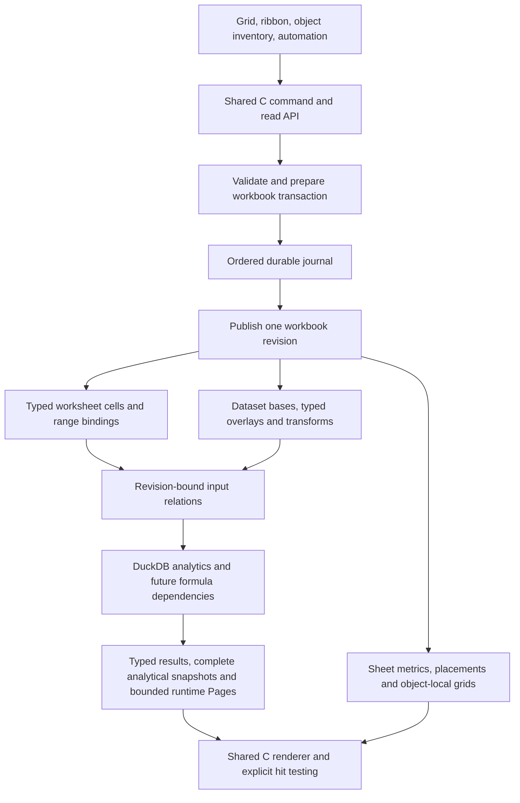
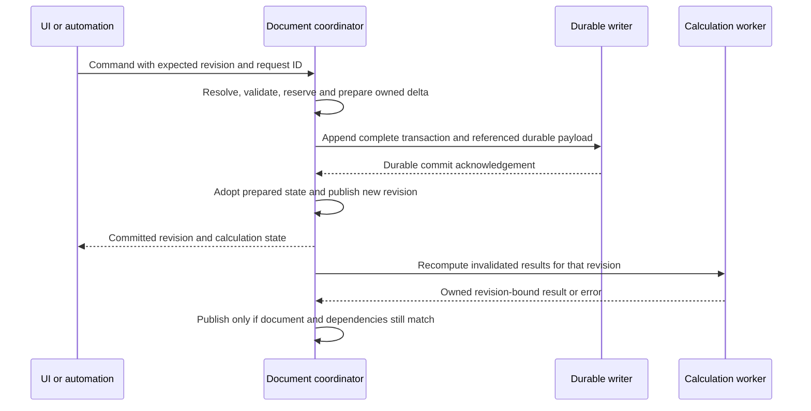

# Workbook editing analytics and versioning TRD Draft

Status: Draft for product and technical iteration, revised 21 October 2026 with the user's decisions. Source baseline remains `b5e6be0e92b9a784027781b78343de51a783e5d3`; the first draft was committed as `4099673`. Accepted design direction is distinguished from remaining implementation proposals in sections 19 and 20 and summarized in [REQUIREMENTS](../REQUIREMENTS.md). No feature implementation or roadmap scheduling is implied.

Duxcel should combine freeform spreadsheet editing with relational analysis and spatial dashboard authoring in one workbook. Users should be able to edit manual cells and eligible imported records, arrange independent analytical objects over a sheet, reference their values, undo workbook changes, retain selected versions and recover committed work. The recommended foundation is a shared C document model and command boundary, with separate data identity, placement, durable history and disposable calculation caches.

The major change is the document contract. Preserve DuckDB as the persistence and analytical engine without adding SQLite now. Separate Connect, Import, materialized Data Model datasets and their views. Preserve worksheet ownership in formulas while allowing a Master View to composite sheets in z-order. A second UI, a separate analytics server and a new rendering engine are unnecessary.

## 1 Product outcomes and boundaries

The intended outcomes are:

1. A sparse editable worksheet can contain irregular manual content and several independently owned analyses, including tables, pivots and charts.
2. Manual ranges and imported datasets can feed analyses through explicit bindings. A future formula can reference worksheet cells and analytical values without relying on what is currently painted.
3. Users edit the workbook's imported/model data, definitions and presentation. External Parquet/CSV files remain unchanged; Connect is read-only and data exports are explicit.
4. Grid-resident objects have unambiguous, non-overlapping ownership on their sheet. Floating objects and a composite Master View can overlap visually without merging sheet values. Movement retains the actual grabbed point and can optionally align to sheet geometry.
5. One coherent workbook history includes cross-sheet and sheet lifecycle changes. Selected versions remain directly restorable independently of retained fine-grained Undo.
6. Committed work survives an interrupted session, while Save produces a coherent named artifact with fast reopening. Recovery can be deferred without losing the recoverable continuation.
7. UI actions and authorized automation use the same document operations. Core execution can eventually run without a window.
8. Save retains complete pivot/aggregate outputs and chart state. Drill-through depends separately on the availability of the backing external or embedded dataset.

Preserve C99, raylib, DuckDB, exact typed values, explicit ownership and the shared C/Wasm UI. Objective-C remains inside the macOS adapter. Browser storage/automation adapters must not become another spreadsheet implementation. Product automation is distinct from development-only review infrastructure.

General Excel formula compatibility, arbitrary SQL write-back, collaborative editing, cloud sync, VBA/COM compatibility, a complete chart catalog and a complete dashboard layout system are separate capabilities. This design must leave room for them without making them acceptance gates for basic selection, recovery or raw-record editing.

## 2 Verified baseline and architectural fit

This baseline comes from the current source and the four documentation entry points. It establishes source behavior, not new native visual or physical-input acceptance.

| Area | Current implementation | Fit and required change |
| --- | --- | --- |
| Manual cells | `SheetCell` stores `(row, col, text)` in a sorted sparse array. `cells_set` removes an empty input. Limits are 20,000 cells and 4 MiB of text per sheet. | Keep sparse storage; introduce typed values and explicit presence before promising empty-text/NULL editing or formulas. No dense sheet allocation. |
| Selection | Active cell, anchor and extent are separate. `select_region` supplies inferred manual, ready object/source and used-area candidates to the existing selection ladder. | Extend candidate/occupancy semantics. Repeated Select All already exists; it needs refinement, not replacement. |
| Selection drawing | `grid.c` draws an active-cell border and the enclosing range border. | The brief's duplicate-border complaint has a concrete source path. Change visible treatment while retaining the active cell internally. |
| Sheet objects | `SheetObject` has a sheet-local ID, integer row/column placement, row/column extent, source binding and representation definitions. | Reuse object identity/definitions. Add placement modes, z-order, local metrics and explicit hit-test ownership. |
| Occupancy | `objects_fits`, manual-edit guards, source-overlap checks and Save validation reject overlapping content. `objects_hit` returns the first matching array item. | Layering changes a model invariant, not just draw order. Every dependent guard, selector, reader, writer and test needs a migration policy. |
| Geometry | Sheet columns have widths; `Grid` has one row-height scalar. Existing chart resizing changes grid spans within bounds. | Per-row sheet heights, object-local matrix metrics, free placement and true independent scale are new model/codec work. |
| Analytics | Real DuckDB definitions, filters/sorts, Tables/PIVOT/charts and bounded typed Pages. Manual cells are not a general analytical relation or formula runtime. | Add explicit range-to-relation adapters and a common effective dataset for edited sources. Retain current SQL generation. |
| Source formats | Native supported primary/Table paths bind styles to verified source versions and record/field identities. Unsupported scopes suspend. | Build on [source-format identity](SOURCE_FORMAT_IDENTITY.md); styles do not establish universal editable lineage. |
| Undo | `Worksheet` coordinates separate bounded Analysis/Cell/Object/Format snapshot stacks using `EditKind`. App Undo operates on the active sheet. | Preserve existing composite atomicity while migrating to workbook transactions. Sheet identity cannot remain an array index. |
| Save | `.dxls` is a versioned DuckDB database. `workbook_snapshot` copies definitions/presentation/ledgers and excludes Undo and Pages. External sources remain references. | Durable journal, user checkpoints, embedded assets and result caches are new persistence families. Format version 14 is not user version 14. |
| Jobs | Native `QueryWorker` owns its DuckDB connection; jobs are latest-wins with stale-reply guards. Browser uses the official asynchronous Worker. | Keep latest-wins reads. Ordered durable mutations cannot be discarded when a newer viewport request arrives. |
| Commands | `DxCommand` maps native/menu intents into App functions; many changes still call stores and history directly. | Introduce a typed document API behind those entry points. An input enum is not yet a durable command protocol. |
| Recovery and automation | No complete production crash journal, restored Undo, user-tagged checkpoints or live-instance semantic automation API. Review has its own excluded queue/registry. | New product boundaries; do not expose review internals or claim their tests as product acceptance. |
| Browser | Shared C UI and substantial metadata components exist; workbook Open/Save remains unavailable. | Extend the shared schema incrementally and preserve existing codec work. Native completion does not establish browser persistence. |

Source map:

- [Workbook model and history](../../src/workbook/workbook.h), [native writer and loader](../../src/workbook/workbook.c), [shared codec](../../src/workbook/workbook_codec.c).
- [Sparse cells](../../src/workbook/cells.c), [object model](../../src/workbook/objects.h), [object validation and movement](../../src/workbook/objects.c), [formats](../../src/workbook/format.h), [source versions](../../src/workbook/source_scope.h).
- [Grid model and transforms](../../src/grid/grid.h), [input and selection drawing](../../src/grid/grid.c), [selection ladder](../../src/grid/selection_ladder.c).
- [App controllers](../../src/app/app.c): `manual_range`, `commit_cell`, `history`, `select_region`, `move_selection`, `capture_sheet`, `workspace_job`, `request_document_action`.
- [Worker ownership and jobs](../../src/data/worker.h), [database execution](../../src/data/database.c), [SQL definitions](../../src/transforms/analysis.h), [platform commands](../../src/platform/platform.h).

## 3 Domain vocabulary and identity

Use **worksheet cells** for manually authored content anywhere on the sparse sheet. Use **inferred region** for a transient rectangle discovered from occupancy. Use **range binding** for an explicitly retained rectangle or named range. Use **dataset** for a typed relation, **table view** for its tabular presentation and **analysis object** for an independently identified analytical definition/presentation.

An inferred region is a navigation convenience. It is not automatically a persisted object, a dataset schema or the owner of the cells it happens to contain. Tetris-like content cannot always be partitioned unambiguously; allow an explicit range binding to resolve ambiguity.

| Entity | Authority and identity | Contract |
| --- | --- | --- |
| Workbook | Durable document UUID, monotonic revision and ID allocation high-water marks | Owns sheets, datasets, definitions, transactions and checkpoint references. File path is a locator. |
| Worksheet | Stable sheet ID; independent display name/order | Owns sparse manual cells, sheet metrics, range bindings, placements and view state. Rename/reorder preserves references. |
| Worksheet cell | Sheet ID plus logical row/column address | Stores optional typed value or expression. Structural operations rewrite references under an explicit rule. |
| Range binding | Stable binding ID plus sheet/address definition | Declares analytical input, headers, schema and expansion policy. Plain selection does not create one. |
| Dataset | Stable dataset ID, immutable base version and schema/field IDs | Represents a range relation, read-only connection, imported source or materialized Data Model query result. Dataset identity is distinct from its views. |
| Record | Dataset/base identity plus stable record ID | Never a displayed row index. Inserted records use durable, non-reused IDs. |
| Analysis definition | Stable analysis ID and definition/data revisions | Binds sources, transforms, shelves, measures and representation. Can be located through an object inventory. |
| Placement | Placement ID, sheet ID, referenced analysis/view ID and geometry | Owns location, size, anchor policy, layer/order and optional local scale. Initially one placement per existing object. |
| Master View | Workbook-owned composition ID plus ordered sheet IDs and display transforms | Composites existing sheets visually. It owns no copied cells or independent calculation plane. |
| Result value | Analysis ID plus result generation and local address or semantic group/measure key | Resolves offscreen values. A retained cache entry alone is not a durable analytical identity. |
| Transaction | Transaction ID, parent state, versioned resolved delta and effect set | One atomic user operation can touch several sheets/stores. |
| Checkpoint | Immutable state manifest plus retained asset references | Opens without replay from workbook creation. Physical blobs may be shared. |
| Version tag | User label pointing to a checkpoint | Immutable target until an explicit retag/delete operation. Separate from Latest Saved. |

These are logical contracts, not a requirement for C classes or one heap object per cell. Existing structures should evolve incrementally. A separate definition/placement entity becomes necessary when one analysis has multiple presentations; the first migration can keep a one-to-one representation.

Source-version counters and object ID high-water marks already protect identity allocation outside Undo. Extend that principle to workbook/sheet/dataset/field IDs: Undo may restore an old binding but cannot recycle an issued identity. A durable UUID identifies a copied document lineage only under the Save As policy in section 14.

## 4 Logical layers and references

Logical separation should allow the same analysis to appear on a sheet and be revealed through an inventory/inspector. That inventory selects/reveals the existing object; it must not create another query authority or force the current bottom-pane design. A later dashboard can reuse definitions with its own placements.

### 4.1 Sheet ownership and references that follow movement

**Accepted direction D02:** ordinary worksheet addresses can refer directly to grid-resident pivot/table output. Binding prioritizes the analytical object's cell ownership within its successful footprint. A formula referring to that output follows the object when it moves, including references from other sheets. It must not fall back to the manual cell newly exposed at the old location.

For example, a pivot output at `Analysis!B7` is referenced from a manual formula `=Analysis!B7*2`. Moving the pivot five columns right updates the displayed reference to `=Analysis!G7*2` and preserves the same object-local output binding. The move, dependent reference rewrites and placement changes are one workbook transaction and one Undo action. Absolute references such as `$B$7` prevent copy-relative adjustment; they do not freeze a reference against movement of its target. Whole-object moves retain field/result identity and do not require recomputing the pivot solely because its screen position changed.

Implement references as parsed bindings to stable sheet/object identities and local targets, retaining relative/absolute flags and a rendered A1 representation. Do not search/replace formula strings. A sheet rename/reorder preserves its identity. Moving a manual range uses the analogous reference-update contract. Copying a range remains a separate operation with its own relative-reference rules.

Grid-resident analytical footprints cannot overlap other grid-resident analytical footprints on the same sheet. The proposed interpretation also blocks covering populated manual cells, pending Q01. This prevents address ambiguity rather than trying to resolve it continuously through z-order. Floating geometry and Master View composition do not claim additional A1 addresses merely by covering pixels. A floating pivot retains a stable analytical target; whether it also retains a reserved grid address is open in Q01.

Movement-following is accepted; behavior after sorting/re-grouping/pivot schema changes is still a separate choice. Object-local positional references and semantic group/measure references answer different questions. Initially preserve the positional target across movement and return an explicit reference error when it no longer exists; do not silently promise that it follows a category through sort. Q02 records the remaining reference and drill-through edge cases.

### 4.2 Master View composition

**Accepted direction:** sheets can be displayed together through a Master View in a user-defined sheet z-order. A manual formula on one sheet can reference a pivot on another, while their rendered content overlaps in the composite. The highest sheet/object in the display stack contributes its own formatting and visible content. Its z-order never changes the ownership of either referenced value.

Master View is a composition of existing sheet IDs, metrics and object transforms, not merged cell storage and not a new formula sheet. Resolve a click to an explicit sheet/object owner before editing or inserting a formula reference. There is no unqualified master `B7` that changes meaning when the sheet stack is reordered. Propose an inspection-first Master View until active-sheet editing is specified in Q04.

Preserve each sheet's column widths, row heights and independent alignment unless an explicit layout command changes them. A composite can share a viewport origin/zoom or apply display transforms, but rendering itself must not rewrite source sheet geometry. Decide transparency and alignment controls in Q04. This permits both visually aligned and misaligned layers without altering calculation dependencies.

Copy/statistics/read APIs name the selected sheet/object owner or an explicit mixed scope. A rendered composite is suitable for image export but is not automatically a typed rectangular dataset. Editing an aggregate does not imply write-back to its underlying rows.

### 4.3 Typed values and manual analytical input

Keep raw input/expression, typed logical value and formatted display separate. A sparse missing coordinate has no entry and reads with the established NULL semantics. Explicit SQL NULL, present zero-length text and text `NULL` retain distinguishable value/presence metadata; no synthetic blank storage category is introduced. Integers and DECIMAL retain exact canonical representations rather than round-tripping through `double`.

A range-to-relation adapter needs explicit rules for headers, duplicate/empty names, type declarations/inference, missing positions and formula errors. Keep generated field IDs stable across header renames. A refresh that changes schema must invalidate or repair consumers; it must not rebind by similar display names. Define whether a binding grows on append and how insert/delete transforms its boundaries.

SQL and future spreadsheet formulas are different evaluators with shared types and dependency revisions. Manual data may be exposed as a managed relation through batched updates; each keystroke need not issue SQL. A pivot over a bound range updates after the cell transaction commits. A manual formula reading that pivot can form a cycle: detect and report it before publishing a mixed-generation result. Do not promise a general formula engine as a side effect of adding bindings.

Row alignment has three meanings: visual alignment, positional reference and relational key alignment. Equal screen rows do not establish a join. UI alignment must not silently create a data relationship.

## 5 Functional requirement inventory

The IDs below are discussion and future acceptance identifiers. **Brief** denotes an expressed product outcome; **Derived** denotes an engineering requirement needed to deliver it safely; **Future** denotes a direction whose complete scope is still open. Proposed semantics are detailed in subsequent sections.

| ID | Origin | Required behavior | Principal dependency |
| --- | --- | --- | --- |
| WM01 | Brief | Support sparse manual content and independent analytical objects on the same sheet. | Preserve existing stores; explicit ownership |
| WM02 | Brief | Expand Select All through deterministic containing regions to the sheet, without turning inferred regions into permanent tables. | Occupancy contract and existing selection ladder |
| WM03 | Brief | Bind an explicit manual range as analytical input and update its consumers. | Typed cells and range-to-relation adapter |
| WM04 | Brief | Reference worksheet and grid-resident analytical cells through A1, including offscreen values, and rewrite dependent references atomically when their target moves. | Parsed stable bindings and formula dependency runtime |
| WM05 | Brief | List/reveal/edit analyses independently of their location on the sheet. | Stable identities and object inventory |
| WM06 | Brief | Retain object-local formatting and representation state across movement and version restore. | Owner-scoped styles and codec |
| DE01 | Brief | Edit workbook-owned imported/model records and fields; keep connected datasets read-only and external files unchanged. | Connect/Import/Data Model modes and effective relation |
| DE02 | Brief | Inspect reproducible transformations and resolved record edits as meaningful steps and SQL where applicable. | Typed operations, bound parameters and read-only SQL presentation |
| DE03 | Derived | Apply edits consistently to viewport, filters, sort, pivot, chart, statistics, copy and export. | One effective relation and revision fence |
| DE04 | Derived | Keep duplicate physical records, explicit NULL patches and inserted records distinct. | Stable record IDs and patch-presence metadata |
| DE05 | Brief | Reorder displayed fields/rows deliberately and preserve formats/references. | Distinguish sort, display order and schema operations |
| DE06 | Brief | Connect to external Parquet/CSV without embedding the whole query result; retain definition/history/styles and limited browse preview. | External binding, provenance and offline status |
| DE07 | Brief | Import a source or materialize a selected query into a workbook Data Model without requiring a visible sheet table. | Durable internal dataset and refresh recipe |
| DE08 | Brief | Drill through a pivot cell into a new query-backed sheet when its backing dataset is available. | Complete result identity, group/filter predicate and dataset provenance |
| HI01 | Brief | Undo/redo document changes in workbook chronology, including cross-sheet operations. | Workbook transaction history |
| HI02 | Brief | Undo sheet deletion and restore its cells, objects, bindings and references. | Stable sheet IDs and retained deletion payload |
| HI03 | Brief | Replay/redo independently of later application preference changes. | Resolved commands and versioned semantics |
| HI04 | Brief | Retain cross-session Undo over the latest three version states including Latest Saved, plus the current unsaved suffix. | Durable history, pruning and checkpoint reachability |
| VE01 | Brief | Create manually named versions with direct state restoration. | Immutable checkpoints and retained assets |
| VE02 | Brief | Save repeatedly into one Latest Saved entry; share identical state with manual tags. | Mutable saved pointer and checkpoint deduplication |
| VE03 | Brief | Restore a complete version without replaying all earlier operations. | Complete state manifest and required assets |
| VE04 | Brief | Save complete pivot/aggregate output and chart state, including offscreen output; keep large browse-query results optional unless materialized into the Data Model. | Complete analytical snapshots distinct from runtime Page caches |
| VE05 | Brief | Save As the inspected historical state by default, with an explicit option to include a selected history subset. | Independent new artifact and retained dependency closure |
| RE01 | Brief | Journal committed document operations and detect an unfinished session. | Ordered durable writer and session generation |
| RE02 | Brief | Offer fast checkpoint open or latest committed-state recovery after an unsaved/interrupted session. | Candidate replay, progress/cancel and preserved journal |
| RE03 | Derived | Handle failed commits, partial Save, disk exhaustion and ambiguous acknowledgements without silent loss or duplicate edits. | Failure protocol and idempotency |
| AU01 | Brief | Route UI and automation through the same semantic operations. | Shared C command boundary |
| AU02 | Brief | Query/manipulate an authorized running instance through a platform transport. | Protocol, capability scope and instance routing |
| AU03 | Future | Run document/analysis operations without a window and optionally render separate previews. | Headless core with optional rendering host |
| LA01 | Brief | Prevent same-sheet grid analytical collisions, allow floating visual overlap and composite sheets through Master View z-order. | Separate occupancy, floating geometry and sheet composition |
| LA02 | Brief | Move and scale analytical objects freely using their local coordinate frame. | Free placement and transform/hit-test model |
| LA03 | Brief | Fit a matrix's local rows/columns to the existing sheet grid. | Explicit grid-alignment mode |
| LA04 | Brief | Fit sheet row/column metrics to a matrix's displayed local metrics in one undoable operation. | Per-row metrics, impact preview and composite transaction |
| LA05 | Brief | Fit a chart to a chosen sheet rectangle without altering sheet metrics. | Geometric bounds and explicit target range |
| LA06 | Brief | Show a cell/anchor spill error for blocked analytical placement and recover visualization after moving to a valid region. | Placement state separate from computed result |
| LA07 | Brief | Bring a dragged or explicitly clicked floating object forward and keep covered objects reachable through unobscured controls. | Floating z-order, overlay handles and object inventory |
| UX01 | Brief | Show one outer selected-range boundary without a second equally active cell border. | Selection paint contract |
| UX02 | Brief | Move a selected range/object from its border or by Option/Alt-dragging its interior. | Focus/gesture arbitration and platform bindings |
| UX03 | Brief | Preserve the grabbed point/cell while dragging, with a truthful destination preview. | Captured local grab offset and coordinate transforms |
| UX04 | Brief | Detect offscreen destination conflicts before destructive cell moves and expose an actionable warning. | Full-model destination validation |
| UX05 | Brief | Keep Save progress and close/unsaved dialogs proportional to the application's existing UI. | Compact content-driven modal sizing and narrow-window checks |
| PL01 | Derived | Preserve existing native files and shared-C browser codec progress during schema changes. | Explicit migrations and platform acceptance |
| PL02 | Derived | Keep work bounded and responsive on the current 8 GB Mac. | Measured memory, latency, checkpoint and retention budgets |

## 6 Command and transaction contract

### 6.1 Distinguish operations from UI events

All controllable actions should have semantic entry points. Only document mutations belong in document Undo and the recovery journal. Pointer samples, hover, selection, pan, focus and pane searches remain transient actions. View restoration can persist a coalesced bookmark independently. Copy is a read/clipboard effect; Paste journals the resolved pasted values, not a future read of the system clipboard.

Global settings remain outside workbook history. **Accepted D08:** workbook display defaults such as locale/date-time display are persisted preferences outside cell/data Undo. A format stores either an explicit override or an Automatic binding to the current workbook default. Undo/Redo restores that binding/override, not a previously rendered string; Automatic display can therefore reflect a newer workbook locale without changing stored values or calculations. Explicit formatting remains independent of that default.

Durably record preference changes separately from the user Undo stack, with a presentation generation and saved presentation generation so changing defaults still makes Save necessary. Version checkpoints capture their defaults for historical display; ordinary cell Undo/Redo does not rewind them. Typed input is resolved at entry, so replay never reparses an old date using a new locale. Calculation timezone, rounding and other future semantic policies cannot be smuggled into a visualization-only setting: any value-changing policy needs a separate explicit command/design.

Per-cell formats and row/column metrics remain undoable document mutations. Selection, window size and personal ribbon density remain session/application presentation. A Save snapshot captures the content revision and presentation generation coherently.

Separate the command requested by an actor from the delta accepted by the document. For example, Paste from current selection becomes a concrete set of cells; Delete filtered rows becomes a frozen record-ID set; Snap becomes exact target geometry and sheet-metric changes. Redo applies the resolved delta without repeating external reads or UI gestures.

Suggested command families are `SetCells`, `ClearCells`, `PasteValues`, `MoveRange`, `InsertSheetRows`, `DeleteSheetColumns`, `CreateSheet`, `DeleteSheet`, `RenameSheet`, `ReorderSheets`, `BindRange`, `ConnectSource`, `ImportSource`, `MaterializeQuery`, `RefreshDataset`, `EditDatasetCells`, `DeleteRecords`, `AddField`, `ChangeTransform`, `SetFormats`, `MoveObject`, `ResizeObject`, `SetObjectLayer`, `SetMasterView`, `SnapObject`, `Undo`, `Redo`, `SaveCheckpoint` and `CreateVersionTag`. A separate non-Undo presentation-preference path uses the same durability discipline. Names are illustrative API vocabulary, not an agreed ABI.

Each mutation envelope carries a protocol/schema version, document ID, request/idempotency ID, expected revision and explicit target identities. Its resolved record includes parent/new revision, before/after values or retained blob references, affected stores/dependencies, and command semantic version. Bulk payloads are bounded blobs, not millions of independent transactions. Counters and IDs must fail on overflow rather than wrap.

### 6.2 Commit and publication order

This is the proposed commit/publication contract. Local recovery protection is accepted; per-action flush versus bounded group commit remains Q05. An optimistic UI preview or buffered action must not claim durability. Allocate/validate before durable commit so normal adoption cannot fail halfway. If a committed transaction cannot be adopted because of an exceptional runtime failure, stop further mutations and reload/recover it; do not continue from a divergent RAM model.

Serialized document mutations establish a total order even when an agent and a user act together. Preconditions reject stale writes rather than editing a target derived from old selection state. Check completed request IDs before revalidating a retry's now-stale expected revision; return the original outcome for the same payload and reject reuse with different payloads. Persist enough deduplication information to cover the promised retry window. Cancellation before commit discards preparation; after commit it cannot erase the accepted operation.

Definition commit and calculation completion are separate statuses. A source edit can be durable while its pivot says Updating. Queries used for validation may run before commit; errors must preserve the old definition when the command promises validated application. Later resource/source errors retain the accepted document and a labelled stale/error result, rather than rewriting history. Automation receives a ticket/revision and can wait for the required analytical result.

### 6.3 Replay and Undo semantics

Replay operates on document data, never by re-enacting keystrokes or button presses. It must not reopen dialogs, import a changed file, send a clipboard operation or execute an untrusted saved SQL string as an arbitrary command.

Resolved deltas make redo deterministic with respect to edited document state. Idempotency is a separate guarantee provided by request deduplication; a command such as Add Sheet is not inherently idempotent. Recomputing analytical results additionally requires pinned inputs and compatible semantics. Capture or materialize outcomes of nondeterministic/external operations when exact replay is promised. Do not assume unchanged SQL text produces identical values across time or engine upgrades.

## 7 Connections imports Data Model and transformations

### 7.1 Source modes and view ownership

**Accepted D01/D03:** external source files are read-only inputs. Editing takes place in the workbook, never by overwriting the original Parquet/CSV through Save. The user can begin in a blank workspace without a Save dialog or mandatory technical name such as Untitled DXLS. First Save requests a `.dxls` destination; recovery can protect the workspace before it has a pathname.

| Operation | Retained data | Behavior and external dependency |
| --- | --- | --- |
| Connect to Parquet/CSV | Connection/reader/query definitions, transformation history, style scopes, source proofs and a limited browse preview; complete dependent analytical outputs as specified in section 9. | Query-backed read-only dataset. Cell edits require conversion/materialization. Refresh and drill-through require the external source. |
| Import Parquet/CSV | Workbook-owned source content plus its reader/query definition, metadata and record identity. Physical storage can be an embedded source asset or an equivalent typed internal base. | Creates an internally queryable/editable base; the original path is optional refresh provenance. Save includes the owned data. |
| Add query result to Data Model | Complete typed result of a selected query, schema, assigned internal record IDs and the query/connection used to refresh it. Does not require retaining the entire upstream file. | An independent internal dataset that can feed views/analyses without a visible sheet table. External access is needed only for a requested refresh. |
| Create a table view | Definition, formatting, placement and binding to a connected or internal dataset. | Presentation does not itself decide whether the backing data is embedded. A large connected table view need not be fully saved. |
| Create pivot/chart | Definition, formatting/layout and complete analytical output tied to the backing dataset version. | Display can survive unavailable input. Drill-through availability follows the backing dataset, not the existence of the visible pivot. |

Import and Add to Data Model both establish workbook-owned data, but capture different boundaries: a source base versus a selected query result. Neither requires displaying it as millions of worksheet cells. Keeping the external connection as refresh provenance does not make ordinary internal queries depend on that connection.

An accepted flow is external Parquet → query Q1 → materialize Q1 into Data Model M1 → internal filtered view Q2 over M1 → pivot P1. Save retains M1, Q1/Q2, P1's complete output and all relevant metadata. Reopen can display P1 and query M1 without the external file. Refresh of M1 reevaluates Q1 externally into a candidate new version; it must not silently redirect Q2 to the external file.

Persist the logical dataset/query binding separately from the external refresh recipe and the session's executable file/table name. Resolve imported/model reads to their owned internal version; resolve Connect reads to its verified external binding. Native paths and browser registration aliases are runtime locators, not replacement dataset identities. This requires evolving the current `Analysis.path`/Table-source ownership rather than merely changing a filename in generated SQL.

Connected query text, filters, sorts and formatting changes remain workbook operations with history. Read-only means no direct cell/record mutation on that external relation; it does not prevent authoring SQL/transform definitions. Export Parquet/CSV writes the selected current relation to an explicit destination, omits workbook formatting/history and leaves the input file unchanged. Replacing an existing export target is a separate explicit file operation.

### 7.2 Workbook-owned effective relation

Use an immutable source base plus typed overrides, inserted records and delete tombstones as the first sparse-edit model:

`effective dataset = base with present field patches, excluding deleted record IDs, union inserted records`

Apply this relation before downstream filters, sort and aggregation. A changed value may enter or leave a filter. Every consumer must read the same dataset revision, including full-range statistics and export. Modifying only a loaded `Page` would produce conflicting answers.

For a sorted display row representing source record 8,431, target record 8,431 and its field ID. Row 7 in a Page is not the edit address. Duplicate rows remain independent records. Distinguish no patch, a present NULL patch and a present empty-string patch; `COALESCE(patch, base)` cannot express this correctly.

Begin editable data with imported bases or materialized Data Model results carrying internal record/field IDs. Native raw-source provenance helps import verification and connected formatting but is not general SQL lineage. DISTINCT, aggregates, joins and arbitrary custom SQL views remain read-only as views until a specific inverse/write-back rule exists. Materializing any supported query as a new internal dataset establishes a new editable boundary; it does not infer how edits should modify its external source.

### 7.3 Schema and order

Add Field is a schema operation with field ID, type, default/expression and backfill policy. Editing a cell enforces or explicitly changes that type. A computed field's formula, a constant column and a patched physical field have different semantics. Field rename/reorder must preserve bindings; drop/type change must invalidate dependents predictably and retain what Undo needs.

Distinguish source transforms from sheet structure. Delete Records removes selected dataset rows, whereas Delete Sheet Rows moves worksheet content and placements. Display-column reorder is different from dropping/adding relation columns. A manual row order needs explicit durable order keys; relational rows do not acquire a permanent user order from their current viewport. Sort ties need a deterministic tiebreaker. DuckDB documents order changes through joins/grouping and potentially unstable sorting; do not promote query position into identity. [DuckDB order preservation](https://duckdb.org/docs/current/sql/dialect/order_preservation).

The current `Analysis` is a structured definition with session history snapshots, not a general DDL/DML event log. Keep a user-facing transformation history separate from the durable document journal. Format/move commands belong in document history but not the SQL transformation chain. SQL is useful inspectable output from typed operations; raw SQL strings alone omit before-images, affected IDs, parameters and nonrelational state.

### 7.4 Compaction and source retention

A sparse overlay is not assumed to remain efficient for millions of changes. Benchmark overlay joins against managed DuckDB tables and compacted Parquet bases. Compaction creates a new immutable base/manifest, preserving record/field IDs or recording an explicit migration. Retained tags/Undo pin old bases. Never compact by overwriting a base still referenced by a version.

Connect minimizes source duplication but cannot promise arbitrary new queries after external bytes disappear. Import/Data Model snapshots retain their selected data boundary, so historical reads do not depend on the original file. A content hash proves identity; it does not retain data. Missing/changed connected inputs suspend dependent new queries or require explicit relinking; complete saved analytical outputs remain readable at their saved generation.

### 7.5 Formatting and refresh identity

**First sufficient safety boundary:** guarantee record-following styles within an unchanged proven source version or an internal dataset with assigned IDs. Sorting/filtering the same records does not move their styles onto other rows. On an external refresh that changes bytes/result membership, treat it as a new version; initially suspend old finite row/cell styles and explain why. Retain the old style scopes/history rather than assigning them by displayed row number.

An ordinal in a particular immutable Parquet source can distinguish duplicate physical records. It is not a business key across replaced files or an arbitrary query's future executions. Query position and row-value fingerprints cannot establish universal identity; identical duplicate rows defeat value-only matching. This follows the existing [source-format identity](SOURCE_FORMAT_IDENTITY.md) containment instead of weakening its verified paths. DuckDB's order guarantees also depend on query operators and settings. [DuckDB order preservation](https://duckdb.org/docs/current/sql/dialect/order_preservation).

For unproven query-result positions, expose result-scoped formatting with a clear persistence/refresh limitation and offer Import/Add to Data Model for a stable frozen dataset. Do not claim a guaranteed record-following style merely because Save succeeded. Field-wide/default formatting can survive compatible schema bindings; record-specific scopes need stronger identity. Unknown or duplicate keys must never silently select a different record.

Validated user-selected unique-key reconciliation is a later opt-in extension. Require uniqueness/non-NULL policy, stable field binding and conflict handling. Do not implement automatic full-row matching or duplicate matching in the first slice. Q06 covers how refreshed internal data should interact with existing edits/styles; until resolved, preserve the current internal version and build a separate candidate rather than overwriting it.

### 7.6 Drill-through and full analytical snapshots

A saved pivot's displayed values are not its source rows. Drill-through creates a new query-backed sheet against the exact backing dataset/version, constrained by the selected group's dimension keys, object/source filters, measure/grain and subtotal/grand-total role. Quote/bind typed values including NULL; do not build the predicate from formatted labels. Show provenance and avoid silently returning current external rows as the historical rows behind a saved number.

For a pivot backed only by Connect, unavailable or changed external data can disable exact drill-through while the full saved pivot remains readable. For a pivot backed by saved Data Model M1, drill-through queries M1 and works without the external file. The new sheet initially holds a query/view, not an automatic second full copy of the matching rows; the user can explicitly materialize it.

Non-additive measures, calculated fields and top-N/Other are not always invertible to a simple equality predicate. Enable only supported lineage/grain combinations and provide a concrete unavailable reason otherwise. Q02 retains the first supported drill-through scope and the meaning of positional versus semantic formula references after regrouping.

## 8 Workbook history and named versions

### 8.1 One workbook chronology

Use one workbook mutation order by default. A transaction changing two sheets is undone as a unit. Deleting a sheet retains its stable ID, contents, analyses, placements and reference state for restoration; hiding/reordering is not deletion. Undo may reveal the affected sheet to explain the operation, without changing which operation is undone.

Do not initially expose a toggle for independent per-sheet Undo. It becomes selective Undo once references cross sheets and requires dependency/conflict analysis. A filtered history view is safe; skipping intervening dependent mutations is a different feature. This follows the brief's later preference for coherent workbook-wide history.

Keep the durable revision sequence monotonic. Undo/Redo append resolved state transitions with links to the original user action and update the user-history cursor/stacks. Recovery replays those transitions, including cursor changes, rather than assuming that every logged mutation is another undoable user edit. Undoing an Undo must not recursively add endless user-history entries.

New edits after Undo clear the current Redo branch. Previously tagged checkpoints remain reachable. Initial history UI is linear; a general branch graph is deferred. Previewing an old version is read-only. Restoring it creates a new current revision/checkpoint target after preserving the previous recoverable state, rather than silently deleting later work.

### 8.2 Save and tag state machine

Use three distinct concepts:

- **Working Head:** latest accepted document revision, with a separately known durable revision.
- **Latest Saved:** a single replaceable pointer to a complete checkpoint in the named workbook artifact.
- **Named Tag:** an explicitly retained label pointing to an immutable checkpoint.

Save writes a coherent checkpoint for captured revision R and presentation generation P, including data required by the selected source modes and complete analytical outputs, then updates Latest Saved only after successful publication. It does not append a new named tag. Create Tag writes/reuses a checkpoint and durably retains its label; the proposed default also updates the named workbook. A blank workspace needs a destination on its first user Save/Tag; opening the application does not force a filename or save dialog.

| Sequence | Expected visible history |
| --- | --- |
| Edit, Save, close, reopen, Edit, Save | One Latest Saved entry; no automatically multiplying named versions. |
| Edit to R10, Create Tag V1 | V1 and Latest Saved can reference the same checkpoint. Show one state with both labels if useful. |
| Continue to R20, Save repeatedly | V1 still points at R10. Latest Saved advances; intermediate automatic saves do not become named tags. |
| Create Tag V2 at unchanged R20 | Reuse the existing state payload; add V2's label. |
| Open V1 in preview | Current head and recovery continuation remain intact. |
| Restore V1, then edit | Start a new current lineage; retain V1 and other named tags, clear incompatible current Redo. |

Deduplicate checkpoint content/manifests, not just revision numbers: two revisions may describe equal content, while equal SQL text over changed source bytes is not equal state. View bookmarks can have a separate generation so a pan alone need not duplicate a large dataset snapshot. Automatic recovery checkpoints are implementation artifacts and do not create user-visible versions.

### 8.3 Retention and pruning

**Accepted D07:** retain Undo across the latest **three version states including Latest Saved**, plus the current unsaved suffix. This means **two inter-version intervals**, not three. In the user's example V10 is Latest Saved: retain V8→V9 and V9→V10, plus changes after V10. V7→V8 is outside the fine-grained window. V1 through V7 remain directly openable checkpoints. Ten versions is an example, not an accepted total-version cap.

Build the window from ordered named-version boundaries plus Latest Saved, merging the same boundary when a tag and Latest Saved point to it. Repeated Save replaces the Latest Saved endpoint without creating another named boundary or discarding history from the retained start. With fewer than three version states, retain the available history. Internal recovery checkpoints never consume a visible version slot. Cross-session Undo is part of this default; expose the actual retained range.

Use an explicit resource policy for unusually large intervals. Byte/age/operation budgets must not silently reduce the accepted window: report a storage limit and offer deliberate pruning/export or reject the operation before protected history is lost. Do not promise all-time fine-grained history.

Prune only after replacement checkpoints and their manifests are durable. Reachability includes named tags, Latest Saved, active head, retained Undo/Redo, recoverable continuations, historical preview and in-flight Save/read snapshots. Enforce storage limits without deleting the only recovery path or silently evicting a named tag. Tag deletion can free data only after all other references retire. Large intervals may exhaust budget even when their count is small.

## 9 Checkpoints caches and file packaging

### 9.1 Complete document state

A checkpoint must contain all authored cells, expressions, schemas/field identities, overlays, transformations, sheet structure/metrics, bindings, object definitions/placements/styles, Master View composition, workbook display defaults and required source/asset references for that revision. It also retains complete analytical outputs as specified below. It is independent of viewport coverage. It may share immutable chunks with other checkpoints, but its manifest must resolve without replay from an earlier tag.

Separate completeness of authored state from completeness of evaluated output. For linked mode, an independent checkpoint still has declared external dependencies; only retained inputs can guarantee a self-contained portable version. A snapshot of RAM Page caches cannot satisfy either document completeness or full analytical-output completeness.

### 9.2 Complete analytical outputs and bounded runtime caches

**Accepted D06:** Save/Tag retains the full output of each pivot/aggregate analytical object, including all values, typed schema, dimension/measure identities, totals and formatting/layout, even when parts are offscreen. Charts retain their complete plotted analytical data, encodings, axes/labels and presentation state. A 5×5 pivot must reopen with all 25 values without rerunning the external source query. Its underlying million-row table is not implied by those 25 values.

| Stored state | Save requirement |
| --- | --- |
| Manual cells, definitions, edits and presentation | Complete authored state, independently of viewport. |
| Imported source or Data Model dataset | Complete workbook-owned dataset at the captured version; no external file needed for queries over it. |
| Pivot/aggregate/chart object | Complete typed analytical result and representation state; required historical payload, not an evictable preview cache. |
| Large connected browse/table query | Definition/history/styles and bounded preview; full result is optional until explicitly imported/materialized. |
| Runtime Pages and GPU textures | Bounded/disposable loading and rendering caches. Their bounds do not truncate the saved analytical snapshot. |

Stream required results to storage with bounded RAM and backpressure. Do not impose a hidden output-row cap or silently fall back to saving only the visible Page. Save shows progress for pending materialization and fails/cancels safely when a complete required result cannot be saved. An earlier complete analytical generation may remain visible as an explicitly saved/stale generation; it cannot masquerade as the result of a newer uncomputed definition. Q07 defines Save policy for those pending/offline cases.

Key stored results by source/base/overlay versions, definition/schema and relevant calculation semantics, with explicit completeness. Workbook display defaults may reformat typed output without invalidating its calculation. Preserve saved results for historical display even when source refresh is unavailable. Exact drill-through is governed by section 7.6.

Formatting, movement and Master View z-order normally invalidate layout/paint, not SQL aggregates. Row/column edits can invalidate reference mapping and layout. Formula/input edits invalidate affected calculation dependencies. Reuse immutable unchanged analytical payloads between checkpoints rather than copying/recalculating on every Save.

### 9.3 DuckDB persistence and journal topology

**Accepted D04:** use DuckDB for workbook persistence and the local recovery journal. Do not add a SQLite dependency or make a DuckDB/SQLite bake-off a prerequisite. Reconsider only if a measured workload demonstrates an unmet requirement and a concrete benefit.

DuckDB supports ACID transactions, including BEGIN, COMMIT and ROLLBACK; its persistent database is distinct from a queried Parquet file. The native workbook writer already uses a DuckDB transaction. [DuckDB transaction management](https://duckdb.org/docs/current/sql/statements/transactions), [persistent database connections](https://duckdb.org/docs/current/connect/overview). The application journal still needs explicit transaction/history/checkpoint records: database rollback after failure is not user Undo across already committed actions.

The recommended topology is a private durable DuckDB recovery/working store per document/session, plus explicit publication of the named DuckDB `.dxls` artifact. They use the same engine but have different lifetimes and Save boundaries. Read/write journal records through a coordinator-owned connection; the app does not have to export the named file just to append an action. Preserve one writer process and define connection ownership; the current analytical in-memory connection alone cannot provide restart recovery.

Two files do not become one transaction merely because both use DuckDB. The authoritative sequence remains journal commit → prepared model adoption → derived analytical/cache updates. Save publishes the exact revision/presentation generation and required payloads into the named artifact, then advances Latest Saved and eventually trims its covered journal prefix. Required payloads become durable before a manifest references them. Test crashes at every boundary; do not depend on a transaction spanning independently published files.

Keep the journal connection open and use prepared/batched writes where measured useful. Pointer motion never generates durable actions; one paste/drag is one logical transaction. Group commit may reduce overhead, but pending versus durable acknowledgement and the bounded loss window need Q05. Save always drains included pending actions and guarantees the complete captured state before reporting success.

Keep product recovery/retained assets in durable platform user-data storage or an explicitly owned workbook working store, outside ignored `build/` and temporary query-spill paths. Generated tests and fault-injection artifacts remain under `build/tests/results/`. A portable `.dxls` must not require the user's private working-store file or a live database WAL to reconstruct its promised saved state. A different package container is not required for the first slice.

### 9.4 Proposed persistence records

These are logical record families for the selected backend, not committed SQL table names or a second generic workbook writer.

| Family | Minimum contents and invariant |
| --- | --- |
| Document and session | Document ID, format/command semantic versions, allocation high-water marks, accepted/durable/saved revisions, presentation generations, session generation and closure state. |
| Transactions | Transaction/request ID, actor, parent/new revision, command kind/version, resolved payload hash/reference and affected owners. Commit only complete records. |
| User history | Original action IDs, grouping, Undo/Redo links and current cursor/branch metadata. Reopening reconstructs the promised retained user history. |
| Payloads | Typed before/after chunks, deleted-sheet state, frozen record selections and any nondeterministic accepted outputs. References carry size/hash and lifetime ownership. |
| Checkpoint manifests | Complete logical state root, internal dataset roots, presentation defaults, required analytical snapshot roots and optional browse-cache roots for one revision/generation. Publish only after required chunks are durable. |
| Tags and saved pointer | Named tag to immutable manifest binding and one replaceable Latest Saved manifest binding. Tag labels do not duplicate datasets. |
| Assets and source bases | Dataset/base identity, retained content hashes, size/type and either retained bytes or an explicitly external dependency. |
| Analytical snapshots | Complete pivot/aggregate/chart output, definition/data identity, typed schema, provenance, completeness and historical/frozen status. Retained checkpoints pin these required payloads. |
| Browse caches | Optional bounded connected-source preview, compatible definition/source key and coverage. Eviction does not delete required analytical snapshots or internal datasets. |

Database transactions/WAL protect record writes; these application records define Undo and user versions. A manifest root or payload reference cannot be pruned while a retained record still requires it. A portable file must carry the promised retained-history subset, not an unresolvable pointer to private session storage.

## 10 Recovery Save and close lifecycle

Replace a single dirty flag as the conceptual model with document ID, accepted head revision, durable journal revision, saved checkpoint revision, session generation and saved-view/cache completeness. The existing dirty flag can remain a derived UI signal during migration. Head equality and content equality are different when Undo returns to saved content.

| Event/state | Required outcome |
| --- | --- |
| Prepared command, no durable acknowledgement | Show pending/unsaved state; never claim crash protection. Commit failure leaves the accepted model unchanged. |
| Crash after commit but before UI acknowledgement | Recover the committed transaction once; retry returns its recorded outcome. |
| Crash with committed suffix beyond Latest Saved | Offer Open saved checkpoint, Recover committed changes and Cancel, with revision/time and recovery estimate where known. |
| User chooses fast checkpoint open | Preserve the recoverable continuation. First mutation requires recovery or an explicit new lineage/copy decision so it cannot overwrite the deferred tail. |
| Recovery underway | Build a separate candidate with progress/cancel. Activate it atomically after validation; keep old checkpoint/tail on failure. |
| Save of R finishes while head is R+N | Mark R saved, retain R+N as unsaved/recoverable. Late completion cannot clear newer dirty state. |
| Save canceled or IO fails | Preserve old artifact, working state and journal. Report the actual remaining durability. |
| Normal close after successful Save | Record session closure only after the intended saved/durable boundary and writer shutdown protocol. |
| Close with committed but unsaved edits | Apply the explicitly selected Save, keep for recovery, discard or cancel policy. Fast close can retain a recoverable suffix without full materialization. |
| Explicit discard | Deliberately retire the relevant continuation after identifying its scope; never treat a crash as discard. |
| Disk full, permission loss or writer failure | Retain the last durable state, stop claiming protection, preserve pending work and expose retry/Save As/copy options. Do not silently continue a guaranteed-durable mode. |

A clean-exit marker is diagnostic, not sufficient proof that no unsaved work exists. A deliberate fast quit may be clean but leave head newer than Latest Saved. Compare durable/saved revisions and session ownership. A stale lock cannot be broken solely because a process ID is absent; verify the document/session identity and platform ownership policy.

**Accepted D05:** local DuckDB journal protection plus explicit named-file Save. Optional named-file autosave is separate. Save includes complete data according to Import/Connect/Data Model rules and required analytical outputs; progress must describe actual work and success only follows full publication. Define crash versus power-loss guarantees and batch/group-commit latency in Q05.

**Accepted UI feedback:** current close/unsaved dialogs appear oversized relative to the application. Redesign them with compact, content-driven bounds, restrained padding/buttons and clear Save/Discard/Cancel semantics; keep progress visible without a disproportionate modal. Validate short/narrow windows and scaling with the actual native UI. This is a requested visual correction, not a newly reproduced runtime measurement.

**Accepted D14:** Save As from a historical preview exports that inspected state, not the later live head. Default to a fresh current-state-only `.dxls`; optionally include a selected retained history range. Preserve all assets/analytical snapshots required by the chosen state/history even when truncating old operation records. Propose a new document identity with origin provenance so its recovery session is independent. Missing external dependencies remain declared; Save As does not secretly import them. CSV/Parquet export remains a different data-only action.

## 11 Layered placement and grid alignment

### 11.1 Geometry and ownership

Separate **grid occupancy**, **floating presentation** and **Master View sheet composition**. A grid-resident analytical object owns its successful local worksheet footprint and cannot overlap another such object on that sheet. A floating object can overlap other floating objects visually. A Master View can composite different sheets even where their grids/objects cover the same pixels; each retains its own address space.

For floating objects, dragging brings the object to the front; explicitly clicking an exposed object also brings it forward. This affects visual interaction, never a formula binding or a dataset. Choose persistence/Undo policy for click-induced promotion under Q04 rather than allowing a focus click to create unexpected data-history entries. Persist deliberately authored sheet/object stacking separately from transient focus where appropriate.

Provide always-reachable object controls outside occludable content: an overlay handle/edge rail plus the object inventory or equivalent guaranteed route. Protruding handles alone are insufficient when many objects exactly coincide or the handle is offscreen. Resolve handle collisions in the overlay UI and provide keyboard Select/Reveal/Bring to front. Covered objects must remain recoverable without moving unrelated content.

Moving an analysis changes placement and dependent reference mapping as one transaction; it does not paste values into `CellStore`, overwrite manual cells or transfer their formatting. Use explicit selected-owner input routing. Master View geometry/transparency remain display rules under Q04, not a mutation of participating sheet data.

Retain three separate geometries:

- Sheet layout: cumulative column widths and row heights in unscaled document units.
- Object layout: local matrix row/column metrics or chart bounds, local scale and local pan where supported.
- View transform: sheet zoom, UI scale, scroll/frozen planes and device pixels.

Persist document geometry, not framebuffer coordinates. Apply and invert the same transforms for drawing, hit testing, selection and dragging. Test variable metrics, frozen columns and zoom rather than assuming a uniform row grid or multiplying screen pixels into stored positions. Sparse row-height overrides and indexed cumulative geometry avoid dense per-row allocations.

### 11.2 Explicit alignment modes

| Mode/action | Exact effect | Impact on other content |
| --- | --- | --- |
| Free placement | Retain unscaled position, bounds and local scale, optionally with a cell anchor plus offsets. A matrix keeps its own grid. | Visual overlaps are allowed; floating value-address policy is Q01. |
| Snap matrix to sheet | Choose a concrete anchor and map its local rows/columns one-to-one to the target sheet rows/columns. Local display metrics adopt sheet metrics; define title/header/total participation. | Does not change sheet widths/heights; must pass grid occupancy. |
| Fit sheet to matrix | Resolve the matrix's displayed local metrics into target sheet row/column metric changes and align placement. | Changes every use of those sheet rows/columns, including offscreen cells and other anchored objects. |
| Fit chart to range | Set chart bounds to the edges of an explicit/previewed sheet rectangle; the chart has no invented cell grid. | Does not change sheet metrics; decide floating-aligned versus grid-resident reservation explicitly. |
| Detach from grid | Capture current displayed bounds/local metrics as free placement. | Values and references stay bound to the same analysis. |

Fit sheet to matrix must preview the affected row/column spans and use one transaction for metrics plus placement. Competing snapped objects may request incompatible widths/heights; choose a policy such as reject with affected-object details or explicitly detach/update affected placements. Do not silently let the last pointer event redefine other objects' layout contracts.

Nearest range is ambiguous. Resolve a deterministic anchor, span, distance/tie rule and sheet-bound clamp before commit, then persist the resolved result. Charts can snap to the nearest previewed bounds or a user-chosen range; whether a matrix preserves its row/column count through scaling is a separate rule. The default is one local result row/column per target row/column when snapped; free scale does not change analytical cardinality.

**Accepted D10:** retain explicit persistent alignment with a bounded frame by default, and do not automatically resize sheet metrics whenever a pivot refreshes. Distinguish the complete result from its bounded visible frame. Explicit result-footprint growth must pass occupancy checks; blocked growth uses the spill state below. Growth never erases cells. One-time Fit sheet does not authorize future automatic sheet resizing.

### 11.3 Existing overlap invariants

Replace the single `objects_fits` concept with distinct validations: worksheet bounds, placement overlap policy, destructive cell-move conflicts and source-write eligibility. Audit `manual_range`, `source_overlap`, history restoration, object hit testing, range plans, copy/statistics routing, source-format publication, Save/Load and shared browser validators. Removing one collision check would leave invalid saved workbooks or ambiguous input behavior.

Manual range selection must not automatically include every visually covered object when moving cells. Preserve an explicit operation scope: cells only, selected placement, or a deliberate compound selection. The current range planner's contained-object behavior needs a compatibility decision under overlap.

### 11.4 Spill state and placement conflicts

**Accepted:** moving/snapping a grid analytical object into another grid object's occupied area must produce an Excel-like cell/anchor spill error. Retain the definition and complete computed output behind the failed visualization. Moving to a valid region enables display without requiring recalculation merely to repair placement. This is placement blockage, not failed analytical materialization.

Represent `Ready`, `PlacementBlocked` and analytical `Pending/Error` separately. Save/reopen must retain blocked requested geometry, result provenance and a reachable move handle. Do not paint a partially overlapping output or destroy another object's cells to make space.

**Proposed Q03 behavior:** keep the last successful effective footprint and reference mapping until a new placement succeeds; retain the requested target and show its spill error through a reachable anchor/overlay. A successful retry atomically publishes placement and dependent A1 rewrites. If there was no prior successful footprint, retain an error anchor without expanding the body. An already-occupied anchor cannot be replaced by an error cell; preserve existing content and use the selected object's handle/status. Q03 asks whether dependent formulas should continue using the last complete value or report a spill error while blocked.

## 12 Selection and dragging contracts

**Selection appearance:** for a multi-cell selection, render one outer active boundary. Retain the active cell/anchor for keyboard navigation, formula entry and traversal, using a subdued interior cue if needed. Object frame selection, matrix cell selection and chart-mark selection must remain visually distinct. A single cell may have one active border. This is a focused change that can ship before durable history.

**Region discovery:** start from the current finite selection and offer strict containing supersets. Use explicit binding/object/result bounds before broader inferred/used-area bounds, with deterministic tie rules. Define diagonal adjacency, blank separators, holes, formatting-only coordinates, zero-length text, SQL NULL and future formulas returning empty text. The existing manual bounding-growth heuristic can merge irregular islands; no inference rule should claim that it knows the user's intended table. Candidate discovery must not scan a dense sheet or infer occupancy from cached Pages alone.

**Gesture arbitration:** border drag moves an already selected range/placement. Option on macOS/Alt elsewhere plus interior drag requests the same move intent, subject to focused controls/editor/popup ownership. During text editing, Option remains available to text/IME behavior. Set a drag threshold to distinguish selection/click from movement; retain visible keyboard/menu Move alternatives. Escape cancels the preview and creates no document transaction.

Capture the source geometry, target identity, document/metric revision and the actual local grab point at pointer-down. For a grid range, retain the grabbed cell's row/column offset within the selection. For free placement, retain its local continuous coordinate. Resolve the preview from that point, not by snapping the object's origin under the cursor. At sheet bounds, clamp the whole selection and show the actual result without implying that an impossible pointer anchor was preserved.

With free-object transform `T`, local grabbed point `q` and pointer in document coordinates `p`, translation is chosen so `T(q) = p`. With a snapped range, target origin is the target pointer cell minus the captured cell offset. Variable-width cells require cell-aware mapping; a fixed pixel delta is insufficient. If subcell fractional anchoring is desired for snapped objects, define it explicitly rather than promising both exact pixel anchoring and exact grid alignment.

For a three-row selection grabbed in its second row, dropping the pointer on row 10 places the selection starting on row 9, within bounds. Dragging a free chart from its lower-right interior keeps that interior point under the pointer. The current border-drag code already captures a grabbed row/column delta; extend and verify it instead of assuming all movement starts at the upper-left corner.

Validate the complete destination from the model, including offscreen cells and intervening metric/source changes. Floating overlap needs an occlusion cue, not a destructive-overwrite warning; grid analytical collisions use the spill state. Manual cell moves retain Excel-style replacement as the target behavior, with explicit replace/cancel before data loss; the accepted D11 initial fallback is safe rejection until that UI exists. A bottom status message alone cannot authorize replacement. Moving a range partly over itself uses one atomic plan, not sequential clearing and pasting. Store exact before/after targets and affected values/styles/references. A drag is one Undo action, including its dependent formula rewrites.

## 13 Automation and headless execution

Create an in-process C document API first. UI intents, tests, a future CLI and platform IPC adapters call it. Core reads include document/revision metadata, sheets/objects, typed cell/range/result queries, schemas, source status, history and operation status. Read requests name a revision or receive one explicitly; paginated results cannot silently mix revisions. Prefer semantic IDs and values to screenshot coordinates for ordinary agent work.

The running app remains the owner of its workbook. External clients send bounded messages; they do not write `.dxls`, recovery journals or DuckDB tables behind it. DuckDB's documented in-process read/write model supports this ownership choice. [DuckDB concurrency](https://duckdb.org/docs/current/connect/concurrency).

Proposed transports are a user-scoped Unix-domain socket on macOS/Linux and a named pipe on Windows, behind one versioned protocol. Exact transport selection is deferred; COM or D-Bus wrappers may be added for ecosystem integration without defining document semantics. Browser control needs a separately authorized message/host bridge into the shared C API, not an assumption that native IPC exists in Wasm.

The protocol needs capability negotiation, explicit instance/document routing, stable error codes, revision preconditions, bounded payloads, request deduplication, pagination, asynchronous completion/cancel and local authorization. No listener is required by default. Local filesystem/user permissions and a scoped session capability should protect an enabled endpoint. Opening/importing/exporting files and executing SQL remain declared capabilities, not implicit privileges of a read-only client. This is product automation, with separate build/runtime controls from the development-only review bridge.

Headless means document transactions, typed reads and analytical execution can run without raylib window/GPU/platform dialogs. Hidden-window mode still has rendering/context dependencies and is a different execution profile. Screenshot/render export is an optional renderer host with deterministic size/scale and an explicit completion barrier. Extract core lifecycle incrementally from App; do not describe a hidden test window as a headless engine.

## 14 Migration and platform contracts

### 14.1 Code ownership changes

| Existing area | Proposed change and boundary |
| --- | --- |
| `src/workbook/workbook.*` | Own stable workbook/sheet identity, content/presentation generations, internal datasets, Master View composition and transaction adoption. Make live authority explicit instead of relying on active App copies captured before Save. |
| `src/workbook/cells.*`, `objects.*`, `format.*` | Add prepare/adopt APIs that produce owned deltas without independently appending a second history entry. Retain existing atomic range/format plans during migration. |
| New narrow command/history modules in `src/workbook/` | Validate typed targets, resolve mutations, coordinate one workbook history and return an effect/invalidation plan. No raylib, platform dialogs or IPC parsing. |
| New journal/checkpoint seam beside workbook persistence | Own serialized record codecs, durable completion, replay, checkpoint manifests and retention. Keep backend-specific handles behind the seam. |
| `src/transforms/` and `src/data/` | Resolve Connect/Import/Data Model boundaries, effective/range relations, refresh candidates and supported drill-through predicates; carry data/definition revisions and lineage. Keep SQL semantics out of UI gestures. |
| `src/data/worker.*` and browser bridge | Separate latest-wins reads from ordered writes and long-running preparation. Define cancellation/publication before selecting extra threads or connections. |
| `src/grid/` | Own selection/drag state, grid occupancy/spill state and reversible geometry transforms; coordinate parsed reference rewrites through commands rather than mutating stores from painting. |
| `src/ui/` | Render the accepted value/layout state and distinguish selection, owner and result status. Drawing must not query or commit. |
| `src/app/app.c` | Integrate document lifecycle, command dispatch, scheduling and publication through extracted cohesive controllers. Keep one App/shared-interface owner and move scenarios to test-only boundaries incrementally. |
| `src/platform/` and `web/` | Adapt durable locations, IO/picker permissions and authorized IPC/host messages. Preserve shared C domain/command semantics. |
| `tests/`, `tools/tests/`, `web/tests/` | Extend existing model/engine/native scenarios and external/browser fault orchestration with named consumers; keep generated recovery files private. |

The first command slice should wrap an existing manual-edit path end to end before converting every handler. Use one history authority per converted operation; avoid a transitional state where both store snapshots and the new workbook history independently undo it. Later extractions follow concrete ownership needs rather than a broad App rewrite.

### 14.2 File and identity migration

1. Introduce stable document/sheet identities and a workbook revision independently from `analysis_revision`, request IDs and sheet indices. Legacy files receive identities in a validated candidate; persist the mapping only through a successful new-format Save. Preserve existing object/source high-water marks.
2. Migrate existing objects to an explicit legacy aligned, non-overlapping placement mode. Preserve current source-header/address behavior and verified format owners. New overlapping/free states require a schema version that older writers cannot silently flatten or discard.
3. Add metadata families through the shared C codec inventory, admission budgets, validation, writer and native/browser adapters. A native-only new format must fail clearly in unsupported browser readers while existing supported files retain their current component behavior.
4. Keep candidate loading and atomic App publication. Validate duplicate IDs, dangling owners/references, malformed journals/manifests, unsupported command versions, oversized payloads and asset integrity before activation. Archive extraction must reject path traversal and excessive expansion if a package is selected.
5. Save As serializes the inspected state and optional selected history with its full required dependency closure. Use a new independent recovery identity by default, retaining origin provenance. Do not bind recovery to pathname alone or merge histories merely because two file copies share a name.
6. Preserve native core-before-workbook fixture ordering, sanitizer coverage, and the current format identity/Worker acceptance. New retained-history policy must coexist with bounded current snapshot stacks during migration without applying both Undo systems to one edit.

Browser durability remains its own integration gate. Storage is origin-scoped and quota-managed; an estimate is not a reservation or a portable workbook Save. [Storage Standard](https://storage.spec.whatwg.org/). Prove DuckDB-Wasm persistence, journal lifetime, embedded datasets and complete-result streaming through the official Worker and shared codec. No SQLite-Wasm dependency is introduced. Keep one shared C model/UI.

## 15 Main pitfalls and mitigations

| Risk | Failure example | Required mitigation |
| --- | --- | --- |
| Mixing identity and position | Format/edit follows visible row 7 after a sort onto a different record. | Dataset/base/record/field identity; verify source epochs before mutation. |
| Visual overlap changes formulas | Reordering Master View sheets changes the value of `B7`. | Stable sheet/object binding, unambiguous grid ownership and atomic A1 rewrites on movement. |
| Partial collision migration | UI permits overlap but Save rejects it, or copy reads the hidden owner. | Separate validators and migrate all consumers together. |
| Latest-wins mutation loss | Scrolling replaces a pending journal write. | Ordered write lane and revision-bound read scheduling. |
| Journal/artifact inconsistency | Recovery journal acknowledges R20 but the named `.dxls` contains R19 after a crash. | One durable sequence, deterministic projection and Save publication protocol, even with DuckDB on both sides. |
| Preference-dependent redo | Paste uses the new locale or today's clipboard. | Capture resolved typed values and semantic policy. |
| Undo breaks dependencies | Undo only the source sheet while retaining dependent sheet changes. | Workbook chronology first; defer selective Undo. |
| Expensive inverse | Delete a million rows but retain only DELETE SQL. | Retain immutable base/before payload references or reject beyond budget. |
| False self-contained version | A tag stores a Parquet hash but the source was removed. | Retained assets or a declared externally dependent version. |
| Unbounded Save | Every minor format change recalculates/copies every full result. | Reuse immutable complete analytical snapshots; stream required new results with progress and bounded RAM. |
| Invalid historical cache | Old totals appear current beside new formulas. | Cache/result revision provenance and explicit stale/frozen states. |
| Misleading durability | Commit acknowledged before chosen sync/flush guarantee. | Define and measure acknowledgement/power-loss contract. |
| Retention removes recovery | History cleanup deletes a base still needed by deferred recovery. | Reachability-based pruning after durable replacement publication. |
| Grid metric conflicts | Fit one pivot to sheet shifts another dashboard object. | Impact preview, anchor rules and explicit conflict policy. |
| Headless still opens windows | Core API triggers native picker or initializes raylib. | Inject platform IO and separate optional rendering host. |
| Runtime leaks from tooling | Agent API reuses excluded review endpoint or Python queue. | Product C protocol and separately authorized adapters. |
| Memory amplification | Live model, Undo, prepared command, Save snapshot and result caches coexist. | Account owned buffers and in-flight/canceled work before admission. |
| Historical sensitive data | A deleted value remains in retained versions/export. | Explicit history export/retention policy and fresh current-state export; no unsupported secure-erasure promise. |
| Refresh reattaches wrong styles/edits | A new duplicate row acquires the previous third row's formatting or patch. | New dataset version, suspended unproven scopes and explicit reconciliation; no ordinal/full-row guessing across refresh. |
| False drill-through | Saved historical aggregate opens today's changed external rows as its original contributors. | Pin internal dataset/version or reject unavailable exact provenance. |
| Required result treated as cache | Eviction removes the only saved full pivot because its source is offline. | Distinguish retained analytical snapshots from optional browse Pages. |

## 16 Performance and resource acceptance

Validate the accepted DuckDB backend using the pinned project engines and current Mac. Measure a single cell, 20,000-cell paste, format range, internal record patch/delete batch, Undo/Redo, journal reopen, import/model refresh and checkpoint publication while analytics is busy. Compare immediate versus bounded group commit and complete-result streaming. Reconsider another dependency only after a concrete measured shortfall.

Measure p50/p95/p99 command preparation, durable acknowledgement, UI frame stalls, recovery time, first useful frame, full-result readiness, file growth and peak owned/RSS memory separately. Use the existing large-source reference for read/overlay behavior without changing its bytes. Include disk-full and interrupted-checkpoint cases, not just a warm happy path.

Proposed product targets for discussion: local selection/drag preview stays within a 16.7 ms frame budget; ordinary edit feedback appears within 50 ms even when durability is pending; small local commits target p95 below 100 ms; eligible saved view reopening targets a useful first frame within 1 s on the stated fixture; long materialization/recovery exposes progress/cancel and never freezes the window. These are candidate targets, not measured results or universal file-size promises. Define fixture sizes and cold/warm conditions before acceptance.

Retain existing Page/wire/format limits until deliberately changed with evidence. Add explicit bounds for journal queue, resolved deltas, retained history, tags/assets, full-result cache, and Save/recovery staging. Low storage or memory must reject/adapt before publication rather than pruning protected history opportunistically. Group commits can improve throughput only under an explicit acknowledgement/data-loss-window contract.

## 17 Acceptance scenarios

Every scenario needs the relevant model, analytical, persistence and real-input evidence. Pure geometry tests do not prove event delivery; a reopened file does not prove correct formula/reference behavior.

| ID | Scenario | Required assertion |
| --- | --- | --- |
| A01 | Select a three-row manual range, then expand Select All repeatedly. | One outer active border; active cell retained; deterministic strict supersets; no dirty/history/query side effect. |
| A02 | Border-drag and Option/Alt-interior-drag from the second cell at several zooms/metric layouts. | Grabbed cell remains the pointer anchor; truthful preview; one committed move; Escape/no-op makes no history entry. |
| A03 | Move partly over the same range and onto offscreen occupied cells. | Atomic self-overlap behavior; full destination checked; explicit conflict action; exact Undo. |
| A04 | Float/scale overlapping objects, promote by drag/click and reveal a fully covered object. | No values/styles deleted; unobscured controls remain reachable; paint/hit order agrees; formulas do not rebind by z-order. |
| A05 | Apply all three snap/fit operations with variable metrics and another anchored object. | Mode-specific geometry, visible impact, deterministic conflict policy, one Undo and identical Save/Open geometry. |
| A06 | Edit a typed bound manual range feeding a pivot and a dependent expression. | NULL/empty/literal text/precision preserved; coherent revision, schema changes explicit, cycles reported. |
| A07 | Patch duplicate imported/model records under filter/sort, including a present NULL and empty-text value. | Correct internal IDs changed; all consumers including full export agree; untouched duplicate preserved; external bytes unchanged. |
| A08 | Add/drop/reorder a field and insert/delete records. | Stable surviving field/record IDs; dependent bindings repaired/invalidated; Undo restores exact values/schema/order. |
| A09 | Edit sheet A, then B; delete A; Undo/Redo across them. | Workbook chronological order; deleted sheet's identity/content/references return; IDs never recycled. |
| A10 | Change workbook display locale after applying Automatic and explicit formats, then Undo/Redo/replay a data edit. | Typed values/calculation identical; Automatic uses the current workbook display default, explicit format stays fixed, data Undo does not rewind locale. |
| A11 | Save repeatedly, create unchanged/changed manual tags and reopen each. | One Latest Saved; immutable named tags; shared state payload; restore independent of old fine-grained history. |
| A12 | With V10 Latest Saved, retain three version states and compact source/history storage. | V8→V9 and V9→V10 plus current suffix survive across reopen; V7→V8 may prune; older tags still open; repeated Save creates no extra boundary. |
| A13 | Kill the owned test process before commit, after commit/before acknowledgement, and through each Save publication stage. | Old or new complete state only; no partial multi-store change; committed retries apply once. |
| A14 | Open checkpoint instead of recovering, cancel recovery, then attempt a new edit. | Tail remains available; candidate failure is atomic; explicit lineage policy prevents loss. |
| A15 | Save R while another command produces R+1; scroll and cancel analytics. | Save reports R; R+1 stays unsaved/recoverable; no durable write dropped. |
| A16 | Remove/replace linked bytes, then restore a version; repeat with retained source assets. | Linked dependencies fail explicitly; retained version remains exact; no positional reattachment. |
| A17 | Send stale, duplicate, unauthorized and oversized automation requests, including UI/agent contention. | Predictable errors and bounded admission; one ordered authority; no hidden filesystem/SQL privileges. |
| A18 | Use the same operation through UI, IPC and headless core. | Equivalent typed document state and analytical results; no window for core-only execution. |
| A19 | Load legacy supported files and new features through native/shared-codec/browser paths. | Correct migration or explicit unsupported result; old candidate preserved; no weakened current format-identity coverage. |
| A20 | Reopen a checkpoint with pivot cells outside the last viewport and a million-row connected browse query. | Full pivot/aggregate/chart output retained; connected browse result need not be embedded; no Page-only snapshot presented as full analytical output. |
| A21 | Reference a pivot through A1 from another sheet, move it, then Undo/Redo. | Same local value remains bound; displayed A1 references update in the move transaction, including absolute references; no stale-position fallback. |
| A22 | Place two grid analytical footprints in conflict, including an occupied attempted anchor. | Visible spill/anchor error and retained calculated result; no overwritten cells; reachable recovery handle; valid retry restores visualization. |
| A23 | Render sheets together in Master View with different widths/heights and change sheet order. | Independent sheet addresses/data/formulas unchanged; explicit click owner; documented transparency; no implicit geometry mutation. |
| A24 | Connect, Import and Add query to Data Model, including a hidden internal dataset. | Correct source/data boundary; Connect edits convert explicitly; Save/export never changes input bytes; model remains queryable without a sheet table. |
| A25 | Save external-backed and Data-Model-backed pivots, remove external access and drill through. | Both full pivots display; model-backed drill-through opens a correctly filtered query sheet offline; external-backed drill-through reports unavailable provenance. |
| A26 | Refresh after row additions/deletions/duplicates with finite row formats and local model edits. | New candidate/version; no positional/full-row style guessing; old state preserved and explicit conflict policy applied. |
| A27 | Save As from an old preview with current-state-only and selected-history options. | Artifact contains inspected state, complete required assets/results and only selected history; live workbook/recovery remain independent. |
| A28 | Open blank workspace and exercise Save progress/close dialogs in narrow and scaled windows. | No forced initial Save/name; compact proportional dialogs with clear actions; no false completion while required data/output is pending. |

Fault injection belongs in owned test processes/private databases, never the user's running application. Use C99 product-linked tests, Python orchestration, and JS browser adapter tests in their existing repository locations. Hidden native workflows retain the desktop lock. Record source/binary/fixture and elapsed limits in ignored results rather than tracked evidence capsules.

## 18 Proposed delivery slices

These are dependency proposals for later roadmap promotion. They are not scheduled roadmap entries, and independent basic UI fixes should not wait for the full history design.

| Slice | Deliverable | Completion gate |
| --- | --- | --- |
| S0 | Record accepted semantics; focused DuckDB latency/failure spike; document/sheet/revision identity plan. | Resolve relevant Q01–Q07 details and measure the pinned DuckDB path without adding dependencies. |
| S1 | Focused selection/drag corrections and region contract. | A01–A03 through pure C and real hidden native input; preserve existing range/format Undo. |
| S2 | Shared command boundary for one manual-edit transaction, workbook history and sheet lifecycle. | UI/API use same producer; exact rollback/no-op/stale behavior; A09–A10. |
| S3 | Native DuckDB durable recovery and checkpoint/Latest Saved lifecycle for that slice. | A13–A15/A28 including blank unnamed workspaces, IO failure, progress/dialog sizing and deferred recovery. Expand commands only with equivalent safety. |
| S4 | Named checkpoints, three-state cross-session Undo retention, pruning and historical Save As. | A11–A12/A27, coherent assets, complete analytical snapshots and explicit history export. |
| S5 | Typed manual cells and range-backed analytical input. | A06 plus typed clipboard/statistics/Save/Open; general formula parser can be a separately accepted sub-slice. |
| S6 | Connect/Import/Data Model boundaries, internal edit overlay, supported refresh and drill-through. | A07–A08/A16/A24–A26 across DuckDB viewport, pivot, statistics, copy/export and offline Save/recovery. |
| S7 | Move-following references, grid spill state, floating objects, Master View and snap modes. | A04–A05/A20–A23; model/codec/hit-test migration included. Start after ownership/reference contracts stabilize. |
| S8 | Production automation transport and core-only host. | A17–A18 over the accepted command subset; preview rendering separately tested. |
| S9 | Browser integration of each new codec/command/storage family. | Actual official-Worker and shared-C App workflow, quota/cancel/reload; existing browser Open/Save gates still apply. |

Native recovery does not wait for full browser persistence; browser compatibility constraints must still inform schema/API design from S0. Formula references can be designed early and delivered after the initial command/recovery slices. Product automation can expose a narrow accepted command subset before every UI feature is converted.

When a slice is accepted, promote concise behavior decisions into REQUIREMENTS/the relevant design owner, dependencies and batch acceptance into ROADMAP, and implemented capability into STATUS. Keep detailed future contracts here while they remain under iteration; avoid copying this inventory into every document.

## 19 Decision register

These product directions were accepted or refined on 21 October. Remaining details are listed separately in section 20; this register no longer presents them as fourteen unanswered product questions.

| Decision | Accepted direction | Remaining boundary |
| --- | --- | --- |
| D01 | Separate Connect, Import and query-result materialization into an optional nonvisual Data Model. | Internal storage representation is an engineering choice; refresh reconciliation is Q06. |
| D02 | Analytical output supports A1 references that follow movement. Same-sheet grid ownership is unambiguous; floating objects and Master View allow visual composition. | Q01–Q04 specify floating addresses, changed result meaning, spill and composite interaction. |
| D03 | Edit the workbook and its internal data; never implicitly edit external Parquet/CSV. Connected relations are read-only; data-only export is explicit. | Materialize to establish a new editable boundary when a query is otherwise read-only. |
| D04 | Continue with DuckDB, including the local journal. Add no SQLite dependency now. | Measure latency/flush/connection behavior; Q05 covers the acknowledgement window. |
| D05 | Protect edits through the local journal and publish complete named `.dxls` state on Save, with progress. | Pending/offline analytical outputs are Q07; named-file autosave is separate. |
| D06 | Save full pivot/aggregate outputs and chart data/state; do not require saving every large connected browse query. Data Model data is retained in full. | Required output cannot silently truncate to runtime Page limits. |
| D07 | Retain cross-session Undo across three version states including Latest Saved: V8→V9 and V9→V10 in the ten-state example, plus the current suffix. | Resource limits must be explicit; this is not a ten-tag retention cap. |
| D08 | Persist workbook visualization defaults outside data Undo. Automatic formats look up the current default; explicit formats ignore it. | Keep input parsing/calculation semantics separate and typed. |
| D09 | Preview old versions read-only; restore into a preserved/new current lineage and Save explicitly. | Retain previous recoverable work before restoration. |
| D10 | Persistent alignment, bounded frame by default and no automatic sheet metric resizing on refresh. | Explicit footprint growth validates occupancy and can produce spill blockage. |
| D11 | Safely reject occupied manual destinations until explicit replacement UI exists; target behavior supports deliberate Excel-style replacement. | Analytical occupancy is not a manual replacement target. |
| D12 | One placement per analysis initially, with identities separated enough for later reuse. | Master View re-renders existing sheets; it does not duplicate analysis ownership. |
| D13 | Start with document safety/command boundary and the focused selection/drag fixes, then source/model editing and layered placement. | Proposed dependencies only; no roadmap scheduling in this revision. |
| D14 | Save As captures the inspected historical/current state; default current-state-only export, optional selected history inclusion/truncation. | Preserve dependency closure and propose an independent new document/recovery identity. |

## 20 Remaining questions and proposed safe defaults

| Question | Ambiguity that affects behavior | Proposed default and decision timing |
| --- | --- | --- |
| Q01 | Does a floating pivot retain a reserved A1 footprint? Can a grid analytical object cover manual values on its own sheet? | Reserve non-overlapping worksheet addresses for grid-resident analytical output; block occupied manual values too. Floating output uses an object binding without newly claiming covered A1 cells. Confirm before the reference/placement slice because the earlier analytical-priority idea could imply a different policy. |
| Q02 | Does a reference follow a positional pivot cell or a category/measure after sort/regroup? What drill-through grain is initially supported? | Guarantee movement-following now. Use positional local cells initially, offer explicit semantic references later; drill through supported dimension/filter lineage and disable ambiguous aggregates. Decide before formula/drill-through acceptance. |
| Q03 | While a move/spill is blocked, do dependent formulas retain last valid values or report spill errors? Where does an error anchor live if its target is already occupied? | Preserve last successful footprint/reference mapping plus pending target; show an overlay/anchor error without overwriting another owner. Prefer an explicit error state for bound reads, with previous computed values separately inspectable. Confirm before spill implementation. |
| Q04 | Which sheets are editable in Master View, which empty/fill regions are transparent, and do clicks persistently change z-order? | Inspection-first composite, explicit active owner, transparent absent/unfilled areas, per-sheet metrics with optional display alignment. Drag/click promotes floating focus; explicit ordering commands persist authored order. Confirm interaction details before composite UI work. |
| Q05 | Can buffered edits be lost on process crash/power loss, and how long may acknowledgement wait? | Distinguish preview/pending/durable states; serialize logical actions and measure DuckDB immediate versus short group commit. Save flushes all included actions. Choose an explicit maximum pending interval after the latency spike; no implied zero-loss guarantee for unacknowledged actions. |
| Q06 | On refreshing an imported/model dataset, what happens to local edits, row styles and duplicate/unkeyed records? | Build a new candidate version, preserve the current one/history and suspend unproven finite styles. No automatic full-row matching; ask for an explicit replace/new-version/reconcile action when edits conflict. Confirm before refresh-with-edits ships. |
| Q07 | Can Save succeed when an analysis's new definition is pending/failed or its external source is offline? | Wait/stream complete output for the captured definition or fail/cancel without replacing the previous saved artifact. Unchanged saved analytical snapshots remain usable offline with their provenance. Define any explicit incomplete-draft Save mode separately. Decide before Save/materialization acceptance. |

Q01–Q04 refine the new ownership/composition model; Q05 is a measured durability tradeoff; Q06 is the important remaining data-identity policy. Q07 prevents the full-output Save guarantee from being weakened implicitly. None requires solving arbitrary SQL write-back, duplicate matching or every future formula function before the first safe slice.
