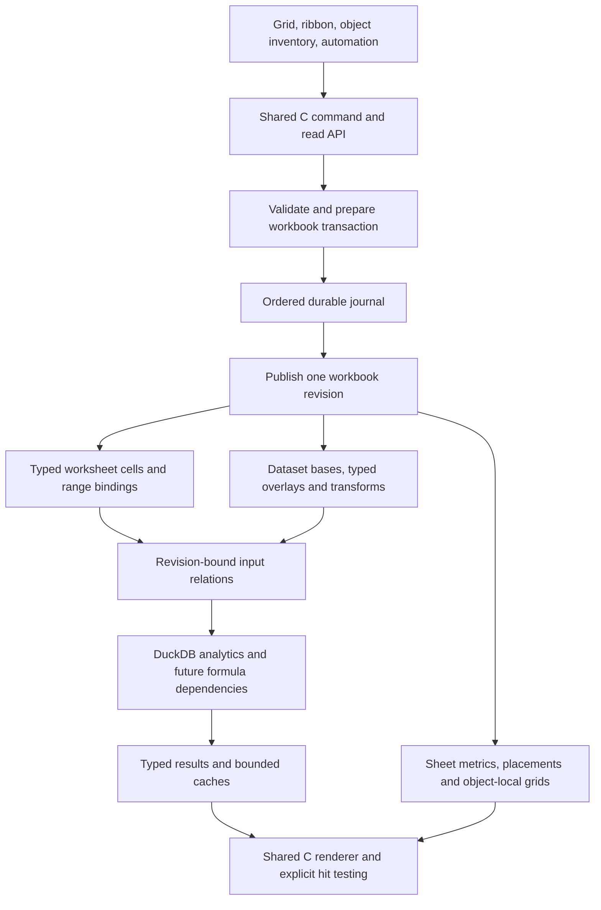
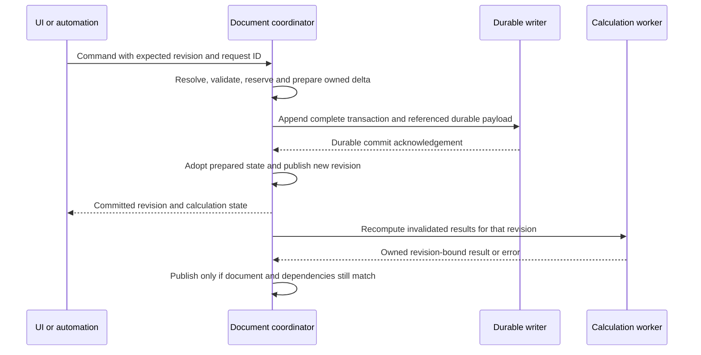

# Workbook editing analytics and versioning TRD Draft

Status: Draft for product and technical iteration. Prepared 20 October 2026 against `b5e6be0e92b9a784027781b78343de51a783e5d3`. Requirements below formalize the supplied product brief; proposed defaults and unresolved decisions remain explicitly identified. This draft does not schedule implementation or supersede accepted behavior in [REQUIREMENTS](../REQUIREMENTS.md).

Duxcel should combine freeform spreadsheet editing with relational analysis and spatial dashboard authoring in one workbook. Users should be able to edit manual cells and eligible imported records, arrange independent analytical objects over a sheet, reference their values, undo workbook changes, retain selected versions and recover committed work. The recommended foundation is a shared C document model and command boundary, with separate data identity, placement, durable history and disposable calculation caches.

The major change is the document contract. A second UI, a separate analytics server and a new rendering engine are unnecessary. SQLite, a workbook archive and platform automation transports are implementation candidates, rather than prerequisites implied by the product behavior.

## 1 Product outcomes and boundaries

The intended outcomes are:

1. A sparse editable worksheet can contain irregular manual content and several independently owned analyses, including tables, pivots and charts.
2. Manual ranges and imported datasets can feed analyses through explicit bindings. A future formula can reference worksheet cells and analytical values without relying on what is currently painted.
3. Users can change eligible imported values and structure without modifying the original Parquet file on every edit. Changes remain inspectable and reversible.
4. Objects can overlap content without destroying it, move from the point actually grabbed, scale independently and optionally align to sheet geometry.
5. One coherent workbook history includes cross-sheet and sheet lifecycle changes. Selected versions remain directly restorable independently of retained fine-grained Undo.
6. Committed work survives an interrupted session, while Save produces a coherent named artifact with fast reopening. Recovery can be deferred without losing the recoverable continuation.
7. UI actions and authorized automation use the same document operations. Core execution can eventually run without a window.

Preserve C99, raylib, DuckDB, exact typed values, explicit ownership and the shared C/Wasm UI. Objective-C remains inside the macOS adapter. Browser storage/automation adapters must not become another spreadsheet implementation. Product automation is distinct from development-only review infrastructure.

General Excel formula compatibility, arbitrary SQL write-back, collaborative editing, cloud sync, VBA/COM compatibility, a complete chart catalog and a complete dashboard layout system are separate capabilities. This design must leave room for them without making them acceptance gates for basic selection, recovery or raw-record editing.

## 2 Verified baseline and architectural fit

This baseline comes from the current source and the four documentation entry points. It establishes source behavior, not new native visual or physical-input acceptance.

| Area | Current implementation | Fit and required change |
| --- | --- | --- |
| Manual cells | `SheetCell` stores `(row, col, text)` in a sorted sparse array. `cells_set` removes an empty input. Limits are 20,000 cells and 4 MiB of text per sheet. | Keep sparse storage; introduce typed values and explicit presence before promising empty-text/NULL editing or formulas. No dense sheet allocation. |
| Selection | Active cell, anchor and extent are separate. `select_region` supplies inferred manual, ready object/source and used-area candidates to the existing selection ladder. | Extend candidate/occupancy semantics. Repeated Select All already exists; it needs refinement, not replacement. |
| Selection drawing | `grid.c` draws an active-cell border and the enclosing range border. | The brief's duplicate-border complaint has a concrete source path. Change visible treatment while retaining the active cell internally. |
| Sheet objects | `SheetObject` has a sheet-local ID, integer row/column placement, row/column extent, source binding and representation definitions. | Reuse object identity/definitions. Add placement modes, z-order, local metrics and explicit hit-test ownership. |
| Occupancy | `objects_fits`, manual-edit guards, source-overlap checks and Save validation reject overlapping content. `objects_hit` returns the first matching array item. | Layering changes a model invariant, not just draw order. Every dependent guard, selector, reader, writer and test needs a migration policy. |
| Geometry | Sheet columns have widths; `Grid` has one row-height scalar. Existing chart resizing changes grid spans within bounds. | Per-row sheet heights, object-local matrix metrics, free placement and true independent scale are new model/codec work. |
| Analytics | Real DuckDB definitions, filters/sorts, Tables/PIVOT/charts and bounded typed Pages. Manual cells are not a general analytical relation or formula runtime. | Add explicit range-to-relation adapters and a common effective dataset for edited sources. Retain current SQL generation. |
| Source formats | Native supported primary/Table paths bind styles to verified source versions and record/field identities. Unsupported scopes suspend. | Build on [source-format identity](SOURCE_FORMAT_IDENTITY.md); styles do not establish universal editable lineage. |
| Undo | `Worksheet` coordinates separate bounded Analysis/Cell/Object/Format snapshot stacks using `EditKind`. App Undo operates on the active sheet. | Preserve existing composite atomicity while migrating to workbook transactions. Sheet identity cannot remain an array index. |
| Save | `.dxls` is a versioned DuckDB database. `workbook_snapshot` copies definitions/presentation/ledgers and excludes Undo and Pages. External sources remain references. | Durable journal, user checkpoints, embedded assets and result caches are new persistence families. Format version 14 is not user version 14. |
| Jobs | Native `QueryWorker` owns its DuckDB connection; jobs are latest-wins with stale-reply guards. Browser uses the official asynchronous Worker. | Keep latest-wins reads. Ordered durable mutations cannot be discarded when a newer viewport request arrives. |
| Commands | `DxCommand` maps native/menu intents into App functions; many changes still call stores and history directly. | Introduce a typed document API behind those entry points. An input enum is not yet a durable command protocol. |
| Recovery and automation | No complete production crash journal, restored Undo, user-tagged checkpoints or live-instance semantic automation API. Review has its own excluded queue/registry. | New product boundaries; do not expose review internals or claim their tests as product acceptance. |
| Browser | Shared C UI and substantial metadata components exist; workbook Open/Save remains unavailable. | Extend the shared schema incrementally and preserve existing codec work. Native completion does not establish browser persistence. |

Source map:

- [Workbook model and history](../../src/workbook/workbook.h), [native writer and loader](../../src/workbook/workbook.c), [shared codec](../../src/workbook/workbook_codec.c).
- [Sparse cells](../../src/workbook/cells.c), [object model](../../src/workbook/objects.h), [object validation and movement](../../src/workbook/objects.c), [formats](../../src/workbook/format.h), [source versions](../../src/workbook/source_scope.h).
- [Grid model and transforms](../../src/grid/grid.h), [input and selection drawing](../../src/grid/grid.c), [selection ladder](../../src/grid/selection_ladder.c).
- [App controllers](../../src/app/app.c): `manual_range`, `commit_cell`, `history`, `select_region`, `move_selection`, `capture_sheet`, `workspace_job`, `request_document_action`.
- [Worker ownership and jobs](../../src/data/worker.h), [database execution](../../src/data/database.c), [SQL definitions](../../src/transforms/analysis.h), [platform commands](../../src/platform/platform.h).

## 3 Domain vocabulary and identity

Use **worksheet cells** for manually authored content anywhere on the sparse sheet. Use **inferred region** for a transient rectangle discovered from occupancy. Use **range binding** for an explicitly retained rectangle or named range. Use **dataset** for a typed relation, **table view** for its tabular presentation and **analysis object** for an independently identified analytical definition/presentation.

An inferred region is a navigation convenience. It is not automatically a persisted object, a dataset schema or the owner of the cells it happens to contain. Tetris-like content cannot always be partitioned unambiguously; allow an explicit range binding to resolve ambiguity.

| Entity | Authority and identity | Contract |
| --- | --- | --- |
| Workbook | Durable document UUID, monotonic revision and ID allocation high-water marks | Owns sheets, datasets, definitions, transactions and checkpoint references. File path is a locator. |
| Worksheet | Stable sheet ID; independent display name/order | Owns sparse manual cells, sheet metrics, range bindings, placements and view state. Rename/reorder preserves references. |
| Worksheet cell | Sheet ID plus logical row/column address | Stores optional typed value or expression. Structural operations rewrite references under an explicit rule. |
| Range binding | Stable binding ID plus sheet/address definition | Declares analytical input, headers, schema and expansion policy. Plain selection does not create one. |
| Dataset | Stable dataset ID, immutable base version and schema/field IDs | Represents a manual-range relation, linked source, retained source or managed import. Dataset identity is distinct from its views. |
| Record | Dataset/base identity plus stable record ID | Never a displayed row index. Inserted records use durable, non-reused IDs. |
| Analysis definition | Stable analysis ID and definition/data revisions | Binds sources, transforms, shelves, measures and representation. Can be located through an object inventory. |
| Placement | Placement ID, sheet ID, referenced analysis/view ID and geometry | Owns location, size, anchor policy, layer/order and optional local scale. Initially one placement per existing object. |
| Result value | Analysis ID plus result generation and local address or semantic group/measure key | Resolves offscreen values. A retained cache entry alone is not a durable analytical identity. |
| Transaction | Transaction ID, parent state, versioned resolved delta and effect set | One atomic user operation can touch several sheets/stores. |
| Checkpoint | Immutable state manifest plus retained asset references | Opens without replay from workbook creation. Physical blobs may be shared. |
| Version tag | User label pointing to a checkpoint | Immutable target until an explicit retag/delete operation. Separate from Latest Saved. |

These are logical contracts, not a requirement for C classes or one heap object per cell. Existing structures should evolve incrementally. A separate definition/placement entity becomes necessary when one analysis has multiple presentations; the first migration can keep a one-to-one representation.

Source-version counters and object ID high-water marks already protect identity allocation outside Undo. Extend that principle to workbook/sheet/dataset/field IDs: Undo may restore an old binding but cannot recycle an issued identity. A durable UUID identifies a copied document lineage only under the Save As policy in section 14.

## 4 Logical layers and references

Logical separation should allow the same analysis to appear on a sheet and be revealed through an inventory/inspector. That inventory selects/reveals the existing object; it must not create another query authority or force the current bottom-pane design. A later dashboard can reuse definitions with its own placements.

### 4.1 Overlap does not define a cell value

Two objects can cover `B7` visually and still have different local values. Z-order alone cannot decide what `=B7` means: moving a chart to the front would otherwise change calculations. Separate visual coverage, input ownership and value ownership.

**Proposed default, pending D02:** worksheet addresses read the worksheet value plane, including any explicitly registered source/table projection. Floating analytical objects do not silently claim those addresses. Object values use qualified references, with a UI gesture to insert the appropriate reference while authoring a formula. Grid alignment is geometric and does not automatically register a projection.

Two object-reference forms are needed conceptually; syntax remains open:

- Positional: a particular analysis's local result row/column. It can legitimately return a different group after sorting.
- Semantic: an analysis's group keys, measure and subtotal/grand-total role. It follows that analytical value across layout changes, returning a reference error if the group disappears.

This is a substantive interpretation of the brief's shared-cell-reference goal. If ordinary A1 references must address overlaid object output, introduce an explicit projection/alias rule with ambiguity errors or declared priority. Do not make formula binding depend on paint order. Preserve existing primary-source address conventions during migration; current source headers are chrome and object outputs have local header/title offsets.

Copy/statistics/read APIs must name the selected owner. Explicitly offer underlying worksheet cells, object result cells or a named mixed selection. A rendered composite is useful for image export but is not automatically a typed rectangular data export. Editing an aggregate does not imply write-back to its underlying rows.

### 4.2 Typed values and manual analytical input

Keep raw input/expression, typed logical value and formatted display separate. A sparse missing coordinate has no entry and reads with the established NULL semantics. Explicit SQL NULL, present zero-length text and text `NULL` retain distinguishable value/presence metadata; no synthetic blank storage category is introduced. Integers and DECIMAL retain exact canonical representations rather than round-tripping through `double`.

A range-to-relation adapter needs explicit rules for headers, duplicate/empty names, type declarations/inference, missing positions and formula errors. Keep generated field IDs stable across header renames. A refresh that changes schema must invalidate or repair consumers; it must not rebind by similar display names. Define whether a binding grows on append and how insert/delete transforms its boundaries.

SQL and future spreadsheet formulas are different evaluators with shared types and dependency revisions. Manual data may be exposed as a managed relation through batched updates; each keystroke need not issue SQL. A pivot over a bound range updates after the cell transaction commits. A manual formula reading that pivot can form a cycle: detect and report it before publishing a mixed-generation result. Do not promise a general formula engine as a side effect of adding bindings.

Row alignment has three meanings: visual alignment, positional reference and relational key alignment. Equal screen rows do not establish a join. UI alignment must not silently create a data relationship.

## 5 Functional requirement inventory

The IDs below are discussion and future acceptance identifiers. **Brief** denotes an expressed product outcome; **Derived** denotes an engineering requirement needed to deliver it safely; **Future** denotes a direction whose complete scope is still open. Proposed semantics are detailed in subsequent sections.

| ID | Origin | Required behavior | Principal dependency |
| --- | --- | --- | --- |
| WM01 | Brief | Support sparse manual content and independent analytical objects on the same sheet. | Preserve existing stores; explicit ownership |
| WM02 | Brief | Expand Select All through deterministic containing regions to the sheet, without turning inferred regions into permanent tables. | Occupancy contract and existing selection ladder |
| WM03 | Brief | Bind an explicit manual range as analytical input and update its consumers. | Typed cells and range-to-relation adapter |
| WM04 | Brief | Reference worksheet and analytical values from future formulas, including offscreen results. | Reference contract and formula dependency runtime |
| WM05 | Brief | List/reveal/edit analyses independently of their location on the sheet. | Stable identities and object inventory |
| WM06 | Brief | Retain object-local formatting and representation state across movement and version restore. | Owner-scoped styles and codec |
| DE01 | Brief | Edit an eligible imported record, insert/delete records and add/change fields without mutating the original file. | Base identity, schema evolution and effective relation |
| DE02 | Brief | Inspect reproducible transformations and resolved record edits as meaningful steps and SQL where applicable. | Typed operations, bound parameters and read-only SQL presentation |
| DE03 | Derived | Apply edits consistently to viewport, filters, sort, pivot, chart, statistics, copy and export. | One effective relation and revision fence |
| DE04 | Derived | Keep duplicate physical records, explicit NULL patches and inserted records distinct. | Stable record IDs and patch-presence metadata |
| DE05 | Brief | Reorder displayed fields/rows deliberately and preserve formats/references. | Distinguish sort, display order and schema operations |
| HI01 | Brief | Undo/redo document changes in workbook chronology, including cross-sheet operations. | Workbook transaction history |
| HI02 | Brief | Undo sheet deletion and restore its cells, objects, bindings and references. | Stable sheet IDs and retained deletion payload |
| HI03 | Brief | Replay/redo independently of later application preference changes. | Resolved commands and versioned semantics |
| HI04 | Brief | Retain fine-grained Undo over a configurable recent version window, including selected reopen boundaries. | Durable history, pruning and checkpoint reachability |
| VE01 | Brief | Create manually named versions with direct state restoration. | Immutable checkpoints and retained assets |
| VE02 | Brief | Save repeatedly into one Latest Saved entry; share identical state with manual tags. | Mutable saved pointer and checkpoint deduplication |
| VE03 | Brief | Restore a complete version without replaying all earlier operations. | Complete state manifest and required assets |
| VE04 | Brief | Open quickly with retained analytical presentation/results; preserve offscreen authored state. | Cache policy distinct from complete document state |
| RE01 | Brief | Journal committed document operations and detect an unfinished session. | Ordered durable writer and session generation |
| RE02 | Brief | Offer fast checkpoint open or latest committed-state recovery after an unsaved/interrupted session. | Candidate replay, progress/cancel and preserved journal |
| RE03 | Derived | Handle failed commits, partial Save, disk exhaustion and ambiguous acknowledgements without silent loss or duplicate edits. | Failure protocol and idempotency |
| AU01 | Brief | Route UI and automation through the same semantic operations. | Shared C command boundary |
| AU02 | Brief | Query/manipulate an authorized running instance through a platform transport. | Protocol, capability scope and instance routing |
| AU03 | Future | Run document/analysis operations without a window and optionally render separate previews. | Headless core with optional rendering host |
| LA01 | Brief | Overlap analytical objects and worksheet content with reversible layer ordering and no destructive spill. | Layer/ownership model and persistence migration |
| LA02 | Brief | Move and scale analytical objects freely using their local coordinate frame. | Free placement and transform/hit-test model |
| LA03 | Brief | Fit a matrix's local rows/columns to the existing sheet grid. | Explicit grid-alignment mode |
| LA04 | Brief | Fit sheet row/column metrics to a matrix's displayed local metrics in one undoable operation. | Per-row metrics, impact preview and composite transaction |
| LA05 | Brief | Fit a chart to a chosen sheet rectangle without altering sheet metrics. | Geometric bounds and explicit target range |
| UX01 | Brief | Show one outer selected-range boundary without a second equally active cell border. | Selection paint contract |
| UX02 | Brief | Move a selected range/object from its border or by Option/Alt-dragging its interior. | Focus/gesture arbitration and platform bindings |
| UX03 | Brief | Preserve the grabbed point/cell while dragging, with a truthful destination preview. | Captured local grab offset and coordinate transforms |
| UX04 | Brief | Detect offscreen destination conflicts before destructive cell moves and expose an actionable warning. | Full-model destination validation |
| PL01 | Derived | Preserve existing native files and shared-C browser codec progress during schema changes. | Explicit migrations and platform acceptance |
| PL02 | Derived | Keep work bounded and responsive on the current 8 GB Mac. | Measured memory, latency, checkpoint and retention budgets |

## 6 Command and transaction contract

### 6.1 Distinguish operations from UI events

All controllable actions should have semantic entry points. Only document mutations belong in document Undo and the recovery journal. Pointer samples, hover, selection, pan, focus and pane searches remain transient actions. View restoration can persist a coalesced bookmark independently. Copy is a read/clipboard effect; Paste journals the resolved pasted values, not a future read of the system clipboard.

Global settings remain outside workbook history. Workbook semantic settings, such as calculation timezone, date parsing and interpretation policy, affect results and must be versioned with the document or explicitly resolved into commands. Formatting and row/column metrics are document presentation mutations. Selection, window size and personal ribbon density are session/application presentation. Decide any exceptional workbook preferences in D08.

Separate the command requested by an actor from the delta accepted by the document. For example, Paste from current selection becomes a concrete set of cells; Delete filtered rows becomes a frozen record-ID set; Snap becomes exact target geometry and sheet-metric changes. Redo applies the resolved delta without repeating external reads or UI gestures.

Suggested command families are `SetCells`, `ClearCells`, `PasteValues`, `MoveRange`, `InsertSheetRows`, `DeleteSheetColumns`, `CreateSheet`, `DeleteSheet`, `RenameSheet`, `ReorderSheets`, `BindRange`, `EditDatasetCells`, `DeleteRecords`, `AddField`, `ChangeTransform`, `SetFormats`, `MoveObject`, `ResizeObject`, `SetObjectLayer`, `SnapObject`, `SetWorkbookPolicy`, `Undo`, `Redo`, `SaveCheckpoint` and `CreateVersionTag`. Names are illustrative API vocabulary, not an agreed ABI.

Each mutation envelope carries a protocol/schema version, document ID, request/idempotency ID, expected revision and explicit target identities. Its resolved record includes parent/new revision, before/after values or retained blob references, affected stores/dependencies, and command semantic version. Bulk payloads are bounded blobs, not millions of independent transactions. Counters and IDs must fail on overflow rather than wrap.

### 6.2 Commit and publication order

This is the proposed durable-by-default contract. An optimistic UI preview is allowed while IO is pending, but it must not claim durability. Allocate/validate before durable commit so normal adoption cannot fail halfway. If a committed transaction cannot be adopted because of an exceptional runtime failure, stop further mutations and reload/recover it; do not continue from a divergent RAM model.

Serialized document mutations establish a total order even when an agent and a user act together. Preconditions reject stale writes rather than editing a target derived from old selection state. Check completed request IDs before revalidating a retry's now-stale expected revision; return the original outcome for the same payload and reject reuse with different payloads. Persist enough deduplication information to cover the promised retry window. Cancellation before commit discards preparation; after commit it cannot erase the accepted operation.

Definition commit and calculation completion are separate statuses. A source edit can be durable while its pivot says Updating. Queries used for validation may run before commit; errors must preserve the old definition when the command promises validated application. Later resource/source errors retain the accepted document and a labelled stale/error result, rather than rewriting history. Automation receives a ticket/revision and can wait for the required analytical result.

### 6.3 Replay and Undo semantics

Replay operates on document data, never by re-enacting keystrokes or button presses. It must not reopen dialogs, import a changed file, send a clipboard operation or execute an untrusted saved SQL string as an arbitrary command.

Resolved deltas make redo deterministic with respect to edited document state. Idempotency is a separate guarantee provided by request deduplication; a command such as Add Sheet is not inherently idempotent. Recomputing analytical results additionally requires pinned inputs and compatible semantics. Capture or materialize outcomes of nondeterministic/external operations when exact replay is promised. Do not assume unchanged SQL text produces identical values across time or engine upgrades.

## 7 Imported data editing and transformations

### 7.1 Effective relation

Use an immutable source base plus typed overrides, inserted records and delete tombstones as the first sparse-edit model:

`effective dataset = base with present field patches, excluding deleted record IDs, union inserted records`

Apply this relation before downstream filters, sort and aggregation. A changed value may enter or leave a filter. Every consumer must read the same dataset revision, including full-range statistics and export. Modifying only a loaded `Page` would produce conflicting answers.

For a sorted display row representing source record 8,431, target record 8,431 and its field ID. Row 7 in a Page is not the edit address. Duplicate rows remain independent records. Distinguish no patch, a present NULL patch and a present empty-string patch; `COALESCE(patch, base)` cannot express this correctly.

Native raw-source provenance is a useful prerequisite, not general SQL lineage. Begin with individually identifiable direct CSV/Parquet records and fields. DISTINCT, aggregates, joins, computed projections and arbitrary custom SQL remain read-only until a specific inverse/write-back rule exists. A read-only result may explicitly be materialized as a new managed dataset with its own IDs.

### 7.2 Schema and order

Add Field is a schema operation with field ID, type, default/expression and backfill policy. Editing a cell enforces or explicitly changes that type. A computed field's formula, a constant column and a patched physical field have different semantics. Field rename/reorder must preserve bindings; drop/type change must invalidate dependents predictably and retain what Undo needs.

Distinguish source transforms from sheet structure. Delete Records removes selected dataset rows, whereas Delete Sheet Rows moves worksheet content and placements. Display-column reorder is different from dropping/adding relation columns. A manual row order needs explicit durable order keys; relational rows do not acquire a permanent user order from their current viewport. Sort ties need a deterministic tiebreaker. DuckDB documents order changes through joins/grouping and potentially unstable sorting; do not promote query position into identity. [DuckDB order preservation](https://duckdb.org/docs/current/sql/dialect/order_preservation).

The current `Analysis` is a structured definition with session history snapshots, not a general DDL/DML event log. Keep a user-facing transformation history separate from the durable document journal. Format/move commands belong in document history but not the SQL transformation chain. SQL is useful inspectable output from typed operations; raw SQL strings alone omit before-images, affected IDs, parameters and nonrelational state.

### 7.3 Compaction and source retention

A sparse overlay is not assumed to remain efficient for millions of changes. Benchmark overlay joins against managed DuckDB tables and compacted Parquet bases. Compaction creates a new immutable base/manifest, preserving record/field IDs or recording an explicit migration. Retained tags/Undo pin old bases. Never compact by overwriting a base still referenced by a version.

Offer distinct **linked source** and **retained/managed source** policies. Linked mode minimizes duplication but cannot promise exact old-version reconstruction after external bytes disappear. Retained mode copies or snapshots source bytes and can satisfy portable restore within a stated storage budget. A content hash proves identity; it does not retain data. Missing/changed linked inputs must suspend edits/analyses or require explicit relinking, never silently reapply patches to new rows.

## 8 Workbook history and named versions

### 8.1 One workbook chronology

Use one workbook mutation order by default. A transaction changing two sheets is undone as a unit. Deleting a sheet retains its stable ID, contents, analyses, placements and reference state for restoration; hiding/reordering is not deletion. Undo may reveal the affected sheet to explain the operation, without changing which operation is undone.

Do not initially expose a toggle for independent per-sheet Undo. It becomes selective Undo once references cross sheets and requires dependency/conflict analysis. A filtered history view is safe; skipping intervening dependent mutations is a different feature. This follows the brief's later preference for coherent workbook-wide history.

Keep the durable revision sequence monotonic. Undo/Redo append resolved state transitions with links to the original user action and update the user-history cursor/stacks. Recovery replays those transitions, including cursor changes, rather than assuming that every logged mutation is another undoable user edit. Undoing an Undo must not recursively add endless user-history entries.

New edits after Undo clear the current Redo branch. Previously tagged checkpoints remain reachable. Initial history UI is linear; a general branch graph is deferred. Previewing an old version is read-only. Restoring it creates a new current revision/checkpoint target after preserving the previous recoverable state, rather than silently deleting later work.

### 8.2 Save and tag state machine

Use three distinct concepts:

- **Working Head:** latest accepted document revision, with a separately known durable revision.
- **Latest Saved:** a single replaceable pointer to a complete checkpoint in the named workbook artifact.
- **Named Tag:** an explicitly retained label pointing to an immutable checkpoint.

Save writes a coherent checkpoint for captured revision R and updates Latest Saved only after successful publication. It does not append a new named tag. Create Tag writes/reuses a checkpoint and durably retains its label; the proposed default also updates the named workbook, matching the brief's expectation that a tag survives closing. An untitled workbook needs a destination on its first user Save/Tag, while recovery can already protect its session.

| Sequence | Expected visible history |
| --- | --- |
| Edit, Save, close, reopen, Edit, Save | One Latest Saved entry; no automatically multiplying named versions. |
| Edit to R10, Create Tag V1 | V1 and Latest Saved can reference the same checkpoint. Show one state with both labels if useful. |
| Continue to R20, Save repeatedly | V1 still points at R10. Latest Saved advances; intermediate automatic saves do not become named tags. |
| Create Tag V2 at unchanged R20 | Reuse the existing state payload; add V2's label. |
| Open V1 in preview | Current head and recovery continuation remain intact. |
| Restore V1, then edit | Start a new current lineage; retain V1 and other named tags, clear incompatible current Redo. |

Deduplicate checkpoint content/manifests, not just revision numbers: two revisions may describe equal content, while equal SQL text over changed source bytes is not equal state. View bookmarks can have a separate generation so a pan alone need not duplicate a large dataset snapshot. Automatic recovery checkpoints are implementation artifacts and do not create user-visible versions.

### 8.3 Retention and pruning

Expose recent **tag intervals** as a user-understandable Undo preference, with additional byte/age/operation limits. For ten retained checkpoints T1 through T10 and a three-interval setting, keep the fine-grained transitions T7→T8, T8→T9 and T9→T10, plus the current unsaved suffix. Every earlier named checkpoint remains directly openable without its intermediate operations. The moving Latest Saved boundary and repeated Saves need a stable internal retention anchor; they cannot arbitrarily reset or multiply the window.

Default reopen behavior remains an explicit product decision: session-only Undo versus bounded cross-session Undo. The later brief asks for configurable cross-session retention, so the proposed first UI offers a stated default and makes the retained range visible. Do not promise all-time history.

Prune only after replacement checkpoints and their manifests are durable. Reachability includes named tags, Latest Saved, active head, retained Undo/Redo, recoverable continuations, historical preview and in-flight Save/read snapshots. Enforce storage limits without deleting the only recovery path or silently evicting a named tag. Tag deletion can free data only after all other references retire. Large intervals may exhaust budget even when their count is small.

## 9 Checkpoints caches and file packaging

### 9.1 Complete document state

A checkpoint must contain all authored cells, expressions, schemas/field identities, overlays, transformations, sheet structure/metrics, bindings, object definitions/placements/styles, semantic workbook policies and required source/asset references for that revision. It is independent of viewport coverage. It may share immutable chunks with other checkpoints, but its manifest must resolve without replay from an earlier tag.

Separate completeness of authored state from completeness of evaluated output. For linked mode, an independent checkpoint still has declared external dependencies; only retained inputs can guarantee a self-contained portable version. A snapshot of RAM Page caches cannot satisfy either document completeness or full analytical-output completeness.

### 9.2 Analytical caches

Persist typed result caches and layout metadata rather than only screenshot/GPU textures. Key them by source/base/overlay versions, definition and schema, relevant workbook policy, engine/codec compatibility and result completeness. A result cache can be accepted for historical display while its refresh is unavailable; label that state and do not combine old values with newly computed dependents.

**Proposed default, pending D06:** Save always captures complete document state and bounded caches for fast reopening. Large full-table outputs remain queryable on demand. Users can request a frozen/full analytical result when it must remain readable without recomputation or source access. If full outputs are mandatory for every Save/Tag, make that an explicit stronger mode with progress, cancellation, disk quota and pending-analysis rules. The implementation cannot silently reduce that guarantee to the visible 256 rows.

Distinguish object scale/format/layout from query result data. Formatting and movement normally invalidate layout/paint, not SQL aggregates. Row/column edits may invalidate reference mapping and layout. Formula/input edits invalidate affected calculation dependencies. This reduces unnecessary Save and recalculation work.

### 9.3 Storage topology options

| Option | Advantage | Cost and decision gate |
| --- | --- | --- |
| Extend the existing DuckDB `.dxls` plus private recovery journal | Preserves native codec/file compatibility and current work. One engine already ships. | Measure small-write latency and checkpoint contention; design coordination with the analytical worker. |
| SQLite recovery journal plus existing DuckDB `.dxls` | Candidate for frequent small durable edits while keeping existing Save/Open. | Adds a shipped native dependency and browser backend work. No automatic atomic commit across the two databases. |
| Managed package with manifest, transactional metadata and immutable assets | Can contain retained Parquet, historical chunks and caches without whole-source duplication per version. | New package reader/writer, migration, admission, portable export, interrupted publication and integrity rules. |
| One new primary database format | Potentially simpler future transaction authority. | Largest migration risk; compare against extending the existing format before adopting. |

**Recommended starting point:** retain native `.dxls` compatibility, introduce a journal interface and measure the first two options before selecting its backend. Do not start by converting the workbook to tar.gz. A compressed archive cannot itself provide per-command transactions and needs a separate working store and atomic export policy.

If SQLite is selected, use one workbook/session transaction authority, not one unrelated database per sheet. Its role is transactional metadata/journaling; DuckDB remains the analytical engine. SQLite WAL is an implementation log and checkpoint mechanism, not the product's user-version history. WAL has one writer and durability depends on sync policy. [SQLite WAL](https://www.sqlite.org/wal.html). A consistent live export can use the documented backup interface rather than copying a changing database file. [SQLite backup API](https://www.sqlite.org/backup.html).

For dual stores, the authoritative sequence is journal commit → prepared model adoption → derived DuckDB/cache updates. A durable manifest ties Save to exact document ID/revision and immutable payload hashes. Required payloads become durable before the manifest references them; publish the completed snapshot before advancing Latest Saved or trimming its recovery prefix. Test crashes at every boundary. Do not pretend two independent SQL transactions constitute one atomic workbook commit.

Keep product recovery/retained assets in durable platform user-data storage or an explicitly owned workbook working store, outside ignored `build/` and temporary query-spill paths. Generated tests and fault-injection artifacts remain under `build/tests/results/`. Never expose a SQLite WAL or other live sidecar as the only file a user must remember to copy.

### 9.4 Proposed persistence records

These are logical record families for the selected backend, not committed SQL table names or a second generic workbook writer.

| Family | Minimum contents and invariant |
| --- | --- |
| Document and session | Document ID, format/command semantic versions, allocation high-water marks, accepted/durable/saved revisions, session generation and closure state. |
| Transactions | Transaction/request ID, actor, parent/new revision, command kind/version, resolved payload hash/reference and affected owners. Commit only complete records. |
| User history | Original action IDs, grouping, Undo/Redo links and current cursor/branch metadata. Reopening reconstructs the promised retained user history. |
| Payloads | Typed before/after chunks, deleted-sheet state, frozen record selections and any nondeterministic accepted outputs. References carry size/hash and lifetime ownership. |
| Checkpoint manifests | Complete logical state root, source/asset roots, semantic policy and optional cache roots for one revision. Publish only after required chunks are durable. |
| Tags and saved pointer | Named tag to immutable manifest binding and one replaceable Latest Saved manifest binding. Tag labels do not duplicate datasets. |
| Assets and source bases | Dataset/base identity, retained content hashes, size/type and either retained bytes or an explicitly external dependency. |
| Result caches | Definition/data/policy compatibility key, typed schema/data, completeness and historical/frozen status. Cache eviction cannot invalidate document history. |

Database transactions/WAL protect record writes; these application records define Undo and user versions. A manifest root or payload reference cannot be pruned while a retained record still requires it. A portable file must carry the promised retained-history subset, not an unresolvable pointer to private session storage.

## 10 Recovery Save and close lifecycle

Replace a single dirty flag as the conceptual model with document ID, accepted head revision, durable journal revision, saved checkpoint revision, session generation and saved-view/cache completeness. The existing dirty flag can remain a derived UI signal during migration. Head equality and content equality are different when Undo returns to saved content.

| Event/state | Required outcome |
| --- | --- |
| Prepared command, no durable acknowledgement | Show pending/unsaved state; never claim crash protection. Commit failure leaves the accepted model unchanged. |
| Crash after commit but before UI acknowledgement | Recover the committed transaction once; retry returns its recorded outcome. |
| Crash with committed suffix beyond Latest Saved | Offer Open saved checkpoint, Recover committed changes and Cancel, with revision/time and recovery estimate where known. |
| User chooses fast checkpoint open | Preserve the recoverable continuation. First mutation requires recovery or an explicit new lineage/copy decision so it cannot overwrite the deferred tail. |
| Recovery underway | Build a separate candidate with progress/cancel. Activate it atomically after validation; keep old checkpoint/tail on failure. |
| Save of R finishes while head is R+N | Mark R saved, retain R+N as unsaved/recoverable. Late completion cannot clear newer dirty state. |
| Save canceled or IO fails | Preserve old artifact, working state and journal. Report the actual remaining durability. |
| Normal close after successful Save | Record session closure only after the intended saved/durable boundary and writer shutdown protocol. |
| Close with committed but unsaved edits | Apply the explicitly selected Save, keep for recovery, discard or cancel policy. Fast close can retain a recoverable suffix without full materialization. |
| Explicit discard | Deliberately retire the relevant continuation after identifying its scope; never treat a crash as discard. |
| Disk full, permission loss or writer failure | Retain the last durable state, stop claiming protection, preserve pending work and expose retry/Save As/copy options. Do not silently continue a guaranteed-durable mode. |

A clean-exit marker is diagnostic, not sufficient proof that no unsaved work exists. A deliberate fast quit may be clean but leave head newer than Latest Saved. Compare durable/saved revisions and session ownership. A stale lock cannot be broken solely because a process ID is absent; verify the document/session identity and platform ownership policy.

The brief moves between autosave and explicit Save. Proposed default: per-command local recovery durability plus explicit named-file Save; consider optional named-file autosave separately. This keeps Save meaningful for portability, checkpoint consolidation and reassurance. Define crash versus power-loss guarantees and batch/group-commit latency rather than assuming every database COMMIT has the strongest disk guarantee.

## 11 Layered placement and grid alignment

### 11.1 Geometry and ownership

Model the worksheet as a value plane plus independent analytical placements and UI selection/interaction layers. Persist layer/order explicitly; use the same stable ordering for paint and hit testing. Permit the base sheet plane to appear above/below analyses, and optionally per-object ordering. Decide transparency for absent cells, fills, object backgrounds and empty areas: an opaque infinite worksheet plane would make an object sent behind it unreachable.

An object moving over data changes only placement. It does not call Paste, write result cells into `CellStore` or transfer underlying formatting. Access covered content through the object inventory, cycle/select-underneath action or an explicit sheet-edit mode. Pointer ownership belongs to the frontmost eligible target; keyboard authoring focus and underlying cell selection remain explicit.

Retain three separate geometries:

- Sheet layout: cumulative column widths and row heights in unscaled document units.
- Object layout: local matrix row/column metrics or chart bounds, local scale and local pan where supported.
- View transform: sheet zoom, UI scale, scroll/frozen planes and device pixels.

Persist document geometry, not framebuffer coordinates. Apply and invert the same transforms for drawing, hit testing, selection and dragging. Test variable metrics, frozen columns and zoom rather than assuming a uniform row grid or multiplying screen pixels into stored positions. Sparse row-height overrides and indexed cumulative geometry avoid dense per-row allocations.

### 11.2 Explicit alignment modes

| Mode/action | Exact effect | Impact on other content |
| --- | --- | --- |
| Free placement | Retain unscaled position, bounds and local scale, optionally with a cell anchor plus offsets. A matrix keeps its own grid. | Can cover content; underlying data is unchanged. |
| Snap matrix to sheet | Choose a concrete anchor and map its local rows/columns one-to-one to the target sheet rows/columns. Local display metrics adopt sheet metrics; define title/header/total participation. | Does not change sheet widths/heights. |
| Fit sheet to matrix | Resolve the matrix's displayed local metrics into target sheet row/column metric changes and align placement. | Changes every use of those sheet rows/columns, including offscreen cells and other anchored objects. |
| Fit chart to range | Set chart bounds to the edges of an explicit/previewed sheet rectangle; the chart has no invented cell grid. | Does not change sheet metrics. |
| Detach from grid | Capture current displayed bounds/local metrics as free placement. | Values and references stay bound to the same analysis. |

Fit sheet to matrix must preview the affected row/column spans and use one transaction for metrics plus placement. Competing snapped objects may request incompatible widths/heights; choose a policy such as reject with affected-object details or explicitly detach/update affected placements. Do not silently let the last pointer event redefine other objects' layout contracts.

Nearest range is ambiguous. Resolve a deterministic anchor, span, distance/tie rule and sheet-bound clamp before commit, then persist the resolved result. Charts can snap to the nearest previewed bounds or a user-chosen range; whether a matrix preserves its row/column count through scaling is a separate rule. The default is one local result row/column per target row/column when snapped; free scale does not change analytical cardinality.

Define what happens when a pivot grows after refresh. A free placement may keep frame size and scroll/clip; an aligned view may grow its footprint or stay bounded. Growth must never erase cells. Sheet metrics do not auto-change on every pivot refresh merely because Fit sheet was used once. Decide dynamic alignment policy in D10.

### 11.3 Existing overlap invariants

Replace the single `objects_fits` concept with distinct validations: worksheet bounds, placement overlap policy, destructive cell-move conflicts and source-write eligibility. Audit `manual_range`, `source_overlap`, history restoration, object hit testing, range plans, copy/statistics routing, source-format publication, Save/Load and shared browser validators. Removing one collision check would leave invalid saved workbooks or ambiguous input behavior.

Manual range selection must not automatically include every visually covered object when moving cells. Preserve an explicit operation scope: cells only, selected placement, or a deliberate compound selection. The current range planner's contained-object behavior needs a compatibility decision under overlap.

## 12 Selection and dragging contracts

**Selection appearance:** for a multi-cell selection, render one outer active boundary. Retain the active cell/anchor for keyboard navigation, formula entry and traversal, using a subdued interior cue if needed. Object frame selection, matrix cell selection and chart-mark selection must remain visually distinct. A single cell may have one active border. This is a focused change that can ship before durable history.

**Region discovery:** start from the current finite selection and offer strict containing supersets. Use explicit binding/object/result bounds before broader inferred/used-area bounds, with deterministic tie rules. Define diagonal adjacency, blank separators, holes, formatting-only coordinates, zero-length text, SQL NULL and future formulas returning empty text. The existing manual bounding-growth heuristic can merge irregular islands; no inference rule should claim that it knows the user's intended table. Candidate discovery must not scan a dense sheet or infer occupancy from cached Pages alone.

**Gesture arbitration:** border drag moves an already selected range/placement. Option on macOS/Alt elsewhere plus interior drag requests the same move intent, subject to focused controls/editor/popup ownership. During text editing, Option remains available to text/IME behavior. Set a drag threshold to distinguish selection/click from movement; retain visible keyboard/menu Move alternatives. Escape cancels the preview and creates no document transaction.

Capture the source geometry, target identity, document/metric revision and the actual local grab point at pointer-down. For a grid range, retain the grabbed cell's row/column offset within the selection. For free placement, retain its local continuous coordinate. Resolve the preview from that point, not by snapping the object's origin under the cursor. At sheet bounds, clamp the whole selection and show the actual result without implying that an impossible pointer anchor was preserved.

With free-object transform `T`, local grabbed point `q` and pointer in document coordinates `p`, translation is chosen so `T(q) = p`. With a snapped range, target origin is the target pointer cell minus the captured cell offset. Variable-width cells require cell-aware mapping; a fixed pixel delta is insufficient. If subcell fractional anchoring is desired for snapped objects, define it explicitly rather than promising both exact pixel anchoring and exact grid alignment.

For a three-row selection grabbed in its second row, dropping the pointer on row 10 places the selection starting on row 9, within bounds. Dragging a free chart from its lower-right interior keeps that interior point under the pointer. The current border-drag code already captures a grabbed row/column delta; extend and verify it instead of assuming all movement starts at the upper-left corner.

Validate the complete destination from the model, including offscreen cells and intervening metric/source changes. Floating overlap needs an occlusion cue, not a destructive-overwrite warning. A manual move into occupied cells requires explicit replace/cancel or a safely rejected move; a bottom status message alone cannot authorize data loss. Moving a range partly over itself uses one atomic plan, not sequential clearing and pasting. On commit store exact before/after targets and affected values/styles/references, without pointer-move history. A drag is one Undo action.

## 13 Automation and headless execution

Create an in-process C document API first. UI intents, tests, a future CLI and platform IPC adapters call it. Core reads include document/revision metadata, sheets/objects, typed cell/range/result queries, schemas, source status, history and operation status. Read requests name a revision or receive one explicitly; paginated results cannot silently mix revisions. Prefer semantic IDs and values to screenshot coordinates for ordinary agent work.

The running app remains the owner of its workbook. External clients send bounded messages; they do not write `.dxls`, recovery journals or DuckDB tables behind it. DuckDB's documented in-process read/write model supports this ownership choice. [DuckDB concurrency](https://duckdb.org/docs/current/connect/concurrency).

Proposed transports are a user-scoped Unix-domain socket on macOS/Linux and a named pipe on Windows, behind one versioned protocol. Exact transport selection is deferred; COM or D-Bus wrappers may be added for ecosystem integration without defining document semantics. Browser control needs a separately authorized message/host bridge into the shared C API, not an assumption that native IPC exists in Wasm.

The protocol needs capability negotiation, explicit instance/document routing, stable error codes, revision preconditions, bounded payloads, request deduplication, pagination, asynchronous completion/cancel and local authorization. No listener is required by default. Local filesystem/user permissions and a scoped session capability should protect an enabled endpoint. Opening/importing/exporting files and executing SQL remain declared capabilities, not implicit privileges of a read-only client. This is product automation, with separate build/runtime controls from the development-only review bridge.

Headless means document transactions, typed reads and analytical execution can run without raylib window/GPU/platform dialogs. Hidden-window mode still has rendering/context dependencies and is a different execution profile. Screenshot/render export is an optional renderer host with deterministic size/scale and an explicit completion barrier. Extract core lifecycle incrementally from App; do not describe a hidden test window as a headless engine.

## 14 Migration and platform contracts

### 14.1 Code ownership changes

| Existing area | Proposed change and boundary |
| --- | --- |
| `src/workbook/workbook.*` | Own stable workbook/sheet identity, revision and transaction adoption. Make live document authority explicit instead of relying on active App copies being captured before Save. |
| `src/workbook/cells.*`, `objects.*`, `format.*` | Add prepare/adopt APIs that produce owned deltas without independently appending a second history entry. Retain existing atomic range/format plans during migration. |
| New narrow command/history modules in `src/workbook/` | Validate typed targets, resolve mutations, coordinate one workbook history and return an effect/invalidation plan. No raylib, platform dialogs or IPC parsing. |
| New journal/checkpoint seam beside workbook persistence | Own serialized record codecs, durable completion, replay, checkpoint manifests and retention. Keep backend-specific handles behind the seam. |
| `src/transforms/` and `src/data/` | Generate/execute the effective dataset and range relations; carry data/definition revisions and lineage. Keep SQL semantics out of UI gestures. |
| `src/data/worker.*` and browser bridge | Separate latest-wins reads from ordered writes and long-running preparation. Define cancellation/publication before selecting extra threads or connections. |
| `src/grid/` | Own selection/drag state and reversible geometry transforms; expose resolved intents rather than mutating persistent stores from painting. |
| `src/ui/` | Render the accepted value/layout state and distinguish selection, owner and result status. Drawing must not query or commit. |
| `src/app/app.c` | Integrate document lifecycle, command dispatch, scheduling and publication through extracted cohesive controllers. Keep one App/shared-interface owner and move scenarios to test-only boundaries incrementally. |
| `src/platform/` and `web/` | Adapt durable locations, IO/picker permissions and authorized IPC/host messages. Preserve shared C domain/command semantics. |
| `tests/`, `tools/tests/`, `web/tests/` | Extend existing model/engine/native scenarios and external/browser fault orchestration with named consumers; keep generated recovery files private. |

The first command slice should wrap an existing manual-edit path end to end before converting every handler. Use one history authority per converted operation; avoid a transitional state where both store snapshots and the new workbook history independently undo it. Later extractions follow concrete ownership needs rather than a broad App rewrite.

### 14.2 File and identity migration

1. Introduce stable document/sheet identities and a workbook revision independently from `analysis_revision`, request IDs and sheet indices. Legacy files receive identities in a validated candidate; persist the mapping only through a successful new-format Save. Preserve existing object/source high-water marks.
2. Migrate existing objects to an explicit legacy aligned, non-overlapping placement mode. Preserve current source-header/address behavior and verified format owners. New overlapping/free states require a schema version that older writers cannot silently flatten or discard.
3. Add metadata families through the shared C codec inventory, admission budgets, validation, writer and native/browser adapters. A native-only new format must fail clearly in unsupported browser readers while existing supported files retain their current component behavior.
4. Keep candidate loading and atomic App publication. Validate duplicate IDs, dangling owners/references, malformed journals/manifests, unsupported command versions, oversized payloads and asset integrity before activation. Archive extraction must reject path traversal and excessive expansion if a package is selected.
5. Save As must declare whether it preserves document lineage or creates a new identity, which history/assets it copies and whether private recovery state follows it. Do not bind recovery to pathname alone or merge histories merely because two file copies share a name.
6. Preserve native core-before-workbook fixture ordering, sanitizer coverage, and the current format identity/Worker acceptance. New retained-history policy must coexist with bounded current snapshot stacks during migration without applying both Undo systems to one edit.

Browser durability remains its own integration gate. Storage is origin-scoped and quota-managed; an estimate is not a reservation or a portable workbook Save. [Storage Standard](https://storage.spec.whatwg.org/). If SQLite is chosen, its Wasm persistence backends have Worker/VFS/locking constraints that require separate proof. [SQLite Wasm persistence](https://sqlite.org/wasm/doc/trunk/persistence.md). Keep the official DuckDB-Wasm Worker for analytics and avoid introducing a second JavaScript model or UI.

## 15 Main pitfalls and mitigations

| Risk | Failure example | Required mitigation |
| --- | --- | --- |
| Mixing identity and position | Format/edit follows visible row 7 after a sort onto a different record. | Dataset/base/record/field identity; verify source epochs before mutation. |
| Visual overlap changes formulas | Bringing a pivot forward changes the value of `B7`. | Qualified result references or explicit projections independent of z-order. |
| Partial collision migration | UI permits overlap but Save rejects it, or copy reads the hidden owner. | Separate validators and migrate all consumers together. |
| Latest-wins mutation loss | Scrolling replaces a pending journal write. | Ordered write lane and revision-bound read scheduling. |
| Dual-store inconsistency | SQLite acknowledges R20 but DuckDB/cache is R19 after a crash. | One durable authority, deterministic projection, manifest/acknowledgement protocol. |
| Preference-dependent redo | Paste uses the new locale or today's clipboard. | Capture resolved typed values and semantic policy. |
| Undo breaks dependencies | Undo only the source sheet while retaining dependent sheet changes. | Workbook chronology first; defer selective Undo. |
| Expensive inverse | Delete a million rows but retain only DELETE SQL. | Retain immutable base/before payload references or reject beyond budget. |
| False self-contained version | A tag stores a Parquet hash but the source was removed. | Retained assets or a declared externally dependent version. |
| Unbounded Save | Every minor format change recalculates/copies every full result. | Complete authored snapshot plus declared cache/materialization policy. |
| Invalid historical cache | Old totals appear current beside new formulas. | Cache/result revision provenance and explicit stale/frozen states. |
| Misleading durability | Commit acknowledged before chosen sync/flush guarantee. | Define and measure acknowledgement/power-loss contract. |
| Retention removes recovery | History cleanup deletes a base still needed by deferred recovery. | Reachability-based pruning after durable replacement publication. |
| Grid metric conflicts | Fit one pivot to sheet shifts another dashboard object. | Impact preview, anchor rules and explicit conflict policy. |
| Headless still opens windows | Core API triggers native picker or initializes raylib. | Inject platform IO and separate optional rendering host. |
| Runtime leaks from tooling | Agent API reuses excluded review endpoint or Python queue. | Product C protocol and separately authorized adapters. |
| Memory amplification | Live model, Undo, prepared command, Save snapshot and result caches coexist. | Account owned buffers and in-flight/canceled work before admission. |
| Historical sensitive data | A deleted value remains in retained versions/export. | Explicit history export/retention policy and fresh current-state export; no unsupported secure-erasure promise. |

## 16 Performance and resource acceptance

Do not approve a backend based on the word transactional. Run a bounded storage spike using the pinned project engines and current Mac. Compare DuckDB and SQLite candidates for a single cell, 20,000-cell paste, format range, record patch/delete batch, Undo/Redo, journal reopen and checkpoint publication while analytics is busy.

Measure p50/p95/p99 command preparation, durable acknowledgement, UI frame stalls, recovery time, first useful frame, full-result readiness, file growth and peak owned/RSS memory separately. Use the existing large-source reference for read/overlay behavior without changing its bytes. Include disk-full and interrupted-checkpoint cases, not just a warm happy path.

Proposed product targets for discussion: local selection/drag preview stays within a 16.7 ms frame budget; ordinary edit feedback appears within 50 ms even when durability is pending; small local commits target p95 below 100 ms; eligible saved view reopening targets a useful first frame within 1 s on the stated fixture; long materialization/recovery exposes progress/cancel and never freezes the window. These are candidate targets, not measured results or universal file-size promises. Define fixture sizes and cold/warm conditions before acceptance.

Retain existing Page/wire/format limits until deliberately changed with evidence. Add explicit bounds for journal queue, resolved deltas, retained history, tags/assets, full-result cache, and Save/recovery staging. Low storage or memory must reject/adapt before publication rather than pruning protected history opportunistically. Group commits can improve throughput only under an explicit acknowledgement/data-loss-window contract.

## 17 Acceptance scenarios

Every scenario needs the relevant model, analytical, persistence and real-input evidence. Pure geometry tests do not prove event delivery; a reopened file does not prove correct formula/reference behavior.

| ID | Scenario | Required assertion |
| --- | --- | --- |
| A01 | Select a three-row manual range, then expand Select All repeatedly. | One outer active border; active cell retained; deterministic strict supersets; no dirty/history/query side effect. |
| A02 | Border-drag and Option/Alt-interior-drag from the second cell at several zooms/metric layouts. | Grabbed cell remains the pointer anchor; truthful preview; one committed move; Escape/no-op makes no history entry. |
| A03 | Move partly over the same range and onto offscreen occupied cells. | Atomic self-overlap behavior; full destination checked; explicit conflict action; exact Undo. |
| A04 | Move/scale a pivot over populated cells, change layer and select underlying content. | No values/styles deleted; paint and hit ordering agree; value references do not change with layer. |
| A05 | Apply all three snap/fit operations with variable metrics and another anchored object. | Mode-specific geometry, visible impact, deterministic conflict policy, one Undo and identical Save/Open geometry. |
| A06 | Edit a typed bound manual range feeding a pivot and a dependent expression. | NULL/empty/literal text/precision preserved; coherent revision, schema changes explicit, cycles reported. |
| A07 | Patch duplicate source records under filter/sort, including a present NULL and empty-text value. | Correct IDs changed; all consumers including full export agree; untouched duplicate preserved. |
| A08 | Add/drop/reorder a field and insert/delete records. | Stable surviving field/record IDs; dependent bindings repaired/invalidated; Undo restores exact values/schema/order. |
| A09 | Edit sheet A, then B; delete A; Undo/Redo across them. | Workbook chronological order; deleted sheet's identity/content/references return; IDs never recycled. |
| A10 | Change application locale/format defaults after a command, then Undo/Redo/replay it. | Resolved document state is identical; unrelated settings and clipboard are not reread. |
| A11 | Save repeatedly, create unchanged/changed manual tags and reopen each. | One Latest Saved; immutable named tags; shared state payload; restore independent of old fine-grained history. |
| A12 | Retain three intervals among ten tags and compact source/history storage. | Older tags still open; current suffix and selected Undo/Redo survive; all pinned assets remain reachable. |
| A13 | Kill the owned test process before commit, after commit/before acknowledgement, and through each Save publication stage. | Old or new complete state only; no partial multi-store change; committed retries apply once. |
| A14 | Open checkpoint instead of recovering, cancel recovery, then attempt a new edit. | Tail remains available; candidate failure is atomic; explicit lineage policy prevents loss. |
| A15 | Save R while another command produces R+1; scroll and cancel analytics. | Save reports R; R+1 stays unsaved/recoverable; no durable write dropped. |
| A16 | Remove/replace linked bytes, then restore a version; repeat with retained source assets. | Linked dependencies fail explicitly; retained version remains exact; no positional reattachment. |
| A17 | Send stale, duplicate, unauthorized and oversized automation requests, including UI/agent contention. | Predictable errors and bounded admission; one ordered authority; no hidden filesystem/SQL privileges. |
| A18 | Use the same operation through UI, IPC and headless core. | Equivalent typed document state and analytical results; no window for core-only execution. |
| A19 | Load legacy supported files and new features through native/shared-codec/browser paths. | Correct migration or explicit unsupported result; old candidate preserved; no weakened current format-identity coverage. |
| A20 | Reopen a checkpoint with results outside the last viewport and with a stale/incomplete analytical cache. | Complete authored state retained; cache provenance/completeness visible; no viewport-only snapshot presented as full materialization. |

Fault injection belongs in owned test processes/private databases, never the user's running application. Use C99 product-linked tests, Python orchestration, and JS browser adapter tests in their existing repository locations. Hidden native workflows retain the desktop lock. Record source/binary/fixture and elapsed limits in ignored results rather than tracked evidence capsules.

## 18 Proposed delivery slices

These are dependency proposals for later roadmap promotion. They are not scheduled roadmap entries, and independent basic UI fixes should not wait for the full history design.

| Slice | Deliverable | Completion gate |
| --- | --- | --- |
| S0 | Accept key semantics; storage latency/failure spike; document/sheet/revision identity plan. | Resolve D01–D06 sufficiently for a vertical slice; compare actual pinned backends. |
| S1 | Focused selection/drag corrections and region contract. | A01–A03 through pure C and real hidden native input; preserve existing range/format Undo. |
| S2 | Shared command boundary for one manual-edit transaction, workbook history and sheet lifecycle. | UI/API use same producer; exact rollback/no-op/stale behavior; A09–A10. |
| S3 | Native durable recovery and checkpoint/Latest Saved lifecycle for that slice. | A13–A15 including untitled workbooks, IO failure and deferred recovery. Expand commands only with equivalent safety. |
| S4 | Named checkpoints, cross-session Undo retention and pruning. | A11–A12, coherent assets and current-state export. |
| S5 | Typed manual cells and range-backed analytical input. | A06 plus typed clipboard/statistics/Save/Open; general formula parser can be a separately accepted sub-slice. |
| S6 | First raw-source edit overlay and schema/record operations. | A07–A08/A16 across real DuckDB viewport, pivot, statistics, copy/export, Save/recovery. |
| S7 | Free placement/layers/object inventory and explicit snap modes. | A04–A05/A20; model/codec/hit-test migration included. Can start after its reference/identity contracts stabilize. |
| S8 | Production automation transport and core-only host. | A17–A18 over the accepted command subset; preview rendering separately tested. |
| S9 | Browser integration of each new codec/command/storage family. | Actual official-Worker and shared-C App workflow, quota/cancel/reload; existing browser Open/Save gates still apply. |

Native recovery does not wait for full browser persistence; browser compatibility constraints must still inform schema/API design from S0. Formula references can be designed early and delivered after the initial command/recovery slices. Product automation can expose a narrow accepted command subset before every UI feature is converted.

When a slice is accepted, promote concise behavior decisions into REQUIREMENTS/the relevant design owner, dependencies and batch acceptance into ROADMAP, and implemented capability into STATUS. Keep detailed future contracts here while they remain under iteration; avoid copying this inventory into every document.

## 19 Decisions for the next iteration

| Decision | Question | Proposed default and tradeoff |
| --- | --- | --- |
| D01 | Must every saved version carry original source bytes, or can it depend on linked files? | Explicit linked and retained modes; retained for a portable/self-contained promise. Costs disk/import time. |
| D02 | What does A1 mean when objects cover the same cells? | Worksheet value plane plus qualified analysis references; an explicit projection is required to expose object output at A1. Strongest semantic departure to review. |
| D03 | What is the first imported-data editing scope? | Direct raw CSV/Parquet records and fields; no aggregate/custom-SQL write-back. |
| D04 | Which backend owns durable commands? | Benchmark existing DuckDB versus SQLite journal behind one C interface before adding a dependency. |
| D05 | Does Save update the named file automatically on every edit? | Local journal protects each committed edit; explicit Save publishes the named file. Optional file autosave later. |
| D06 | Does Save require every full analytical output, or complete authored state plus bounded caches? | Complete authored state plus bounded caches, with explicit frozen/full result capture. The stronger default needs cost/budget acceptance. |
| D07 | What is the default Undo retention after reopen? | Offer bounded cross-session retention by intervals and bytes; choose the actual default after measuring. Zero can mean session-only. |
| D08 | Which workbook preferences participate in Undo/versioning? | Calculation/interpretation policies do; personal chrome/selection does not. Decide per preference rather than excluding all settings. |
| D09 | Does restoring a version create a recoverable new head, a saved checkpoint or an explicit copy? | Preserve old current state; restore into a new current lineage, Save explicitly. Read-only preview remains distinct. |
| D10 | Does grid alignment remain live through pivot growth and sheet metric changes? | Explicit persistent alignment mode; bounded frame by default, no automatic sheet resizing on query refresh. Review matrix growth/anchor rules. |
| D11 | How should ordinary cell moves handle occupied destinations? | Reject safely until explicit replace/cancel UI exists; analytical overlap remains nondestructive. |
| D12 | Can one analysis have multiple simultaneous placements in the first release? | One placement initially; separate identity responsibilities so later dashboards can reuse definitions. |
| D13 | Which first slice takes priority after this design is accepted? | Document safety/command boundary plus the small selection/drag fix; source editing and layered placement follow their explicit contracts. |
| D14 | What history and assets travel with Save As or an exported copy? | Explicit current-state versus history-inclusive export; decide lineage copying and retention visibility. |

The first iteration should focus on D01, D02, D05 and D06: they determine whether a version can be independent of external files, how layered cells are referenced, what Save guarantees and whether opening requires recomputation. Storage engine and transport choices follow those promises.
